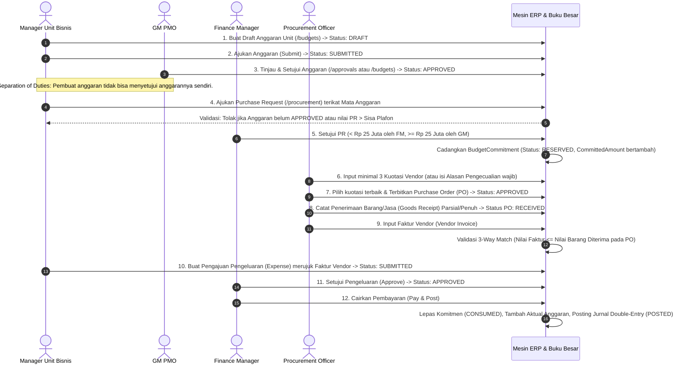
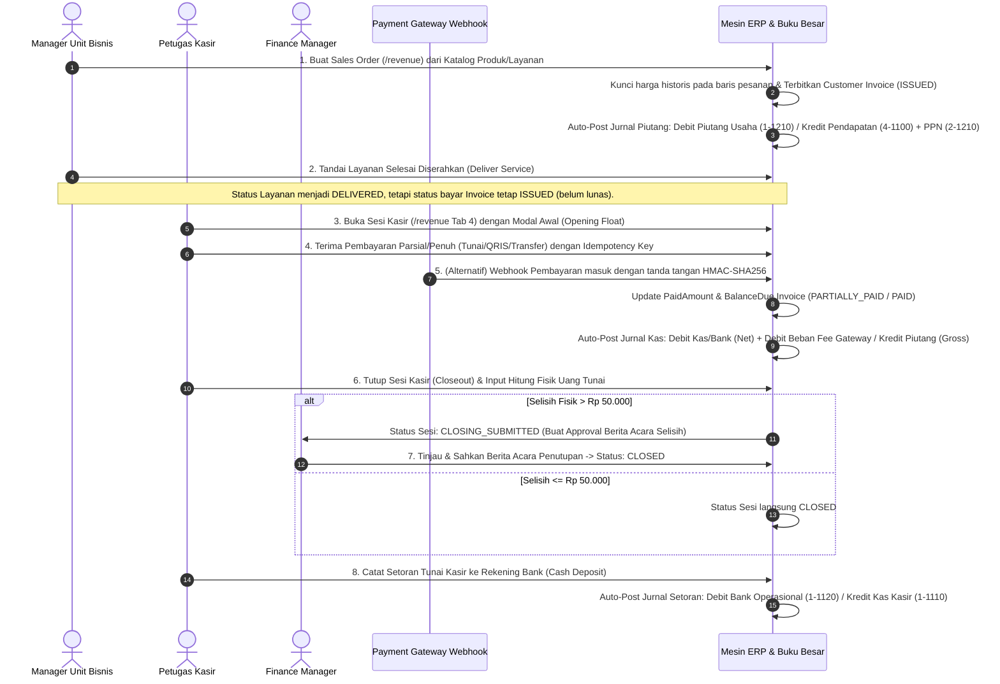
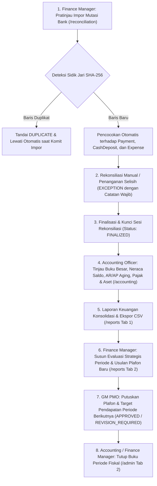

# Skema Database (dbdiagram.io) & User Journey ERP Keuangan PMO UTama

Dokumen ini menggabungkan:
1. **Skema Database dalam format DBML** yang siap langsung disalin (*copy-paste*) ke **[dbdiagram.io](https://dbdiagram.io/d)** untuk visualisasi Entity Relationship Diagram (ERD).
2. **Peta User Journey End-to-End** lintas 9 peran pengguna dan 3 siklus operasional utama.

---

## Bagian 1: Skema Database untuk `dbdiagram.io` (DBML)

Salin seluruh isi blok kode `dbml` di bawah ini dan tempelkan ke halaman editor **[https://dbdiagram.io/d](https://dbdiagram.io/d)**:

```dbml
Project pmo_utama_erp {
  database_type: 'PostgreSQL'
  Note: 'Skema Database ERP Keuangan & Operasional PMO UTama (35 Entitas)'
}

// ============================================================================
// 1. ORGANISASI, MASTER DATA, RBAC & KONTROL SISTEM
// ============================================================================

Table BusinessUnit {
  id varchar [pk]
  code varchar [unique, not null]
  name varchar [not null]
  type varchar [not null, default: 'OPERATIONAL']
  managerName varchar [not null]
  isActive boolean [not null, default: true]
  isDemoData boolean [not null, default: true]
  createdAt timestamp [not null, default: `now()`]
  updatedAt timestamp [not null]
}

Table CostCenter {
  id varchar [pk]
  code varchar [unique, not null]
  name varchar [not null]
  businessUnitId varchar [not null, ref: > BusinessUnit.id]
  isActive boolean [not null, default: true]
  createdAt timestamp [not null, default: `now()`]
}

Table FundSource {
  id varchar [pk]
  code varchar [unique, not null]
  name varchar [not null]
  type varchar [not null, default: 'INTERNAL_ALLOCATION']
  description text
  isActive boolean [not null, default: true]
  createdAt timestamp [not null, default: `now()`]
}

Table FiscalPeriod {
  id varchar [pk]
  code varchar [unique, not null]
  name varchar [not null]
  startDate timestamp [not null]
  endDate timestamp [not null]
  status varchar [not null, default: 'OPEN']
  isClosed boolean [not null, default: false]
  closedAt timestamp
  closedById varchar
  reopenReason text
  createdAt timestamp [not null, default: `now()`]
}

Table Role {
  id varchar [pk]
  code varchar [unique, not null]
  name varchar [not null]
  description text [not null]
  permissions text[] [not null]
  approvalLimit decimal(18,2) [not null, default: 0]
  createdAt timestamp [not null, default: `now()`]
}

Table User {
  id varchar [pk]
  email varchar [unique, not null]
  fullName varchar [not null]
  passwordHash varchar [not null]
  roleCode varchar [not null, ref: > Role.code]
  businessUnitId varchar [ref: > BusinessUnit.id]
  isActive boolean [not null, default: true]
  isDemoData boolean [not null, default: true]
  createdAt timestamp [not null, default: `now()`]
  updatedAt timestamp [not null]
}

Table ApprovalPolicy {
  id varchar [pk]
  module varchar [not null]
  name varchar [not null]
  minAmount decimal(18,2) [not null]
  maxAmount decimal(18,2)
  requiredRoleCode varchar [not null]
  minQuotations int [not null, default: 3]
  requireSeparationOfDuties boolean [not null, default: true]
  isActive boolean [not null, default: true]
  createdAt timestamp [not null, default: `now()`]
}

Table ApprovalRequest {
  id varchar [pk]
  requestNumber varchar [unique, not null]
  module varchar [not null]
  entityId varchar [not null]
  entityCode varchar [not null]
  title varchar [not null]
  businessUnitId varchar
  amount decimal(18,2) [not null]
  status varchar [not null, default: 'PENDING']
  requestedById varchar [not null]
  requestedByName varchar [not null]
  requiredRoleCode varchar [not null]
  decidedById varchar
  decidedByName varchar
  decidedAt timestamp
  decisionNote text
  exceptionReason text
  createdAt timestamp [not null, default: `now()`]

  indexes {
    (status, requiredRoleCode)
    (module, entityId)
  }
}

Table AuditLog {
  id varchar [pk]
  actorId varchar
  actorName varchar [not null]
  actorRole varchar [not null]
  action varchar [not null]
  module varchar [not null]
  entityType varchar [not null]
  entityId varchar [not null]
  entityCode varchar
  summary text [not null]
  beforeData jsonb
  afterData jsonb
  ipAddress varchar
  requestId varchar
  createdAt timestamp [not null, default: `now()`]

  indexes {
    (module, createdAt)
    (entityType, entityId)
  }
}

Table Notification {
  id varchar [pk]
  userId varchar
  roleCode varchar
  title varchar [not null]
  message text [not null]
  category varchar [not null]
  severity varchar [not null, default: 'INFO']
  targetUrl varchar [not null]
  entityType varchar [not null]
  entityId varchar [not null]
  isRead boolean [not null, default: false]
  createdAt timestamp [not null, default: `now()`]

  indexes {
    (roleCode, isRead)
  }
}

Table FileAttachment {
  id varchar [pk]
  displayName varchar [not null]
  storageKey varchar [unique, not null]
  mimeType varchar [not null]
  sizeBytes int [not null]
  module varchar [not null]
  entityId varchar [not null]
  documentType varchar [not null]
  verificationStatus varchar [not null, default: 'VERIFIED']
  uploadedById varchar [not null]
  uploadedByName varchar [not null]
  createdAt timestamp [not null, default: `now()`]

  indexes {
    (module, entityId)
  }
}

Table SystemSetting {
  id varchar [pk]
  key varchar [unique, not null]
  value text [not null]
  category varchar [not null]
  description text [not null]
  updatedById varchar
  updatedAt timestamp [not null]
}

// ============================================================================
// 2. PERENCANAAN MODAL & ANGGARAN (BUDGETING & COMMITMENTS)
// ============================================================================

Table Budget {
  id varchar [pk]
  docNumber varchar [unique, not null]
  title varchar [not null]
  businessUnitId varchar [not null, ref: > BusinessUnit.id]
  fiscalPeriodId varchar [not null, ref: > FiscalPeriod.id]
  fundSourceId varchar [not null, ref: > FundSource.id]
  version int [not null, default: 1]
  status varchar [not null, default: 'DRAFT']
  totalAllocated decimal(18,2) [not null, default: 0]
  totalCommitted decimal(18,2) [not null, default: 0]
  totalActual decimal(18,2) [not null, default: 0]
  revenueTarget decimal(18,2) [not null, default: 0]
  notes text
  rejectionReason text
  createdById varchar [not null]
  createdByName varchar [not null]
  submittedAt timestamp
  approvedById varchar
  approvedByName varchar
  approvedAt timestamp
  isDemoData boolean [not null, default: true]
  createdAt timestamp [not null, default: `now()`]
  updatedAt timestamp [not null]

  indexes {
    (businessUnitId, fiscalPeriodId, status)
  }
}

Table BudgetLine {
  id varchar [pk]
  budgetId varchar [not null, ref: > Budget.id]
  costCenterId varchar [not null, ref: > CostCenter.id]
  accountCode varchar [not null]
  category varchar [not null]
  description text [not null]
  allocatedAmount decimal(18,2) [not null]
  committedAmount decimal(18,2) [not null, default: 0]
  actualAmount decimal(18,2) [not null, default: 0]
}

Table BudgetRevision {
  id varchar [pk]
  budgetId varchar [not null, ref: > Budget.id]
  version int [not null]
  reason text [not null]
  previousAllocated decimal(18,2) [not null]
  newAllocated decimal(18,2) [not null]
  snapshotData jsonb [not null]
  revisedById varchar [not null]
  revisedByName varchar [not null]
  approvedById varchar
  status varchar [not null, default: 'APPROVED']
  createdAt timestamp [not null, default: `now()`]
}

Table BudgetCommitment {
  id varchar [pk]
  budgetLineId varchar [not null, ref: > BudgetLine.id]
  sourceType varchar [not null]
  sourceId varchar [not null]
  sourceDocNumber varchar [not null]
  amount decimal(18,2) [not null]
  status varchar [not null, default: 'RESERVED']
  createdAt timestamp [not null, default: `now()`]

  indexes {
    (sourceType, sourceId)
  }
}

// ============================================================================
// 3. PENGADAAN, VENDOR, PO, PENERIMAAN BARANG & PENGELUARAN BIAYA
// ============================================================================

Table Vendor {
  id varchar [pk]
  code varchar [unique, not null]
  name varchar [not null]
  legalName varchar [not null]
  taxIdNpwp varchar [unique, not null]
  category varchar [not null]
  contactName varchar [not null]
  email varchar [not null]
  phone varchar [not null]
  address text [not null]
  bankName varchar [not null]
  bankAccountNo varchar [not null]
  bankAccountHolder varchar [not null]
  completenessScore int [not null, default: 100]
  hasConflictOfInterest boolean [not null, default: false]
  conflictNote text
  evaluationRating decimal(3,2) [not null, default: 4.50]
  evaluationNote text
  status varchar [not null, default: 'ACTIVE']
  isDemoData boolean [not null, default: true]
  createdAt timestamp [not null, default: `now()`]
  updatedAt timestamp [not null]
}

Table PurchaseRequest {
  id varchar [pk]
  docNumber varchar [unique, not null]
  title varchar [not null]
  businessUnitId varchar [not null, ref: > BusinessUnit.id]
  costCenterId varchar [not null, ref: > CostCenter.id]
  budgetLineId varchar [not null, ref: > BudgetLine.id]
  purpose text [not null]
  estimatedTotal decimal(18,2) [not null]
  status varchar [not null, default: 'DRAFT']
  minQuotationsRequired int [not null, default: 3]
  quotationExceptionReason text
  rejectionReason text
  requestedById varchar [not null]
  requestedByName varchar [not null]
  approvedById varchar
  approvedByName varchar
  approvedAt timestamp
  isDemoData boolean [not null, default: true]
  createdAt timestamp [not null, default: `now()`]
  updatedAt timestamp [not null]
}

Table PurchaseRequestLine {
  id varchar [pk]
  purchaseRequestId varchar [not null, ref: > PurchaseRequest.id]
  itemName varchar [not null]
  specification text
  quantity decimal(12,2) [not null]
  unit varchar [not null]
  estimatedUnitPrice decimal(18,2) [not null]
  lineTotal decimal(18,2) [not null]
}

Table VendorQuotation {
  id varchar [pk]
  purchaseRequestId varchar [not null, ref: > PurchaseRequest.id]
  vendorId varchar [not null, ref: > Vendor.id]
  quotationNumber varchar [not null]
  quotedSubtotal decimal(18,2) [not null]
  taxAmount decimal(18,2) [not null]
  totalAmount decimal(18,2) [not null]
  deliveryDays int [not null]
  warrantyInfo text
  documentComplete boolean [not null, default: true]
  isSelected boolean [not null, default: false]
  selectionReason text
  notes text
  createdAt timestamp [not null, default: `now()`]
}

Table PurchaseOrder {
  id varchar [pk]
  docNumber varchar [unique, not null]
  purchaseRequestId varchar [not null, ref: > PurchaseRequest.id]
  vendorId varchar [not null, ref: > Vendor.id]
  businessUnitId varchar [not null, ref: > BusinessUnit.id]
  selectedQuotationId varchar
  orderDate timestamp [not null, default: `now()`]
  expectedDeliveryDate timestamp [not null]
  paymentTerms varchar [not null, default: 'NET 30']
  subtotal decimal(18,2) [not null]
  discountAmount decimal(18,2) [not null, default: 0]
  taxAmount decimal(18,2) [not null]
  totalAmount decimal(18,2) [not null]
  status varchar [not null, default: 'APPROVED']
  selectionJustification text [not null]
  cancellationReason text
  createdById varchar [not null]
  createdByName varchar [not null]
  approvedById varchar
  approvedAt timestamp
  isDemoData boolean [not null, default: true]
  createdAt timestamp [not null, default: `now()`]
  updatedAt timestamp [not null]
}

Table PurchaseOrderLine {
  id varchar [pk]
  purchaseOrderId varchar [not null, ref: > PurchaseOrder.id]
  itemName varchar [not null]
  quantity decimal(12,2) [not null]
  receivedQuantity decimal(12,2) [not null, default: 0]
  invoicedQuantity decimal(12,2) [not null, default: 0]
  unit varchar [not null]
  unitPrice decimal(18,2) [not null]
  lineTotal decimal(18,2) [not null]
}

Table GoodsReceipt {
  id varchar [pk]
  docNumber varchar [unique, not null]
  purchaseOrderId varchar [not null, ref: > PurchaseOrder.id]
  receivedDate timestamp [not null, default: `now()`]
  receivedById varchar [not null]
  receivedByName varchar [not null]
  conditionNote text
  deliveryNoteRef varchar [not null]
  status varchar [not null, default: 'COMPLETE']
  createdAt timestamp [not null, default: `now()`]
}

Table GoodsReceiptLine {
  id varchar [pk]
  goodsReceiptId varchar [not null, ref: > GoodsReceipt.id]
  purchaseOrderLineId varchar [not null]
  itemName varchar [not null]
  quantityReceived decimal(12,2) [not null]
  condition varchar [not null, default: 'GOOD']
}

Table VendorInvoice {
  id varchar [pk]
  internalNumber varchar [unique, not null]
  vendorInvoiceNumber varchar [not null]
  vendorId varchar [not null, ref: > Vendor.id]
  purchaseOrderId varchar [ref: > PurchaseOrder.id]
  businessUnitId varchar [not null, ref: > BusinessUnit.id]
  invoiceDate timestamp [not null]
  dueDate timestamp [not null]
  subtotal decimal(18,2) [not null]
  taxAmount decimal(18,2) [not null]
  totalAmount decimal(18,2) [not null]
  paidAmount decimal(18,2) [not null, default: 0]
  matchingStatus varchar [not null, default: 'MATCHED_3WAY']
  matchingNote text
  status varchar [not null, default: 'VERIFIED']
  createdById varchar [not null]
  verifiedById varchar
  createdAt timestamp [not null, default: `now()`]
  updatedAt timestamp [not null]

  indexes {
    (vendorId, vendorInvoiceNumber) [unique]
  }
}

Table Expense {
  id varchar [pk]
  docNumber varchar [unique, not null]
  title varchar [not null]
  businessUnitId varchar [not null, ref: > BusinessUnit.id]
  costCenterId varchar [not null, ref: > CostCenter.id]
  budgetLineId varchar [not null, ref: > BudgetLine.id]
  fundSourceId varchar [not null, ref: > FundSource.id]
  vendorId varchar [ref: > Vendor.id]
  vendorInvoiceId varchar [ref: > VendorInvoice.id]
  category varchar [not null]
  paymentMethod varchar [not null, default: 'BANK_TRANSFER']
  recipientName varchar [not null]
  transactionDate timestamp [not null]
  subtotal decimal(18,2) [not null]
  taxAmount decimal(18,2) [not null, default: 0]
  totalAmount decimal(18,2) [not null]
  description text [not null]
  receiptRef varchar
  status varchar [not null, default: 'DRAFT']
  rejectionReason text
  voidReason text
  journalEntryId varchar
  createdById varchar [not null]
  createdByName varchar [not null]
  approvedById varchar
  approvedByName varchar
  approvedAt timestamp
  paidAt timestamp
  isDemoData boolean [not null, default: true]
  createdAt timestamp [not null, default: `now()`]
  updatedAt timestamp [not null]
}

// ============================================================================
// 4. PENDAPATAN, PESANAN PELANGGAN, FAKTUR, PEMBAYARAN & KASIR
// ============================================================================

Table Customer {
  id varchar [pk]
  code varchar [unique, not null]
  name varchar [not null]
  organizationType varchar [not null, default: 'CORPORATE']
  taxIdNpwp varchar
  contactPerson varchar [not null]
  email varchar [not null]
  phone varchar [not null]
  address text [not null]
  creditLimit decimal(18,2) [not null, default: 100000000]
  status varchar [not null, default: 'ACTIVE']
  isDemoData boolean [not null, default: true]
  createdAt timestamp [not null, default: `now()`]
}

Table ProductService {
  id varchar [pk]
  sku varchar [unique, not null]
  name varchar [not null]
  category varchar [not null]
  businessUnitId varchar [not null, ref: > BusinessUnit.id]
  unitPrice decimal(18,2) [not null]
  unit varchar [not null, default: 'Paket']
  taxCode varchar [not null, default: 'PPN-11']
  revenueAccountCode varchar [not null, default: '4-1100']
  isActive boolean [not null, default: true]
  createdAt timestamp [not null, default: `now()`]
  updatedAt timestamp [not null]
}

Table ProductPriceHistory {
  id varchar [pk]
  productServiceId varchar [not null, ref: > ProductService.id]
  oldPrice decimal(18,2) [not null]
  newPrice decimal(18,2) [not null]
  changedById varchar [not null]
  changedByName varchar [not null]
  reason text [not null]
  changedAt timestamp [not null, default: `now()`]
}

Table SalesOrder {
  id varchar [pk]
  docNumber varchar [unique, not null]
  customerId varchar [not null, ref: > Customer.id]
  businessUnitId varchar [not null, ref: > BusinessUnit.id]
  orderDate timestamp [not null, default: `now()`]
  dueDate timestamp [not null]
  terms varchar [not null, default: 'NET 14']
  subtotal decimal(18,2) [not null]
  discountAmount decimal(18,2) [not null, default: 0]
  taxAmount decimal(18,2) [not null]
  totalAmount decimal(18,2) [not null]
  status varchar [not null, default: 'CONFIRMED']
  deliveryStatus varchar [not null, default: 'PENDING']
  deliveredAt timestamp
  deliveredBy varchar
  deliveryNotes text
  notes text
  createdById varchar [not null]
  createdByName varchar [not null]
  isDemoData boolean [not null, default: true]
  createdAt timestamp [not null, default: `now()`]
  updatedAt timestamp [not null]
}

Table SalesOrderLine {
  id varchar [pk]
  salesOrderId varchar [not null, ref: > SalesOrder.id]
  productServiceId varchar [not null, ref: > ProductService.id]
  description text [not null]
  quantity decimal(12,2) [not null]
  unitPrice decimal(18,2) [not null]
  discountAmount decimal(18,2) [not null, default: 0]
  taxAmount decimal(18,2) [not null]
  lineTotal decimal(18,2) [not null]
}

Table CustomerInvoice {
  id varchar [pk]
  docNumber varchar [unique, not null]
  salesOrderId varchar [ref: > SalesOrder.id]
  customerId varchar [not null, ref: > Customer.id]
  businessUnitId varchar [not null, ref: > BusinessUnit.id]
  issueDate timestamp [not null, default: `now()`]
  dueDate timestamp [not null]
  subtotal decimal(18,2) [not null]
  discountAmount decimal(18,2) [not null, default: 0]
  taxAmount decimal(18,2) [not null]
  totalAmount decimal(18,2) [not null]
  paidAmount decimal(18,2) [not null, default: 0]
  balanceDue decimal(18,2) [not null]
  status varchar [not null, default: 'ISSUED']
  serviceDelivered boolean [not null, default: false]
  notes text
  createdById varchar [not null]
  createdByName varchar [not null]
  isDemoData boolean [not null, default: true]
  createdAt timestamp [not null, default: `now()`]
  updatedAt timestamp [not null]
}

Table CustomerInvoiceLine {
  id varchar [pk]
  customerInvoiceId varchar [not null, ref: > CustomerInvoice.id]
  description text [not null]
  quantity decimal(12,2) [not null]
  unitPrice decimal(18,2) [not null]
  discountAmount decimal(18,2) [not null, default: 0]
  taxAmount decimal(18,2) [not null]
  lineTotal decimal(18,2) [not null]
}

Table CashRegister {
  id varchar [pk]
  code varchar [unique, not null]
  name varchar [not null]
  businessUnitId varchar [not null, ref: > BusinessUnit.id]
  isActive boolean [not null, default: true]
}

Table CashierSession {
  id varchar [pk]
  sessionNumber varchar [unique, not null]
  cashRegisterId varchar [not null, ref: > CashRegister.id]
  businessUnitId varchar [not null, ref: > BusinessUnit.id]
  cashierId varchar [not null]
  cashierName varchar [not null]
  openedAt timestamp [not null, default: `now()`]
  openingFloat decimal(18,2) [not null]
  totalCashIn decimal(18,2) [not null, default: 0]
  totalCashOut decimal(18,2) [not null, default: 0]
  theoreticalBalance decimal(18,2) [not null]
  actualCountedCash decimal(18,2)
  discrepancyAmount decimal(18,2)
  discrepancyReason text
  status varchar [not null, default: 'OPEN']
  closedAt timestamp
  reviewedById varchar
  reviewedByName varchar
  reviewedAt timestamp
  reviewNote text
  isDemoData boolean [not null, default: true]
}

Table Payment {
  id varchar [pk]
  receiptNumber varchar [unique, not null]
  customerInvoiceId varchar [not null, ref: > CustomerInvoice.id]
  cashierSessionId varchar [ref: > CashierSession.id]
  bankAccountId varchar [ref: > BankAccount.id]
  paymentDate timestamp [not null, default: `now()`]
  method varchar [not null]
  grossAmount decimal(18,2) [not null]
  feeAmount decimal(18,2) [not null, default: 0]
  netAmount decimal(18,2) [not null]
  referenceNo varchar [not null]
  idempotencyKey varchar [unique, not null]
  status varchar [not null, default: 'CONFIRMED']
  journalEntryId varchar
  receivedById varchar [not null]
  receivedByName varchar [not null]
  notes text
  isDemoData boolean [not null, default: true]
  createdAt timestamp [not null, default: `now()`]
}

Table Refund {
  id varchar [pk]
  refundNumber varchar [unique, not null]
  paymentId varchar [not null, ref: > Payment.id]
  customerInvoiceId varchar [not null, ref: > CustomerInvoice.id]
  amount decimal(18,2) [not null]
  reason text [not null]
  status varchar [not null, default: 'PROCESSED']
  requestedById varchar [not null]
  requestedByName varchar [not null]
  approvedById varchar
  processedAt timestamp [not null, default: `now()`]
  createdAt timestamp [not null, default: `now()`]
}

Table CashDeposit {
  id varchar [pk]
  depositNumber varchar [unique, not null]
  cashierSessionId varchar [not null, ref: > CashierSession.id]
  bankAccountId varchar [not null, ref: > BankAccount.id]
  depositDate timestamp [not null, default: `now()`]
  amount decimal(18,2) [not null]
  referenceNo varchar [not null]
  depositedById varchar [not null]
  depositedByName varchar [not null]
  status varchar [not null, default: 'VERIFIED']
  notes text
  createdAt timestamp [not null, default: `now()`]
}

// ============================================================================
// 5. REKENING BANK & REKONSILIASI MUTASI BANK
// ============================================================================

Table BankAccount {
  id varchar [pk]
  code varchar [unique, not null]
  bankName varchar [not null]
  accountNumberMasked varchar [not null]
  accountHolder varchar [not null]
  businessUnitId varchar [not null, ref: > BusinessUnit.id]
  glAccountCode varchar [not null, default: '1-1120']
  currentBalance decimal(18,2) [not null, default: 0]
  currency varchar [not null, default: 'IDR']
  isActive boolean [not null, default: true]
  createdAt timestamp [not null, default: `now()`]
}

Table BankStatementImport {
  id varchar [pk]
  importNumber varchar [unique, not null]
  bankAccountId varchar [not null, ref: > BankAccount.id]
  periodLabel varchar [not null]
  fileName varchar [not null]
  totalLines int [not null]
  matchedCount int [not null, default: 0]
  unmatchedCount int [not null, default: 0]
  duplicateCount int [not null, default: 0]
  status varchar [not null, default: 'RECONCILING']
  importedById varchar [not null]
  importedByName varchar [not null]
  finalizedById varchar
  finalizedAt timestamp
  createdAt timestamp [not null, default: `now()`]
}

Table BankStatementLine {
  id varchar [pk]
  importId varchar [not null, ref: > BankStatementImport.id]
  bankAccountId varchar [not null, ref: > BankAccount.id]
  transactionDate timestamp [not null]
  description text [not null]
  referenceNo varchar [not null]
  direction varchar [not null]
  amount decimal(18,2) [not null]
  runningBalance decimal(18,2)
  fingerprint varchar [unique, not null]
  matchStatus varchar [not null, default: 'UNMATCHED']
  matchedEntityType varchar
  matchedEntityId varchar
  matchedDocNumber varchar
  exceptionNote text
  reconciledById varchar
  reconciledByName varchar
  reconciledAt timestamp
}

// ============================================================================
// 6. AKUNTANSI, BUKU BESAR, PAJAK, ASET TETAP & EVALUASI STRATEGIS
// ============================================================================

Table ChartOfAccount {
  id varchar [pk]
  code varchar [unique, not null]
  name varchar [not null]
  type varchar [not null]
  normalBalance varchar [not null]
  parentCode varchar
  isControlAccount boolean [not null, default: false]
  isActive boolean [not null, default: true]
  createdAt timestamp [not null, default: `now()`]
}

Table AccountMapping {
  id varchar [pk]
  transactionType varchar [unique, not null]
  description text [not null]
  debitAccountCode varchar [not null]
  creditAccountCode varchar [not null]
  updatedAt timestamp [not null]
}

Table JournalEntry {
  id varchar [pk]
  journalNumber varchar [unique, not null]
  entryDate timestamp [not null]
  fiscalPeriodId varchar [not null, ref: > FiscalPeriod.id]
  businessUnitId varchar [not null, ref: > BusinessUnit.id]
  sourceType varchar [not null]
  sourceId varchar
  sourceDocNumber varchar
  idempotencyKey varchar [unique, not null]
  description text [not null]
  totalDebit decimal(18,2) [not null]
  totalCredit decimal(18,2) [not null]
  status varchar [not null, default: 'POSTED']
  reversedFromId varchar
  reversalReason text
  createdById varchar [not null]
  createdByName varchar [not null]
  postedById varchar
  postedAt timestamp
  isDemoData boolean [not null, default: true]
  createdAt timestamp [not null, default: `now()`]

  indexes {
    (fiscalPeriodId, status)
    (sourceType, sourceId)
  }
}

Table JournalLine {
  id varchar [pk]
  journalEntryId varchar [not null, ref: > JournalEntry.id]
  accountCode varchar [not null, ref: > ChartOfAccount.code]
  costCenterId varchar [ref: > CostCenter.id]
  description text [not null]
  debit decimal(18,2) [not null, default: 0]
  credit decimal(18,2) [not null, default: 0]

  indexes {
    (accountCode)
  }
}

Table TaxConfiguration {
  id varchar [pk]
  taxCode varchar [unique, not null]
  name varchar [not null]
  taxType varchar [not null]
  ratePercent decimal(5,2) [not null]
  effectiveFrom timestamp [not null]
  effectiveTo timestamp
  version int [not null, default: 1]
  isInclusive boolean [not null, default: false]
  isActive boolean [not null, default: true]
  notes text
}

Table FixedAsset {
  id varchar [pk]
  assetCode varchar [unique, not null]
  name varchar [not null]
  category varchar [not null]
  businessUnitId varchar [not null, ref: > BusinessUnit.id]
  acquisitionDate timestamp [not null]
  acquisitionCost decimal(18,2) [not null]
  salvageValue decimal(18,2) [not null, default: 0]
  usefulLifeMonths int [not null]
  depreciationMethod varchar [not null, default: 'STRAIGHT_LINE']
  accumulatedDepreciation decimal(18,2) [not null, default: 0]
  bookValue decimal(18,2) [not null]
  location varchar [not null]
  status varchar [not null, default: 'ACTIVE']
  policyApproved boolean [not null, default: true]
  createdAt timestamp [not null, default: `now()`]
}

Table StrategicEvaluation {
  id varchar [pk]
  evalNumber varchar [unique, not null]
  fiscalPeriodId varchar [not null, ref: > FiscalPeriod.id]
  businessUnitId varchar [not null, ref: > BusinessUnit.id]
  targetRevenue decimal(18,2) [not null]
  actualRevenue decimal(18,2) [not null]
  budgetCeiling decimal(18,2) [not null]
  actualExpense decimal(18,2) [not null]
  netCashflow decimal(18,2) [not null]
  varianceAnalysis text [not null]
  riskSummary text [not null]
  recommendedNextCeiling decimal(18,2) [not null]
  recommendedRevenueTarget decimal(18,2) [not null]
  gmDecision varchar [not null, default: 'PENDING']
  gmDecisionNote text
  decidedById varchar
  decidedByName varchar
  decidedAt timestamp
  createdAt timestamp [not null, default: `now()`]
  updatedAt timestamp [not null]
}

// ============================================================================
// PENGELOMPOKAN VISUAL UNTUK DBDIAGRAM.IO
// ============================================================================

TableGroup MasterAndGovernance {
  BusinessUnit
  CostCenter
  FundSource
  FiscalPeriod
  Role
  User
  ApprovalPolicy
  ApprovalRequest
  AuditLog
  Notification
  FileAttachment
  SystemSetting
}

TableGroup Budgeting {
  Budget
  BudgetLine
  BudgetRevision
  BudgetCommitment
}

TableGroup ProcurementAndExpense {
  Vendor
  PurchaseRequest
  PurchaseRequestLine
  VendorQuotation
  PurchaseOrder
  PurchaseOrderLine
  GoodsReceipt
  GoodsReceiptLine
  VendorInvoice
  Expense
}

TableGroup RevenueAndCashier {
  Customer
  ProductService
  ProductPriceHistory
  SalesOrder
  SalesOrderLine
  CustomerInvoice
  CustomerInvoiceLine
  CashRegister
  CashierSession
  Payment
  Refund
  CashDeposit
}

TableGroup BankReconciliation {
  BankAccount
  BankStatementImport
  BankStatementLine
}

TableGroup AccountingAndStrategy {
  ChartOfAccount
  AccountMapping
  JournalEntry
  JournalLine
  TaxConfiguration
  FixedAsset
  StrategicEvaluation
}
```

---

## Bagian 2: Peta User Journey End-to-End

### 1. Daftar Peran Pengguna (9 Actor Personas)

| Peran (`Role.code`) | Akun Demo (`DemoErp!2026`) | Fokus Ruang Kerja di Aplikasi |
| :--- | :--- | :--- |
| **Manager Unit Bisnis** (`UNIT_MANAGER`) | `unit.diklat@pmoutama.demo.id` | Menyusun draft anggaran unit, mengajukan PR, mengajukan biaya operasional, membuat pesanan pelanggan (`SalesOrder`), dan mencatat penyerahan layanan. |
| **General Manager PMO** (`GM_PMO`) | `gm@pmoutama.demo.id` | Meninjau Dashboard Eksekutif, menyetujui plafon & revisi anggaran, menyetujui PR strategis (>= Rp 25 Juta), dan memutuskan plafon periode berikutnya. |
| **Procurement Officer** (`PROCUREMENT`) | `procurement@pmoutama.demo.id` | Mengelola vendor aktif, menginput minimal 3 kuotasi penawaran, menerbitkan Purchase Order (PO), mencatat penerimaan barang (`GoodsReceipt`), dan memverifikasi tagihan vendor (*3-Way Match*). |
| **Finance Manager** (`FINANCE_MANAGER`) | `finance@pmoutama.demo.id` | Menyetujui PR operasional (< Rp 25 Juta), menyetujui & mencairkan pengeluaran biaya (*Auto-Journal*), menyetujui refund & berita acara selisih kasir, serta memfinalisasi rekonsiliasi bank. |
| **Petugas Kasir** (`CASHIER`) | `kasir@pmoutama.demo.id` | Membuka sesi kasir dengan modal awal (*opening float*), menerima pembayaran pelanggan (Tunai/QRIS/Transfer/VA), menutup shift kasir dengan hitung fisik kas, dan mencatat setoran tunai ke bank. |
| **Accounting Officer** (`ACCOUNTING`) | `accounting@pmoutama.demo.id` | Mengelola Bagan Akun (COA), membuat jurnal penyesuaian berimbang, mengeksekusi jurnal pembalik (*Reversal*), memeriksa Buku Besar & Neraca Saldo, meregistrasi aset tetap, dan menutup periode fiskal. |
| **Tax Officer** (`TAX_OFFICER`) | `tax@pmoutama.demo.id` | Mengelola konfigurasi tarif PPN/PPh secara versi dan meninjau posisi PPN Keluaran vs PPN Masukan. |
| **Internal Auditor** (`AUDITOR`) | `auditor@pmoutama.demo.id` | Menginspeksi seluruh dokumen, laporan keuangan, dan *Server-Side Audit Trail* secara *Read-Only* tanpa wewenang mengubah data. |
| **System Administrator** (`SUPER_ADMIN`) | `admin@pmoutama.demo.id` | Mengelola pengguna, matriks role RBAC, unit bisnis, dan parameter sistem tanpa hak menyetujui transaksi keuangan. |

---

### 2. Journey A: Siklus Anggaran -> Pengadaan (PR/PO/GR) -> 3-Way Match -> Pencairan Biaya & Jurnal Otomatis



1. **Penyusunan & Persetujuan Anggaran (`/budgets`)**:
   - **Manager Unit** membuat draft anggaran per *Cost Center* (`CAPEX`, `OPEX`, `MODAL_KERJA`), lalu menekan **Ajukan Persetujuan** (`SUBMITTED`).
   - **GM PMO** meninjau dan menyetujui anggaran (`APPROVED`). Sistem mencegah pembuat anggaran menyetujui pengajuannya sendiri (*Separation of Duties*).
   - Jika terjadi perubahan pagu di tengah periode, fitur **Revisi Plafon** menyimpan snapshot versi sebelumnya ke tabel `BudgetRevision`.
2. **Purchase Request & Pencadangan Komitmen (`/procurement` Tab 1)**:
   - **Manager Unit** membuat PR dengan memilih baris mata anggaran yang sudah `APPROVED`.
   - Saat **Finance Manager** (atau **GM PMO** untuk PR >= Rp 25 Juta) menyetujui PR, sistem membuat `BudgetCommitment` berstatus `RESERVED` sehingga sisa plafon langsung dikurangi sebesar estimasi PR.
3. **Kuotasi Vendor, PO, Penerimaan Barang & 3-Way Match (`/procurement` Tab 1 s/d Tab 3)**:
   - **Procurement Officer** menginput penawaran vendor. Sistem mewajibkan minimal **3 penawaran vendor** sebelum PO dapat diterbitkan, kecuali diisi alasan pengecualian (`quotationExceptionReason`) yang tercatat pada Audit Trail.
   - Setelah PO terbit dan barang/jasa diterima melalui **Goods Receipt (GR)**, **Procurement Officer** mencatat **Vendor Invoice**. Sistem menjalankan **3-Way Match** (membandingkan nilai PO, kuantitas yang telah diterima di GR, dan nilai tagihan vendor) serta menolak nomor faktur ganda dari vendor yang sama.
4. **Pencairan Biaya & Auto-Posting Jurnal (`/procurement` Tab 4)**:
   - **Finance Manager** menyetujui dokumen `Expense` lalu menekan **Cairkan & Posting Jurnal**.
   - Sistem secara atomik mengubah komitmen anggaran menjadi aktual (`actualAmount`), menandai faktur vendor `PAID`, dan menerbitkan `JournalEntry` berimbang di Buku Besar. Jika diperlukan pembatalan setelah posting, tersedia fitur **Void / Reversal** dengan alasan wajib.

---

### 3. Journey B: Siklus Pesanan Pelanggan -> Penyerahan Layanan -> Invoice -> Pembayaran Idempoten -> Sesi Kasir & Setoran Bank



1. **Master Produk & Harga Historis (`/revenue` Tab 5)**:
   - Setiap perubahan harga katalog produk/layanan disimpan ke `ProductPriceHistory`, sedangkan pesanan dan faktur lama tetap menggunakan harga snapshot saat transaksi dibuat.
2. **Pesanan Pelanggan & Penyerahan Layanan (`/revenue` Tab 1 & Tab 2)**:
   - **Manager Unit** membuat **Sales Order** dan menerbitkan **Customer Invoice** (`ISSUED`). Sistem memposting jurnal piutang usaha (`1-1210`) terhadap pendapatan (`4-1100`).
   - Saat layanan selesai diberikan, klik **Selesaikan Layanan** (`DELIVERED`). Status penyelesaian layanan terpisah dari status pelunasan tagihan.
3. **Pembayaran Parsial/Penuh, Potongan Fee & Webhook (`/revenue` Tab 2 & Tab 3)**:
   - **Petugas Kasir** mencatat pembayaran pelanggan (parsial atau penuh) yang dilindungi `idempotencyKey`.
   - Jika metode pembayaran mengenakan biaya *payment gateway* (`feeAmount`), sistem menjurnal penerimaan bersih ke Kas/Bank, biaya potongan ke Beban Administrasi Bank (`5-1500`), dan pelunasan bruto ke Piutang Usaha (`1-1210`).
   - Endpoint webhook `/api/v1/revenue/payments/webhook` memverifikasi tanda tangan `HMAC-SHA256` sebelum mengonfirmasi pembayaran.
4. **Sesi Kasir, Hitung Fisik & Setoran Bank (`/revenue` Tab 4)**:
   - **Petugas Kasir** membuka shift (`OPEN`) dan pada akhir shift memasukkan hasil hitung fisik uang tunai (`actualCountedCash`).
   - Jika selisih fisik terhadap saldo teoritis melebihi Rp 50.000, status sesi menjadi `CLOSING_SUBMITTED` untuk ditinjau dan disahkan oleh **Finance Manager**.
   - Kasir kemudian mencatat **Setoran Kas ke Bank (`CashDeposit`)** yang otomatis memindahkan saldo dari Kas Kasir (`1-1110`) ke Bank Operasional (`1-1120`).

---

### 4. Journey C: Rekonsiliasi Bank -> Buku Besar & Tutup Periode -> Laporan & Evaluasi Strategis GM PMO



1. **Pratinjau & Rekonsiliasi Mutasi Bank (`/reconciliation`)**:
   - **Finance Manager** menjalankan tahap **Pratinjau (Preview)** saat mengimpor mutasi rekening koran. Sistem menghitung sidik jari `SHA-256` per baris untuk mencegah duplikasi impor dan menyarankan pencocokan otomatis terhadap pembayaran, setoran kasir, atau pengeluaran biaya.
   - Setelah seluruh baris berstatus `MATCHED` atau diberi catatan selisih (`EXCEPTION`), sesi dikunci melalui tombol **Finalisasi Rekonsiliasi** (`FINALIZED`).
2. **Buku Besar, Jurnal Pembalik, Pajak & Aset Tetap (`/accounting`)**:
   - **Accounting Officer** memeriksa **Buku Besar & Neraca Saldo**, **Umur Piutang (AR) & Utang (AP)**, rekapitulasi **PPN Keluaran vs PPN Masukan**, serta **Daftar Aset Tetap**.
   - Jurnal terposting bersifat *immutable* (tidak dapat dihapus); koreksi dilakukan melalui fitur **Jurnal Pembalik (Reversal)**.
3. **Laporan Keuangan, Ekspor CSV & Evaluasi Strategis (`/reports` & `/admin`)**:
   - **Finance Manager** meninjau Laporan Laba Rugi, Neraca, Arus Kas, dan Realisasi Anggaran vs Aktual, mengunduh laporan dalam format **CSV**, serta menyusun dokumen **Evaluasi Strategis Periode**.
   - **GM PMO** meninjau analisis selisih serta risiko pada dokumen evaluasi tersebut dan menetapkan keputusan plafon anggaran periode berikutnya (`APPROVED` / `REVISION_REQUIRED` / `REJECTED`).
   - Pada akhir periode, **Accounting Officer** atau **Finance Manager** mengunci periode fiskal (`CLOSED`) pada halaman `/admin`.
