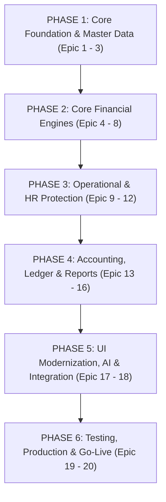

# 📋 JIRA MASTER PRODUCT BACKLOG & WORK BREAKDOWN STRUCTURE (WBS): DARI NOL (0) SAMPAI PRODUCTION

> **Sistem:** ERP Keuangan & Operasional PMO UTama Universitas Terbuka  
> **Status Sinkronisasi Kode Eksisting:** 100% Selaras dengan 14 Modul Web (`apps/web/src/modules/`) & 11 API Router (`apps/api/src/modules/`)  
> **Status Kepatuhan Regulasi:** Peraturan Rektor UT No. 310 Tahun 2025, ISAK 335, DIPA Pusat, & Format Anggaran Semula-Menjadi  
> **Tujuan Dokumen:** Master Breakdown Tiket Jira terlengkap dari inisiasi sistem (0%) hingga siap go-live di server produksi (100%). Dilengkapi penanda status apa yang **sudah didevelop di web saat ini `[x]`** dan apa yang **sedang/harus diselaraskan dengan Pertor 310 & Excel Manajer `[ ]`**.

---

## 🗺️ MATRIKS SINKRONISASI KODE EKSISTING VS DOKUMEN & REGULASI

Tabel ini memetakan seluruh file kode riil yang sudah ada di proyek kita terhadap bab regulasi Pertor 310 dan dokumen Excel kerja:

| No | Modul Web Eksisting (`apps/web/src/modules/`) | API Endpoint (`apps/api/src/modules/`) | Acuan Regulasi & Dokumen Kerja | Status Implementasi di Sistem |
| :---: | :--- | :--- | :--- | :--- |
| 1 | `LoginView.vue` | `/api/v1/auth` | Kebijakan IT & RBAC UT | **Selesai (Sudah Develop)** |
| 2 | `DashboardView.vue` | `/api/v1/reports/dashboard` | Executive KPI & Evaluasi RGA | **Selesai (Perlu Sinkronisasi COA Baru)** |
| 3 | `AppsLauncherView.vue` | `/api/v1/master/apps` | App Grid Launchpad (Odoo Style) | **Selesai (Sudah Develop)** |
| 4 | `BudgetsView.vue` | `/api/v1/budget` | Tabel Kerja 2027 & Revisi 7 Block Grant | **Sedang Diselaraskan ke Semula-Menjadi** |
| 5 | `ProcurementView.vue` | `/api/v1/procurement` | Lampiran III Pertor 310 (Mekanisme LS) | **Selesai (Perlu Update Akun Utang 2101)** |
| 6 | `PettyCashView.vue` | `/api/v1/pettycash` | Lampiran III Pertor 310 (Mekanisme UMK) | **Selesai (Perlu Update Akun UMK 1105)** |
| 7 | `RevenueCashierView.vue` | `/api/v1/revenue` | Pertor 310 (E-Revenue `420301xxxxxx`) | **Selesai (Perlu Sinkronisasi COA 12-Digit)** |
| 8 | `ReconciliationView.vue`| `/api/v1/reconciliation` | Lampiran I Kebijakan 01 (Kas & Bank) | **Selesai (Sudah Develop)** |
| 9 | `HrisView.vue` | `/api/v1/hris` | Standar Biaya Masukan & Gaji PUT PK | **Selesai (Perlu Penguncian Tgl 25)** |
| 10 | `AssetsView.vue` | `/api/v1/assets` | Lampiran I Kebijakan 07 (Kapitalisasi Aset) | **Selesai (Perlu Threshold 10% & Tgl 20)** |
| 11 | `AccountingView.vue` | `/api/v1/accounting` | Lampiran II & Dokumen Excel (COA UT & Revisi 7) | **Tuntas Diselaraskan: 70 Akun COA & CoaCombobox** |
| 12 | `ReportsStrategyView.vue`| `/api/v1/reports` | Standar ISAK 335 (5 Laporan Keuangan) | **Selesai (Perlu Format Unrestricted/Restricted)** |
| 13 | `ApprovalsView.vue` | `/api/v1/master/approvals` | Matriks Otorisasi Pengeluaran PMO | **Selesai (Sudah Develop)** |
| 14 | `AdminAuditView.vue` | `/api/v1/master/audit` | Kebijakan Audit Internal & IT Governance | **Selesai (Sudah Develop)** |

---

## 🏗️ 20 EPIC LENGKAP: DARI NOL (0) SAMPAI PRODUCTION

---

## 📌 EPIC 1: FONDASI ARSITEKTUR MONOREPO & DATABASE CORE
* **Epic Key:** `EPIC-01-ARCH`
* **Epic Name:** Monorepo Architecture & Database Engine
* **Deskripsi:** Inisiasi repositori, workspace npm, koneksi database PostgreSQL, prisma client generator, dan struktur isolasi environment.

### [PMO-011] Inisiasi NPM Workspaces Monorepo & Script Orchestration
* **Issue Type:** Task | **Priority:** Blocker | **Estimasi:** 3 SP
* **Status:** `[x] SELESAI DI DEVELOP`
* **Acceptance Criteria:**
  1. `npm run dev` menjalankan frontend Vite (port 5173) dan backend API Express (port 4000) secara simultan.
  2. Typecheck TypeScript lintas workspace berjalan tanpa error.
* **Subtasks:**
  * [x] `PMO-011-1`: Konfigurasi root `package.json` dengan workspaces `apps/api` dan `apps/web`.
  * [x] `PMO-011-2`: Setup skrip build, typecheck, dan dev runner.
  * [x] `PMO-011-3`: Setup `.gitignore` untuk melindungi folder cache temporary (`scratch/`, `data/`, `dist/`).

### [PMO-012] Setup Database PostgreSQL & Prisma ORM Schema
* **Issue Type:** Task | **Priority:** Blocker | **Estimasi:** 5 SP
* **Status:** `[x] SELESAI DI DEVELOP`
* **Acceptance Criteria:**
  1. Skema relasional PostgreSQL terdefinisi di `prisma/schema.prisma`.
  2. Koneksi pool basis data stabil dengan dukungan transaksi ACID berpasangan.
* **Subtasks:**
  * [x] `PMO-012-1`: Inisialisasi konfigurasi Prisma dengan provider `postgresql`.
  * [x] `PMO-012-2`: Definisikan model dasar (`User`, `Role`, `BusinessUnit`, `FiscalPeriod`).
  * [x] `PMO-012-3`: Buat utilitas desimal aman (*safe math*) di `apps/api/src/shared/decimal.ts`.

---

## 📌 EPIC 2: AUTENTIKASI, SESI & ROLE-BASED ACCESS CONTROL (RBAC)
* **Epic Key:** `EPIC-02-AUTH`
* **Epic Name:** Authentication, Security & RBAC 9 Roles
* **Deskripsi:** Mengamankan akses sistem melalui JSON Web Token (JWT), enkripsi password, navigasi guarded route, dan matriks hak akses 9 peran pengguna.

### [PMO-021] Backend JWT Auth Engine & Role Hierarchy
* **Issue Type:** Story | **Priority:** Critical | **Estimasi:** 5 SP
* **Status:** `[x] SELESAI DI DEVELOP`
* **Acceptance Criteria:**
  1. Endpoint `/api/v1/auth/login` memvalidasi username/email dan password hash (bcrypt).
  2. Middleware `requireAuth` dan `requirePermission` memverifikasi token dan hak aksi.
* **Subtasks:**
  * [x] `PMO-021-1`: Buat router `apps/api/src/modules/auth/routes.ts`.
  * [x] `PMO-021-2`: Implementasikan middleware otentikasi di `apps/api/src/middleware/auth.ts`.
  * [x] `PMO-021-3`: Buat seeding data 9 role pengguna default (GM, Finance, Unit Manager, dll).

### [PMO-022] Frontend Login UI & Session Persistence (`LoginView.vue`)
* **Issue Type:** Story | **Priority:** High | **Estimasi:** 3 SP
* **Status:** `[x] SELESAI DI DEVELOP`
* **Acceptance Criteria:**
  1. Halaman login elegan dengan pilihan quick-switch akun demo 9 role.
  2. Sesi login tersimpan di Pinia store dan terproteksi dari refresh halaman.
* **Subtasks:**
  * [x] `PMO-022-1`: Bangun antarmuka `apps/web/src/modules/LoginView.vue`.
  * [x] `PMO-022-2`: Setup Pinia store `apps/web/src/stores/auth.ts`.
  * [x] `PMO-022-3`: Pasang Vue Router navigation guards di `apps/web/src/router/index.ts`.

---

## 📌 EPIC 3: MASTER DATA RESMI PERTOR 310 & 5 UNIT BISNIS PMO
* **Epic Key:** `EPIC-03-MSTR`
* **Epic Name:** Official PMO Master Data & Business Units (Excel Specific)
* **Deskripsi:** Mengisi database dengan data master operasional spesifik PMO dari file Excel: 70 Akun COA 12-Digit (`docs/KODE COA UT.xlsx` & `Semula-Menjadi Revisi ke 7`) dan 5 Unit Bisnis PMO.

### [PMO-031] Injeksi 70 Akun COA Operasional PMO dari File Excel
* **Issue Type:** Story | **Priority:** Blocker | **Estimasi:** 5 SP
* **Status:** `[x] SELESAI (IN REVIEW)`
* **Acceptance Criteria:**
  1. Tabel `ChartOfAccount` terisi 70 akun operasional spesifik PMO dari file Excel resmi (`prisma/seeds/coa-pmo-official.json`).
  2. Format kode akun baku 12 digit `X.XX.XX.XX.XX.XX` (Kepala 1 Aset/Kas s/d Kepala 5 Belanja).
  3. Relasi 20 akun E-Revenue (`420301xxxxxx`) dan 27 akun Belanja Operasional ditandai aktif.
* **Subtasks:**
  * [x] `PMO-031-1`: Ekstrak 70 akun operasional PMO dari file Excel menjadi JSON terstruktur (`prisma/seeds/coa-pmo-official.json`).
  * [x] `PMO-031-2`: Migrasi schema Prisma dan model relasi AccountMapping.
  * [x] `PMO-031-3`: Eksekusi seeder ke PostgreSQL dan verifikasi total 70 akun aktif.
  * [x] `PMO-031-4`: Implementasi komponen pencarian instan `CoaCombobox.vue` di antarmuka frontend.

### [PMO-032] Master Data 5 Unit Bisnis PMO & Cost Center Hierarchy
* **Issue Type:** Task | **Priority:** High | **Estimasi:** 3 SP
* **Status:** `[ ] HARUS DIKERJAKAN`
* **Acceptance Criteria:**
  1. Terdaftar 5 unit bisnis resmi: `BU-ITS`, `BU-KLINIK`, `BU-MICE`, `BU-TCI`, `PMO-MGMT`.
  2. Setiap unit memiliki mapping Cost Center untuk isolasi beban anggaran.
* **Subtasks:**
  * [ ] `PMO-032-1`: Tambahkan 5 kode unit bisnis resmi ke `prisma/seed.ts`.
  * [ ] `PMO-032-2`: Relasikan unit bisnis ke model `CostCenter` dan `User`.
  * [ ] `PMO-032-3`: Sediakan filter unit bisnis di dropdown master UI.

---

## 📌 EPIC 4: PENGANGGARAN DINAMIS FORMAT SEMULA - MENJADI
* **Epic Key:** `EPIC-04-BGT`
* **Epic Name:** Dynamic Semula-Menjadi Budgeting Engine
* **Deskripsi:** Menyesuaikan model `BudgetLine` dan tampilan `BudgetsView.vue` agar mendukung formula 4 volume ($V_1 \times V_2 \times V_3 \times V_4$), komparasi berdampingan Semula vs Menjadi, dan snapshot revisi.

### [PMO-041] Penyesuaian Skema Prisma BudgetLine Multi-Volume & Pagu Pergeseran
* **Issue Type:** Story | **Priority:** Critical | **Estimasi:** 5 SP
* **Jira Key:** `KOI-94` | **Status:** `[x] IN REVIEW (Board 3)`
* **Acceptance Criteria:**
  1. `BudgetLine` memiliki kolom: `activityCode` (`26.1.1.1.1`), `subActivity`, `detailDescription`, `vol1`-`vol4`, `satuan1`-`satuan4`, `semulaAmount`, `pergeseranAmount`, `allocatedAmount`.
  2. Rumus: $\text{Total Vol} = V_1 \times V_2 \times V_3 \times V_4$; $\text{Pagu} = \text{Total Vol} \times \text{Tarif}$; $\text{Selisih} = \text{Semula} - \text{Menjadi}$.
* **Subtasks:**
  * [x] `PMO-041-1`: Update model `BudgetLine` di `prisma/schema.prisma`.
  * [x] `PMO-041-2`: Jalankan `npx prisma db push` untuk migrasi kolom baru.
  * [x] `PMO-041-3`: Sesuaikan payload validator Zod di `apps/api/src/modules/budget/routes.ts`.

### [PMO-042] Transformasi Antarmuka `BudgetsView.vue` ke Format Semula - Menjadi
* **Issue Type:** Story | **Priority:** Critical | **Estimasi:** 8 SP
* **Jira Key:** `KOI-98` | **Status:** `[x] IN REVIEW (Board 3)`
* **Acceptance Criteria:**
  1. Tabel menampilkan kolom: *No*, *Unit Bisnis*, *Sub Kegiatan*, *Detil*, *COA*, *Pagu Semula*, *Pergeseran (+/-)*, *Pagu Menjadi*, *Realisasi*, *Sisa*.
  2. Filter pill instan: `Semua`, `IT Solution`, `KLINIK`, `MICE`, `TCI`, `Keuangan & Umum`.
  3. Klik baris membuka Slide Drawer rincian 4 volume ($V_1 \times V_2 \times V_3 \times V_4$) dan prognosis triwulan.
* **Subtasks:**
  * [x] `PMO-042-1`: Refactor tabel utama di `apps/web/src/modules/BudgetsView.vue`.
  * [x] `PMO-042-2`: Pasang filter pill unit bisnis dinamis.
  * [x] `PMO-042-3`: Buat komponen drawer rincian kalkulator volume.
  * [x] `PMO-042-4`: Tambahkan fitur validasi agar pengeluaran tidak melebihi pagu bebas.

### [PMO-043] Versioning Snapshot Revisi Anggaran (Revisi 1 s/d Revisi 7)
* **Issue Type:** Story | **Priority:** High | **Estimasi:** 5 SP
* **Jira Key:** `KOI-99` | **Status:** `[x] IN REVIEW (Board 3)`
* **Acceptance Criteria:**
  1. Pengesahan revisi anggaran membekukan seluruh baris ke model `BudgetRevision` dalam format JSON.
  2. Tersedia tab arsip revisi untuk membandingkan pagu antar revisi masa lalu.
* **Subtasks:**
  * [x] `PMO-043-1`: Endpoint `POST /api/v1/budgets/:id/revisions`.
  * [x] `PMO-043-2`: UI modal pengajuan revisi dengan pilihan alasan revisi baku (*"Dialihkan ke Block Grant PMO"*, dll).
  * [x] `PMO-043-3`: Endpoint komparasi versi revisi (`diff`).

### [PMO-044] Injeksi Data Anggaran Riil (Revisi 7 Block Grant & Usulan 2027)
* **Issue Type:** Task | **Priority:** Medium | **Estimasi:** 5 SP
* **Jira Key:** `KOI-100` | **Status:** `[x] IN REVIEW (Board 3)`
* **Acceptance Criteria:**
  1. 140 baris anggaran riil 2026 (Revisi 7) masuk ke database.
  2. 200 baris anggaran usulan 2027 masuk ke database.
* **Subtasks:**
  * [x] `PMO-044-1`: Script import data `Revisi 7 Block Grant`.
  * [x] `PMO-044-2`: Script import data `Tabel Usulan 2027`.
  * [x] `PMO-044-3`: Verifikasi total pagu seimbang di dashboard budgeting.

---

## 📌 EPIC 5: PENGADAAN LANGSUNG REKANAN (MEKANISME LS VENDOR)
* **Epic Key:** `EPIC-05-PROC`
* **Epic Name:** Direct Procurement & LS Disbursement
* **Deskripsi:** Mengelola pengadaan pihak ketiga, PR, PO, BAST/GRN, serta pemotongan utang pajak sesuai alur LS Lampiran III Pertor 310.

### [PMO-051] Alur Purchase Request (PR) & Auto-Lock Budget Commitment (Jira: KOI-105)
* **Issue Type:** Task | **Priority:** High | **Estimasi:** 5 SP
* **Status:** `[x] SELESAI DI DEVELOP - IN REVIEW (BOARD AKTIF)`
* **Acceptance Criteria:**
  1. Form PR mengecek ketersediaan `availableAmount` di `BudgetLine` 296 pos riil.
  2. Persetujuan PR otomatis mengunci dana di `BudgetCommitment`.
  3. Integrasi Smart BudgetLine Picker dengan pencarian instan dan filter unit bisnis.
* **Subtasks:**
  * [x] `PMO-051-1`: Endpoint pengajuan PR di `apps/api/src/modules/procurement/routes.ts`.
  * [x] `PMO-051-2`: UI form PR di `ProcurementView.vue` dengan Smart BudgetLine Picker.
  * [x] `PMO-051-3`: Sambungkan dropdown akun belanja ke master COA Pertor 310 & 296 pos riil.

### [PMO-052] Penerimaan Barang/Jasa (BAST) & Jurnal Akrual Utang Pengadaan
* **Issue Type:** Story | **Priority:** High | **Estimasi:** 5 SP
* **Jira Key:** `KOI-106` | **Status:** `[x] IN REVIEW (Board 3)`
* **Acceptance Criteria:**
  1. Input BAST mencatat penerimaan barang/jasa vendor.
  2. Sistem memposting jurnal akrual:  
     *(Dr)* `5xxxxxx` Beban / `12xxxxxx` Aset Tetap  
     *(Cr)* `210101010100` Utang Pengadaan Barang dan Jasa  
     *(Cr)* `2102xxxxxx` Utang Pajak PPh/PPN.
* **Subtasks:**
  * [x] `PMO-052-1`: Endpoint input Goods Receipt / BAST.
  * [x] `PMO-052-2`: Update generator jurnal akrual dengan kode akun utang Pertor 310 (`210101010100`).
  * [x] `PMO-052-3`: Upload file lampiran BAST PDF.

### [PMO-053] Pelunasan Tagihan Vendor via Bank & Penyetoran Pajak
* **Issue Type:** Story | **Priority:** High | **Estimasi:** 3 SP
* **Jira Key:** `KOI-107` | **Status:** `[x] IN REVIEW (Board 3)`
* **Acceptance Criteria:**
  1. Konfirmasi transfer bank mencatat jurnal pelunasan:  
     *(Dr)* `210101010100` Utang Pengadaan  
     *(Cr)* `110101020200` Bank BRI PMO (atau `110102010100` Rekening Giro Pengeluaran).
* **Subtasks:**
  * [x] `PMO-053-1`: Endpoint pembayaran invoice vendor.
  * [x] `PMO-053-2`: Update jurnal pelunasan bank dan penutupan utang pengadaan 210101010100.

---

## 📌 EPIC 6: MESIN VALIDASI PAJAK OTOMATIS (PPh 21/22/23 & PPN 11%)
* **Epic Key:** `EPIC-06-TAX`
* **Epic Name:** Automated Tax Compliance Engine
* **Deskripsi:** Menghitung potongan pajak secara presisi untuk mencegah nota belanja ditolak Puslakeu.

### [PMO-061] Modul Logika Kalkulator Pajak Terintegrasi
* **Issue Type:** Story | **Priority:** Critical | **Estimasi:** 5 SP
* **Status:** `[x] SELESAI DI DEVELOP`
* **Acceptance Criteria:**
  1. Menghitung PPh 21 (Honor Perorangan), PPh 22 (Barang Pemerintah > Rp 2 Juta), PPh 23 (Jasa Badan 2%), dan PPN 11%.
  2. Validasi NPWP aktif untuk menentukan kenaikan tarif non-NPWP (20% untuk PPh 21, 100% untuk PPh 23).
* **Subtasks:**
  * [x] `PMO-061-1`: Buat fungsi kalkulator pajak di backend `apps/api/src/shared/decimal.ts`.
  * [x] `PMO-061-2`: Komponen `CurrencyInput.vue` dan widget kalkulasi pajak live di frontend.
  * [ ] `PMO-061-3`: Hubungkan akun pajak ke kode COA `210201010100` s/d `210202010100`.

---

## 📌 EPIC 7: KAS KECIL & UANG MUKA KEGIATAN (MEKANISME UMK PANJAR)
* **Epic Key:** `EPIC-07-UMK`
* **Epic Name:** Petty Cash & Activity Cash Advance (UMK)
* **Deskripsi:** Mengelola panjar operasional tim lapangan, pengesahan SPJ nota belanja, dan pengembalian sisa uang panjar (`PettyCashView.vue`).

### [PMO-071] Pengajuan & Pencairan Panjar UMK Staf Kegiatan
* **Issue Type:** Story | **Priority:** High | **Estimasi:** 5 SP
* **Status:** `[x] SELESAI DI DEVELOP`
* **Acceptance Criteria:**
  1. PIC mengajukan permohonan uang muka kegiatan.
  2. Pencairan memposting jurnal panjar:  
     *(Dr)* `110501010100` Uang Muka Kegiatan Pegawai UT  
     *(Cr)* `110102010100` Kas/Giro Pengeluaran.
* **Subtasks:**
  * [x] `PMO-071-1`: Model `PettyCashSubmission` di Prisma schema.
  * [x] `PMO-071-2`: Endpoint pengajuan dan persetujuan GM di `apps/api/src/modules/pettycash/routes.ts`.
  * [ ] `PMO-071-3`: Update kode akun panjar ke `110501010100`.

### [PMO-072] Pertanggungjawaban SPJ, Upload Foto Nota & Tutup Panjar
* **Issue Type:** Story | **Priority:** Critical | **Estimasi:** 5 SP
* **Status:** `[x] SELESAI DI DEVELOP`
* **Acceptance Criteria:**
  1. Staf wajib mengunggah foto nota kuitansi asli.
  2. Verifikasi SPJ memposting jurnal beban dan menutup saldo UMK:  
     *(Dr)* `5xxxxxx` Beban Terkait  
     *(Cr)* `2102xxxxxx` Utang Pajak  
     *(Cr)* `110501010100` Uang Muka Kegiatan Pegawai UT.
* **Subtasks:**
  * [x] `PMO-072-1`: Endpoint upload attachment kuitansi di `apps/api/src/modules/pettycash/`.
  * [x] `PMO-072-2`: Antarmuka verifikasi nota kas kecil di `PettyCashView.vue`.
  * [ ] `PMO-072-3`: Update jurnal SPJ sesuai format baku Lampiran III Pertor 310.

---

## 📌 EPIC 8: PENDAPATAN UNIT BISNIS & INTEGRASI E-REVENUE
* **Epic Key:** `EPIC-08-REV`
* **Epic Name:** Commercial Revenue & POS Cashier Engine
* **Deskripsi:** Pengelolaan invoice penjualan 5 unit bisnis, kasir tunai poliklinik/event, dan deposit kas bank (`RevenueCashierView.vue`).

### [PMO-081] Invoice Penjualan Komersial & Relasi Akun E-Revenue
* **Issue Type:** Story | **Priority:** High | **Estimasi:** 5 SP
* **Status:** `[x] SELESAI DI DEVELOP`
* **Acceptance Criteria:**
  1. Invoice penjualan mencatat piutang dan pendapatan unit bisnis terkait.
  2. Terhubung langsung ke kode akun Pertor 310 kelompok `420301xxxxxx`.
* **Subtasks:**
  * [x] `PMO-081-1`: Endpoint penerbitan invoice di `apps/api/src/modules/revenue/routes.ts`.
  * [x] `PMO-081-2`: Cetak invoice standar ber-QR Code di frontend.
  * [ ] `PMO-081-3`: Sambungkan ke master COA pendapatan unit bisnis Pertor 310.

### [PMO-082] Modul Kasir Tunai (POS) & Penyetoran Deposit Bank
* **Issue Type:** Story | **Priority:** Medium | **Estimasi:** 5 SP
* **Status:** `[x] SELESAI DI DEVELOP`
* **Acceptance Criteria:**
  1. Kasir membuka sesi kasir, menerima uang tunai, dan mencetak struk bukti bayar.
  2. Penutupan sesi kasir memicu pencatatan deposit ke rekening bank universitas.
* **Subtasks:**
  * [x] `PMO-082-1`: Model `CashRegister` dan `CashierSession` di Prisma schema.
  * [x] `PMO-082-2`: Antarmuka kasir kas di `RevenueCashierView.vue`.
  * [x] `PMO-082-3`: Rekonsiliasi setoran kas harian ke bank.

---

## 📌 EPIC 9: REKONSILIASI REKENING KORAN BANK (CASH & BANK)
* **Epic Key:** `EPIC-09-BNK`
* **Epic Name:** Bank Statement Import & Reconciliation Engine
* **Deskripsi:** Impor mutasi rekening koran bank mitra (BRI, Mandiri, BTN, BNI) dan pencocokan otomatis (*auto-matching*) transaksi buku kas (`ReconciliationView.vue`).

### [PMO-091] Impor Rekening Koran Bank CSV/Excel & Auto-Matching
* **Issue Type:** Story | **Priority:** High | **Estimasi:** 5 SP
* **Status:** `[x] SELESAI DI DEVELOP`
* **Acceptance Criteria:**
  1. Staf dapat mengunggah file rekening koran bank format CSV/Excel.
  2. Sistem mencocokkan nominal dan nomor referensi transaksi buku kas secara otomatis (*matching rate > 90%*).
* **Subtasks:**
  * [x] `PMO-091-1`: Parser CSV rekening koran di `apps/api/src/modules/reconciliation/`.
  * [x] `PMO-091-2`: Logika pencocokan saldo kas di backend.
  * [x] `PMO-091-3`: Antarmuka rekonsiliasi dua kolom di `ReconciliationView.vue`.

---

## 📌 EPIC 10: SDM, PRESENSI & PERLINDUNGAN PAYROLL (LOCK TGL 25)
* **Epic Key:** `EPIC-10-HR`
* **Epic Name:** HRIS, Attendance & Strict 25th Payroll Auto-Lock
* **Deskripsi:** Manajemen personil kontrak PUT PK, pencatatan lembur, dan penguncian sistematis setiap tanggal 25 untuk menjamin gaji tidak pernah molor lewat tanggal 30 (`HrisView.vue`).

### [PMO-101] Database Karyawan, Kontrak & Rekap Presensi
* **Issue Type:** Task | **Priority:** High | **Estimasi:** 3 SP
* **Status:** `[x] SELESAI DI DEVELOP`
* **Acceptance Criteria:**
  1. Terdata profil pegawai, NIK, jabatan, nomor rekening bank, dan komponen gaji pokok/tunjangan.
* **Subtasks:**
  * [x] `PMO-101-1`: Model `Employee` dan `Attendance` di Prisma schema.
  * [x] `PMO-101-2`: CRUD API di `apps/api/src/modules/hris/routes.ts`.
  * [x] `PMO-101-3`: Antarmuka daftar karyawan di `HrisView.vue`.

### [PMO-102] Engine Auto-Lock Presensi & Lembur Setiap Tanggal 25 Pukul 23:59
* **Issue Type:** Story | **Priority:** Critical | **Estimasi:** 5 SP
* **Status:** `[ ] HARUS DIKERJAKAN`
* **Acceptance Criteria:**
  1. Sistem otomatis mengunci formulir lembur dan presensi pada tanggal 25 pukul 23:59.
  2. Generator slip gaji menerbitkan rekapitulasi gaji untuk diverifikasi GM (tgl 26-28).
* **Subtasks:**
  * [ ] `PMO-102-1`: Background task pemeriksa batas cut-off tanggal 25.
  * [ ] `PMO-102-2`: Generator slip gaji bulanan (`SalarySlip`).
  * [ ] `PMO-102-3`: Cetak rekapitulasi daftar gaji format resmi universitas.

---

## 📌 EPIC 11: ASET TETAP & DEPRESIASI GARIS LURUS (FIXED ASSETS)
* **Epic Key:** `EPIC-11-AST`
* **Epic Name:** Fixed Assets, Capitalization & Depreciation Engine
* **Deskripsi:** Evaluasi ambang batas kapitalisasi aset (>10% nilai sejenis) dan penyusutan garis lurus dengan aturan cut-off tanggal 20 sesuai Kebijakan Akuntansi No. 07 Pertor 310 (`AssetsView.vue`).

### [PMO-111] Filter Ambang Batas Kapitalisasi Aset Tetap (>10% Nilai Buku)
* **Issue Type:** Story | **Priority:** High | **Estimasi:** 5 SP
* **Status:** `[x] SELESAI DI DEVELOP (Perlu Update Threshold)`
* **Acceptance Criteria:**
  1. Belanja peralatan/mesin yang memenuhi ambang batas materialitas dicatat sebagai Aset Tetap (Akun 12).
  2. Belanja di bawah ambang batas langsung diakui sebagai Beban Operasional (Akun 5).
* **Subtasks:**
  * [x] `PMO-111-1`: Model `FixedAsset` di Prisma schema.
  * [x] `PMO-111-2`: Antarmuka katalog inventaris aset di `AssetsView.vue`.
  * [ ] `PMO-111-3`: Penerapan logika threshold materialitas Pertor 310.

### [PMO-112] Kalkulator Depresiasi Garis Lurus & Cut-off Tanggal 20
* **Issue Type:** Story | **Priority:** High | **Estimasi:** 5 SP
* **Status:** `[ ] HARUS DIKERJAKAN`
* **Acceptance Criteria:**
  1. Masa manfaat aset sesuai tabel resmi: Komputer/Server (4-8 thn), Medis (5-10 thn), Software (4 thn).
  2. Beli s/d tanggal 20 disusutkan bulan berjalan; lewat tanggal 20 disusutkan bulan berikutnya.
* **Subtasks:**
  * [ ] `PMO-112-1`: Engine penghitung depresiasi bulanan di backend `apps/api/src/modules/assets/`.
  * [ ] `PMO-112-2`: Posting jurnal otomatis penyusutan bulanan ke akun `520801010200` dan akumulasi `120307020100`.

---

## 📌 EPIC 12: PUSAT PERSETUJUAN MULTI-LEVEL (APPROVAL MATRIX)
* **Epic Key:** `EPIC-12-APPR`
* **Epic Name:** Centralized Approval Matrix & Governance
* **Deskripsi:** Mengelola alur persetujuan bertingkat (Unit Manager $\rightarrow$ Keuangan $\rightarrow$ GM PMO) dengan aturan pemisahan tugas (*Separation of Duties*) (`ApprovalsView.vue`).

### [PMO-121] Inbox Approval Terpusat Lintas Dokumen (`ApprovalsView.vue`)
* **Issue Type:** Story | **Priority:** High | **Estimasi:** 5 SP
* **Status:** `[x] SELESAI DI DEVELOP`
* **Acceptance Criteria:**
  1. Pejabat berwenang dapat melihat seluruh permohonan persetujuan (Budget, PR, UMK, Reimburse) di satu inbox.
  2. Aksi persetujuan (*Approve*) atau penolakan (*Reject* dengan alasan wajib) langsung memperbarui status dokumen.
* **Subtasks:**
  * [x] `PMO-121-1`: Model `ApprovalRequest` dan `ApprovalPolicy` di Prisma schema.
  * [x] `PMO-121-2`: Endpoint approval di `apps/api/src/modules/master/routes.ts`.
  * [x] `PMO-121-3`: Antarmuka inbox persetujuan di `ApprovalsView.vue`.

---

## 📌 EPIC 13: BUKU BESAR UMUM & GENERAL LEDGER (GL ENGINE)
* **Epic Key:** `EPIC-13-GL`
* **Epic Name:** Automated Double-Entry General Ledger
* **Deskripsi:** Mesin pembukuan otomatis berpasangan yang menjamin seluruh transaksi menghasilkan entri jurnal seimbang ($\sum \text{Debit} = \sum \text{Kredit}$) (`AccountingView.vue`).

### [PMO-131] Core Double-Entry Ledger Engine & Audit Trail Jurnal
* **Issue Type:** Story | **Priority:** Critical | **Estimasi:** 5 SP
* **Status:** `[x] SELESAI DI DEVELOP`
* **Acceptance Criteria:**
  1. Sistem otomatis menolak transaksi jika Debit tidak sama dengan Kredit.
  2. Setiap entri jurnal mencatat nomor dokumen sumber, tanggal, user pembuat, dan rincian akun.
* **Subtasks:**
  * [x] `PMO-131-1`: Model `JournalEntry` dan `JournalLine` di Prisma schema.
  * [x] `PMO-131-2`: Backend posting service di `apps/api/src/modules/accounting/routes.ts`.
  * [x] `PMO-131-3`: Antarmuka daftar jurnal dan buku besar di `AccountingView.vue`.

---

## 📌 EPIC 14: PELAPORAN KEUANGAN STANDAR ISAK 335 UT PTNBH
* **Epic Key:** `EPIC-14-REP`
* **Epic Name:** Financial Statements & ISAK 335 Compliance
* **Deskripsi:** Menyusun 5 laporan keuangan pokok universitas nonlaba yang memisahkan kantong dana *Unrestricted* dan *Restricted* (`ReportsStrategyView.vue`).

### [PMO-141] Generator Laporan Posisi Keuangan (Neraca) & Laporan Aktivitas
* **Issue Type:** Story | **Priority:** High | **Estimasi:** 8 SP
* **Status:** `[x] SELESAI DI DEVELOP (Perlu Penyesuaian Format ISAK 335)`
* **Acceptance Criteria:**
  1. Neraca menyajikan Aset = Liabilitas + Aset Neto.
  2. Laporan Aktivitas menghitung surplus/defisit operasional dari pendapatan dan beban.
  3. Membedakan dana tanpa pembatasan (Unrestricted - 31) dan dana terikat (Restricted - 32).
* **Subtasks:**
  * [x] `PMO-141-1`: Query laporan finansial di `apps/api/src/modules/reports/routes.ts`.
  * [x] `PMO-141-2`: Tampilan antarmuka laporan interaktif di `ReportsStrategyView.vue`.
  * [ ] `PMO-141-3`: Penyesuaian klasifikasi akun sesuai Lampiran I Pertor 310.

### [PMO-142] Generator Laporan Arus Kas Metode Langsung (Direct Method)
* **Issue Type:** Story | **Priority:** High | **Estimasi:** 5 SP
* **Status:** `[ ] HARUS DIKERJAKAN`
* **Acceptance Criteria:**
  1. Arus kas disajikan berdasarkan metode langsung: Arus Kas Operasi, Investasi, dan Pendanaan.
* **Subtasks:**
  * [ ] `PMO-142-1`: Logika ekstraksi arus kas langsung dari mutasi rekening bank kas.
  * [ ] `PMO-142-2`: Tampilan tab Laporan Arus Kas di frontend.

---

## 📌 EPIC 15: EKSEKUTIF DASHBOARD & ANALITIK KINERJA RGA
* **Epic Key:** `EPIC-15-DASH`
* **Epic Name:** Executive Dashboard & Strategic RGA Metrics
* **Deskripsi:** Visualisasi ringkasan eksekutif untuk pimpinan (GM PMO dan Direktur): serapan anggaran, saldo kas, realisasi target pendapatan RGA, dan status proyek (`DashboardView.vue`).

### [PMO-151] Metrik Ringkasan Eksekutif & Visualisasi Serapan Anggaran
* **Issue Type:** Story | **Priority:** High | **Estimasi:** 5 SP
* **Status:** `[x] SELESAI DI DEVELOP`
* **Acceptance Criteria:**
  1. Kartu metrik KPI menampilkan total pagu, total serapan riil, saldo kas bebas, dan target revenue RGA.
  2. Grafik tren pendapatan vs beban bulanan.
* **Subtasks:**
  * [x] `PMO-151-1`: Endpoint analitik di `apps/api/src/modules/reports/dashboard`.
  * [x] `PMO-151-2`: Komponen grafik dan KPI cards di `DashboardView.vue`.
  * [ ] `PMO-151-3`: Update query metrik agar menghitung pergeseran Semula-Menjadi.

---

## 📌 EPIC 16: EKSPOR KOMPATIBILITAS UNIVERSITAS PUSAT (ZERO RE-TYPING)
* **Epic Key:** `EPIC-16-EXP`
* **Epic Name:** Central University Integration & Zero-Typing Export
* **Deskripsi:** Menyediakan fitur ekspor satu-klik dengan skema kolom yang 100% pas dengan tabel Excel manajer (`Revisi ke-7` 60 kolom) dan aplikasi *Expenditure* universitas pusat.

### [PMO-161] Generator Ekspor Excel Format Resmi PBI (Tabel 60 Kolom)
* **Issue Type:** Story | **Priority:** High | **Estimasi:** 5 SP
* **Status:** `[ ] HARUS DIKERJAKAN`
* **Acceptance Criteria:**
  1. Sekali klik menghasilkan file XLSX dengan header, rumus, dan data persis dokumen `Semula-Menjadi Revisi ke 7`.
  2. Kolom IKPS, Standar Kegiatan, BAS, COA, Vol 1-4, Semula, Menjadi, dan Prognosis terpetakan utuh.
* **Subtasks:**
  * [ ] `PMO-161-1`: Pasang library `exceljs` di `apps/api`.
  * [ ] `PMO-161-2`: Endpoint `GET /api/v1/budgets/:id/export/pbi-excel`.
  * [ ] `PMO-161-3`: Tombol aksi di antarmuka `BudgetsView.vue`.

---

## 📌 EPIC 17: SISTEM AUDIT LOG & IT GOVERNANCE (KEPATUHAN SISTEM)
* **Epic Key:** `EPIC-17-AUD`
* **Epic Name:** Immutable Audit Logging & System Settings
* **Deskripsi:** Perekaman jejak audit yang tidak dapat dihapus (*append-only*) untuk setiap perubahan anggaran, persetujuan belanja, dan transaksi keuangan (`AdminAuditView.vue`).

### [PMO-171] Perekaman Otomatis Mutasi Data & Jejak Audit
* **Issue Type:** Task | **Priority:** High | **Estimasi:** 3 SP
* **Status:** `[x] SELESAI DI DEVELOP`
* **Acceptance Criteria:**
  1. Setiap mutasi mencatat ID user, aksi, payload data lama vs data baru, tanggal, dan IP address.
  2. Log audit dapat difilter berdasarkan modul, entitas, dan tanggal.
* **Subtasks:**
  * [x] `PMO-171-1`: Model `AuditLog` di Prisma schema.
  * [x] `PMO-171-2`: Interceptor `recordAuditLog` di setiap router API backend.
  * [x] `PMO-171-3`: Antarmuka pencarian log di `AdminAuditView.vue`.

---

## 📌 EPIC 18: KOMPONEN GLOBAL UI & ASISTEN KEUANGAN CERDAS (AI ASSISTANT)
* **Epic Key:** `EPIC-18-AI`
* **Epic Name:** Enterprise Navigation, Omnisearch & AI Assistant
* **Deskripsi:** Komponen navigasi tingkat atas: macOS-style Dock (`MacDock.vue`), Omnisearch pencarian cepat (`OmnisearchModal.vue` Cmd+K), App Launcher Grid (`AppsLauncherView.vue`), dan Asisten Keuangan AI (`AiAssistantWidget.vue`).

### [PMO-181] Navigasi Cepat, Omnisearch Cmd+K & App Launcher Modal
* **Issue Type:** Story | **Priority:** Medium | **Estimasi:** 5 SP
* **Status:** `[x] SELESAI DI DEVELOP`
* **Acceptance Criteria:**
  1. Tekan `Cmd + K` membuka dialog pencarian instan seluruh menu, dokumen anggaran, dan transaksi.
  2. MacDock dan AppLauncher memungkinkan perpindahan antar modul secara mulus.
* **Subtasks:**
  * [x] `PMO-181-1`: Komponen `apps/web/src/components/OmnisearchModal.vue`.
  * [x] `PMO-181-2`: Komponen `apps/web/src/components/MacDock.vue`.
  * [x] `PMO-181-3`: Komponen `apps/web/src/components/AppLauncherModal.vue`.

### [PMO-182] Widget Asisten Keuangan AI Terintegrasi
* **Issue Type:** Story | **Priority:** Low | **Estimasi:** 5 SP
* **Status:** `[x] SELESAI DI DEVELOP`
* **Acceptance Criteria:**
  1. Staf dapat bertanya dalam bahasa alami mengenai status sisa pagu unit, aturan pajak Pertor 310, atau riwayat transaksi.
  2. AI merespons dengan data akurat berbasis konteks sistem.
* **Subtasks:**
  * [x] `PMO-182-1`: Integrasi OpenAI API di backend `apps/api/src/modules/reports/`.
  * [x] `PMO-182-2`: Widget interaktif di `apps/web/src/components/AiAssistantWidget.vue`.

---

## 📌 EPIC 19: QUALITY ASSURANCE, END-TO-END TESTING & SIMULASI 9 ROLE
* **Epic Key:** `EPIC-19-TEST`
* **Epic Name:** Quality Assurance, Vitest Suites & Role Simulation
* **Deskripsi:** Pengujian otomatis backend API (Vitest & Supertest) dan pengujian simulasi bisnis nyata lintas 9 peran pengguna sesuai panduan `PANDUAN-SIMULASI-REAL-LIFE-LINTAS-ROLE.md`.

### [PMO-191] Automated Unit & Integration Testing (Vitest Suites)
* **Issue Type:** Task | **Priority:** High | **Estimasi:** 5 SP
* **Status:** `[ ] HARUS DIKERJAKAN`
* **Acceptance Criteria:**
  1. Pengujian otomatis memvalidasi rumus volume budgeting, kalkulator pajak, dan double-entry ledger balance.
  2. Semua unit test lulus dengan `npm run test` di `apps/api`.
* **Subtasks:**
  * [ ] `PMO-191-1`: Test suite kalkulator pajak PPh/PPN di `apps/api/test/tax.test.ts`.
  * [ ] `PMO-191-2`: Test suite formula Semula-Menjadi di `apps/api/test/budget.test.ts`.
  * [ ] `PMO-191-3`: Test suite double-entry balance di `apps/api/test/accounting.test.ts`.

---

## 📌 EPIC 20: INFRASTRUKTUR PRODUCTION, DEPLOYMENT & DISASTER RECOVERY
* **Epic Key:** `EPIC-20-OPS`
* **Epic Name:** Production Infrastructure, Nginx SSL & Automated Backup
* **Deskripsi:** Penggelaran sistem ke server production (VPS / Server On-Premise Kampus), Nginx reverse proxy HTTPS SSL, process manager PM2 cluster, dan automated database backup harian.

### [PMO-201] Production Build, Nginx Reverse Proxy & PM2 Process Manager
* **Issue Type:** Task | **Priority:** Critical | **Estimasi:** 5 SP
* **Status:** `[ ] HARUS DIKERJAKAN`
* **Acceptance Criteria:**
  1. Backend berjalan di mode cluster PM2 (auto-restart saat failure).
  2. Nginx menyajikan aset statis frontend dan mem-proxy `/api/v1` dengan aman menggunakan SSL HTTPS.
* **Subtasks:**
  * [ ] `PMO-201-1`: Konfigurasi `nginx.conf` production.
  * [ ] `PMO-201-2`: Konfigurasi PM2 `ecosystem.config.cjs`.
  * [ ] `PMO-201-3`: Skrip build production frontend (`npm run build`).

### [PMO-202] Automated Database Backup & Disaster Recovery Runbook
* **Issue Type:** Task | **Priority:** High | **Estimasi:** 3 SP
* **Status:** `[ ] HARUS DIKERJAKAN`
* **Acceptance Criteria:**
  1. Crontab otomatis melakukan backup PostgreSQL setiap hari pukul 02:00.
  2. Tersedia panduan pemulihan data (*disaster recovery runbook*).
* **Subtasks:**
  * [ ] `PMO-202-1`: Shell script `scripts/backup-db.sh`.
  * [ ] `PMO-202-2`: Pemasangan crontab backup harian dengan retensi 30 hari.
  * [ ] `PMO-202-3`: Uji simulasi restore basis data.

---

## 📊 REKAPITULASI HITUNGAN TIKET & PEMANFAATAN FITUR JIRA

### 1. Jumlah Riil Tiket
* **Total Epics:** 20 Epic
* **Total Tiket Utama (Tasks/Stories):** 35 Tiket
* **Total Sub-tiket (Subtasks):** 103 Subtask
* **Total Keseluruhan:** 138 Item Terdata

### 2. Pemanfaatan Fitur Jira (Panduan Perintah `/jira`)
Ketika perintah `/jira` dijalankan, seluruh data diorganisir memanfaatkan 4 fitur Jira:
1. **Board (Kanban / Scrum):** 
   * Jalur status: `To Do` $\rightarrow$ `In Progress` $\rightarrow$ `In Review` $\rightarrow$ `Done`.
   * Swimlane dikelompokkan per Epic agar fokus per modul.
2. **Timeline (Roadmap / Gantt Chart):**
   * Memetakan dependensi antar Epic (Epic 1 & 3 sebagai fondasi sebelum Epic 4 Budgeting dan Epic 8 General Ledger).
   * Milestones per sprint (Sprint 1: Master Data & Budgeting, Sprint 2: Belanja & Pajak, Sprint 3: HR & Aset, Sprint 4: Ledger & Production).
3. **Calendar:**
   * Menandai tanggal kritis keuangan: **Tanggal 20** (Cut-off Depresiasi Aset), **Tanggal 25** (Auto-lock Presensi/Lembur HRIS), dan **Tanggal 30** (Batas Pencairan Gaji Puslakeu).
   * Menjadwalkan sprint start, review, dan release target.
4. **Jira Project Docs / Confluence:**
   * Menaruh file acuan: `docs/MASTER-BLUEPRINT-ERP-PMO-FINANCE.md` (SSOT), regulasi Pertor 310, dan tabel format Semula-Menjadi agar tim dev/QA tidak tersesat.

---

> **Panduan Penggunaan Saat Sprint:**  
> Ketika Anda ingin mengerjakan tiket yang perlu diselaraskan (misal: `PMO-031`), cukup sebutkan kuncinya ke AI. AI akan mengeksekusi subtask satu per satu, melakukan verifikasi, dan menyiapkan pesan commit Git siap pakai.
