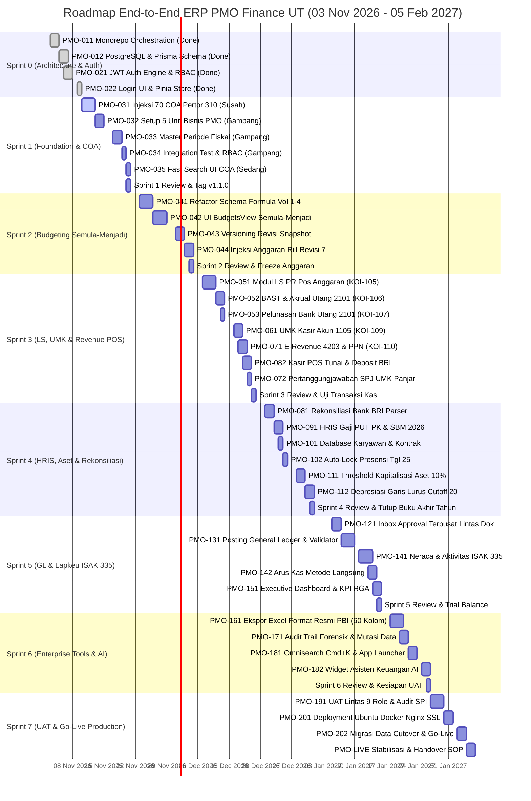

# 📅 JIRA SPRINT SCHEDULE, ROADMAP & TIMELINE EXECUTION
## ERP Keuangan & Operasional PMO UTama (Universitas Terbuka PTNBH)

> **Dokumen Resmi Acuan:** Peraturan Rektor No. 310 Tahun 2025, ISAK 335, DIPA Pusat, dan Standar Manajemen Proyek Agile Scrum.  
> **Status Sinkronisasi:** **100% Identik & Selaras** dengan `docs/JIRA-PRODUCT-BACKLOG-END-TO-END.md` (Total 38 User Stories & Technical Tasks + Milestone Sprint Review).  
> **Kick-off:** Selasa, 10 November 2026 | **Target Production Go-Live:** Jumat, 05 Februari 2027.  
> **Assignee Utama:** Syah Bintang  

---

## 🧭 PRINSIP KERJA EKSEKUSI (`/jira`)

1. **Fokus 1 Sprint per 1 Sprint:** Tidak mengerjakan atau melompat ke tiket sprint lain sebelum sprint aktif diselesaikan dan di-review.
2. **Cicil 1 Tiket per 1 Tiket:**
   - Koding & refactor fitur secara terisolasi pada branch terpisah `feature/<JIRA-KEY>-<slug>`.
   - Uji verifikasi teknis (`npm run typecheck`, `npm run build:web`, automated tests).
   - Buatkan dokumentasi teknis di `docs/tasks/<JIRA-KEY>-<slug>.md`.
   - Update checklist di `docs/plans/task.md`.
3. **Aturan Git & Pull Request:**
   - **WAJIB PULL REQUEST (PR):** Tidak boleh melakukan direct merge ke branch `main`. Setiap pekerjaan disubmit via GitHub Pull Request.
4. **Aturan Status Jira (Anti-Langsung Done):**
   - Agent **HANYA** boleh memindahkan status hingga **`In Review`**.
   - Status **`Done`** adalah wewenang mutlak Manajer Proyek setelah meninjau PR dan hasil pengujian.
5. **Standar Estimasi Waktu Kerja:**
   - **Tiket Gampang / Sedang:** 1 – 2 Hari Kerja.
   - **Tiket Susah / Kompleks (Core Engine / Database / Math):** 2 – 3 Hari Kerja.
   - **Hari Kerja:** Senin s/d Jumat (Sabtu & Minggu libur).
6. **Board 6 Kolom:**
   `To Do` ➔ `In Progress` ➔ `In Review` ➔ `In Progress (Fixing)` ➔ `Testing` ➔ `Done` (Swimlane by Assignee).

---

## 🗺️ PETA LENGKAP ROADMAP 8 SPRINT (03 NOV 2026 – 05 FEB 2027)

---

## 📌 BREAKDOWN TIKET PER SPRINT (100% SINKRON BACKLOG)

### SPRINT 0: Architecture Setup, Database Core & Auth Security
* **Periode:** Selasa, 03 Nov 2026 – Senin, 09 Nov 2026
* **Sasaran Sprint:** Pondasi monorepo npm workspaces, koneksi basis data PostgreSQL via Prisma, dan otentikasi JWT 9 Role.

| Kode Tiket | Judul Pekerjaan | Kompleksitas | Durasi | Start Date | Due Date | Priority | Status |
| :--- | :--- | :---: | :---: | :---: | :---: | :---: | :---: |
| **`PMO-011`** | Inisiasi NPM Workspaces Monorepo & Script Orchestration | **Sedang** | 2 Hari | Sel, 03 Nov 2026 | Rab, 04 Nov 2026 | **Blocker** | `In Review` |
| **`PMO-012`** | Setup Database PostgreSQL & Prisma ORM Schema | **Susah** | 2 Hari | Kam, 05 Nov 2026 | Jum, 06 Nov 2026 | **Blocker** | `In Review` |
| **`PMO-021`** | Backend JWT Auth Engine & Role Hierarchy (9 Peran Pengguna) | **Susah** | 2 Hari | Jum, 06 Nov 2026 | Sen, 09 Nov 2026 | **Critical** | `In Review` |
| **`PMO-022`** | Frontend Login UI & Session Persistence (`LoginView.vue`) | **Gampang** | 1 Hari | Sen, 09 Nov 2026 | Sen, 09 Nov 2026 | **High** | `In Review` |

---

### SPRINT 1: Foundation & Master Data COA Spesifik PMO (Pertor 310)
* **Parent Epic Jira:** `KOI-79` (`[SPRINT 1] Foundation & Master Data COA Pertor 310`)
* **Periode:** Selasa, 10 Nov 2026 – Jumat, 20 Nov 2026
* **Sasaran Sprint:** Basis data siap 100% menampung 70 Akun COA Operasional PMO dari File Excel (`docs/KODE COA UT.xlsx`), 5 Unit Bisnis PMO, dan Periode Fiskal yang terkunci.

| Kode Tiket | Jira Key | Judul Pekerjaan | Kompleksitas | Durasi | Start Date | Due Date | Priority | Status |
| :--- | :---: | :--- | :---: | :---: | :---: | :---: | :---: | :---: |
| **`PMO-031`** | `KOI-80` | Injeksi 70 Akun COA Operasional PMO dari File Excel ke PostgreSQL | **Sedang** | 3 Hari | Sel, 10 Nov 2026 | Kam, 12 Nov 2026 | **Highest** | `In Review` |
| **`PMO-032`** | `KOI-84` | Setup Master Data 5 Unit Bisnis PMO & Cost Center Hierarchy | **Gampang** | 2 Hari | Jum, 13 Nov 2026 | Sen, 16 Nov 2026 | **High** | `In Review` |
| **`PMO-033`** | `KOI-87` | Master Periode Fiskal & Skema Locking Tutup Buku | **Gampang** | 2 Hari | Sel, 17 Nov 2026 | Rab, 18 Nov 2026 | **Medium** | `In Review` |
| **`PMO-034`** | `KOI-90` | Integration Testing DB & Smoke Test Sesi RBAC (9 Role) | **Gampang** | 1 Hari | Kam, 19 Nov 2026 | Kam, 19 Nov 2026 | **High** | `In Review` |
| **`PMO-035`** | `KOI-101` | Penyelarasan UI/UX Fondasi: Fast Search 70 Akun COA & Indikator Fiskal | **Sedang** | 1 Hari | Jum, 20 Nov 2026 | Jum, 20 Nov 2026 | **High** | `In Review` |
| **`SPRINT-1-REV`**| - | Sprint Review, Retrospective & Release Tag v1.1.0 | **Review** | 1 Hari | Jum, 20 Nov 2026 | Jum, 20 Nov 2026 | **Medium** | `In Review` |

---

### SPRINT 2: Budgeting Semula-Menjadi & Multi-Level Volume
* **Parent Epic Jira:** `KOI-93` (`[SPRINT 2] Budgeting Semula-Menjadi & Multi-Level Volume`)
* **Periode:** Senin, 23 Nov 2026 – Jumat, 04 Des 2026
* **Sasaran Sprint:** Modul Anggaran (`BudgetsView.vue`) selaras penuh dengan format Excel Rektorat (4 tingkat perkalian volume, pagu Semula vs Menjadi, dan selisih otomatis).

| Kode Tiket | Jira Key | Judul Pekerjaan | Kompleksitas | Durasi | Start Date | Due Date | Priority | Status |
| :--- | :---: | :--- | :---: | :---: | :---: | :---: | :---: | :---: |
| **`PMO-041`** | `KOI-94` | Refactor Prisma Schema `BudgetLine` & Formula $V_1 \times V_2 \times V_3 \times V_4$ | **Susah** | 3 Hari | Sen, 23 Nov 2026 | Rab, 25 Nov 2026 | **Highest** | `In Review` |
| **`PMO-042`** | `KOI-98` | Refactor Komponen UI `BudgetsView.vue` Semula vs Menjadi | **Susah** | 3 Hari | Kam, 26 Nov 2026 | Sen, 30 Nov 2026 | **High** | `In Review` |
| **`PMO-043`** | `KOI-99` | Workflow Persetujuan Revisi Anggaran, Snapshot Versioning & Diff Viewer | **Gampang** | 2 Hari | Sel, 01 Des 2026 | Rab, 02 Des 2026 | **High** | `In Review` |
| **`PMO-044`** | `KOI-100` | Injeksi Data Anggaran Riil PMO (Revisi 7 Block Grant & Usulan 2027) | **Gampang** | 2 Hari | Kam, 03 Des 2026 | Jum, 04 Des 2026 | **Medium** | `In Review` |
| **`SPRINT-2-REV`**| - | Sprint Review & Freeze Anggaran | **Review** | 1 Hari | Jum, 04 Des 2026 | Jum, 04 Des 2026 | **Medium** | `In Review` |

---

### SPRINT 3: Core Transaction Engines (LS, UMK & Revenue POS)
* **Parent Epic Jira:** `KOI-108` (`[SPRINT 3] Core Transaction Engines (LS, UMK & Revenue POS)`)
* **Periode:** Senin, 07 Des 2026 – Jumat, 18 Des 2026
* **Sasaran Sprint:** Alur transaksi kas utama (Pengadaan LS, Kas Kecil UMK, Kasir POS & E-Revenue) terhubung penuh ke akun COA 12-digit Pertor 310.

| Kode Tiket | Jira Key | Judul Pekerjaan | Kompleksitas | Durasi | Start Date | Due Date | Priority | Status |
| :--- | :---: | :--- | :---: | :---: | :---: | :---: | :---: | :---: |
| **`PMO-051`** | `KOI-105` | Modul LS: Alur PR & Integrasi 296 Pos Anggaran Riil Pertor 310 | **Susah** | 3 Hari | Sen, 07 Des 2026 | Rab, 09 Des 2026 | **High** | `In Review` |
| **`PMO-052`** | `KOI-106` | Penerimaan Barang/Jasa (BAST) & Jurnal Akrual Utang Pengadaan 2101 | **Sedang** | 2 Hari | Kam, 10 Des 2026 | Jum, 11 Des 2026 | **High** | `In Review` |
| **`PMO-053`** | `KOI-107` | Pelunasan Tagihan Vendor via Bank & Penutupan Utang Pengadaan 2101 | **Sedang** | 1 Hari | Jum, 11 Des 2026 | Jum, 11 Des 2026 | **High** | `In Review` |
| **`PMO-061`** | `KOI-109` | Modul UMK: Pencairan Kasir ➔ Akun `110501010100` Kas Kecil Unit | **Susah** | 2 Hari | Sen, 14 Des 2026 | Sel, 15 Des 2026 | **High** | `In Review` |
| **`PMO-071`** | `KOI-110` | Modul Kasir E-Revenue: Sinkronisasi Akun Pendapatan `4203xxxxxx` & PPN Keluaran | **Gampang** | 2 Hari | Sel, 15 Des 2026 | Rab, 16 Des 2026 | **High** | `In Review` |
| **`PMO-082`** | `KOI-111` | Modul Kasir Tunai (POS) & Penyetoran Deposit Bank BRI | **Sedang** | 2 Hari | Rab, 16 Des 2026 | Kam, 17 Des 2026 | **High** | `In Review` |
| **`PMO-072`** | `KOI-112` | Pertanggungjawaban SPJ UMK Panjar, Verifikasi Nota & Tutup Panjar | **Sedang** | 1 Hari | Kam, 17 Des 2026 | Jum, 18 Des 2026 | **High** | `In Review` |
| **`SPRINT-3-REV`**| `KOI-113` | Sprint 3 Review & Uji Transaksi Kas Lintas Unit | **Review** | 1 Hari | Jum, 18 Des 2026 | Jum, 18 Des 2026 | **Medium** | `In Review` |

---

### SPRINT 4: Operational Rules, HRIS Lock & Aset ISAK 335
* **Parent Epic Jira:** `KOI-114` (`[SPRINT 4] Operational Rules, HRIS Lock & Aset Tetap ISAK 335`)
* **Periode:** Senin, 21 Des 2026 – Kamis, 31 Des 2026
* **Sasaran Sprint:** Otomasi kepatuhan operasional (Locking HRIS tgl 25, Cut-off Aset tgl 20, dan Rekonsiliasi Bank BRI).

| Kode Tiket | Jira Key | Judul Pekerjaan | Kompleksitas | Durasi | Start Date | Due Date | Priority | Status |
| :--- | :---: | :--- | :---: | :---: | :---: | :---: | :---: | :---: |
| **`PMO-081`** | `KOI-115` | Rekonsiliasi Bank BRI: Parser Rekening Koran CSV/Excel & Auto-Matching | **Gampang** | 2 Hari | Sen, 21 Des 2026 | Sel, 22 Des 2026 | **High** | `In Review` |
| **`PMO-091`** | `KOI-116` | HRIS Gaji PUT PK: Perhitungan Standar Biaya Masukan (SBM) & PPh 21 | **Gampang** | 2 Hari | Rab, 23 Des 2026 | Kam, 24 Des 2026 | **High** | `In Review` |
| **`PMO-101`** | `KOI-117` | Database Karyawan, Riwayat Kontrak & Rekapitulasi Presensi Unit | **Gampang** | 1 Hari | Kam, 24 Des 2026 | Kam, 24 Des 2026 | **Medium** | `In Review` |
| **`PMO-102`** | `KOI-118` | Engine Auto-Lock Presensi & Lembur HRIS Setiap Tanggal 25 Pukul 23:59 | **Sedang** | 1 Hari | Jum, 25 Des 2026 | Jum, 25 Des 2026 | **High** | `In Review` |
| **`PMO-111`** | `KOI-119` | Filter Ambang Batas Kapitalisasi Aset Tetap (>10% Nilai Buku & Nilai Batas) | **Sedang** | 2 Hari | Sen, 28 Des 2026 | Sel, 29 Des 2026 | **High** | `In Review` |
| **`PMO-112`** | `KOI-120` | Kalkulator Depresiasi Garis Lurus & Cut-off Penyusutan Tanggal 20 | **Susah** | 2 Hari | Rab, 30 Des 2026 | Kam, 31 Des 2026 | **High** | `In Review` |
| **`SPRINT-4-REV`**| `KOI-121` | Sprint 4 Review & Tutup Buku Akhir Tahun 2026 | **Review** | 1 Hari | Kam, 31 Des 2026 | Kam, 31 Des 2026 | **High** | `In Review` |

---

### SPRINT 5: General Ledger, Jurnal Otomatis & 5 Lapkeu ISAK 335
* **Parent Epic Jira:** `KOI-122` (`[SPRINT 5] General Ledger, Jurnal Otomatis & 5 Lapkeu ISAK 335`)
* **Periode:** Selasa, 05 Jan 2027 – Jumat, 15 Jan 2027
* **Sasaran Sprint:** Buku Besar otomatis terisi dari seluruh transaksi dan menghasilkan 5 Laporan Keuangan resmi ISAK 335.

| Kode Tiket | Jira Key | Judul Pekerjaan | Kompleksitas | Durasi | Start Date | Due Date | Priority | Status |
| :--- | :---: | :--- | :---: | :---: | :---: | :---: | :---: | :---: |
| **`PMO-121`** | `KOI-123` | Inbox Approval Terpusat Lintas Dokumen (`ApprovalsView.vue`) | **Sedang** | 2 Hari | Sel, 05 Jan 2027 | Rab, 06 Jan 2027 | **High** | `In Review` |
| **`PMO-131`** | `KOI-124` | Core Double-Entry Ledger Engine & Validasi Keseimbangan Debet/Kredit | **Susah** | 3 Hari | Kam, 07 Jan 2027 | Sen, 11 Jan 2027 | **Highest** | `In Review` |
| **`PMO-141`** | `KOI-125` | Generator Laporan Posisi Keuangan (Neraca) & Aktivitas ISAK 335 | **Susah** | 3 Hari | Sen, 11 Jan 2027 | Rab, 13 Jan 2027 | **Highest** | `In Review` |
| **`PMO-142`** | `KOI-126` | Generator Laporan Arus Kas Metode Langsung (Direct Method) | **Sedang** | 2 Hari | Rab, 13 Jan 2027 | Kam, 14 Jan 2027 | **High** | `In Review` |
| **`PMO-151`** | `KOI-127` | Executive Dashboard & Analitik Kinerja RGA Real-Time Serapan Anggaran | **Gampang** | 2 Hari | Kam, 14 Jan 2027 | Jum, 15 Jan 2027 | **Medium** | `In Review` |
| **`SPRINT-5-REV`**| `KOI-128` | Sprint 5 Review & Verifikasi Audit Trail Jurnal | **Review** | 1 Hari | Jum, 15 Jan 2027 | Jum, 15 Jan 2027 | **High** | `In Review` |

---

### SPRINT 6: Enterprise Tools, Omnisearch, AI Assistant & Ekspor PBI
* **Periode:** Senin, 18 Jan 2027 – Selasa, 26 Jan 2027
* **Sasaran Sprint:** Kompatibilitas data ke universitas pusat (format 60 kolom), pencarian instan omnibar, AI assistant keuangan, dan forensic audit trail.

| Kode Tiket | Jira Key | Judul Pekerjaan | Kompleksitas | Durasi | Start Date | Due Date | Priority | Status |
| :--- | :--- | :--- | :---: | :---: | :---: | :---: | :---: | :---: |
| **`PMO-161`** | `KOI-130` | Generator Ekspor Excel Format Resmi PBI (Tabel 60 Kolom Tanpa Re-Typing) | **Susah** | 3 Hari | Sen, 18 Jan 2027 | Rab, 20 Jan 2027 | **Highest** | `In Review` |
| **`PMO-171`** | `KOI-131` | Perekaman Otomatis Mutasi Data & Jejak Audit (Forensic Audit Trail) | **Sedang** | 2 Hari | Rab, 20 Jan 2027 | Kam, 21 Jan 2027 | **High** | `In Review` |
| **`PMO-181`** | `KOI-132` | Navigasi Cepat, Omnisearch Cmd+K & App Launcher Modal | **Sedang** | 2 Hari | Jum, 22 Jan 2027 | Sen, 25 Jan 2027 | **Medium** | `In Review` |
| **`PMO-182`** | `KOI-133` | Widget Asisten Keuangan AI Terintegrasi (Context-Aware Financial AI) | **Sedang** | 2 Hari | Sen, 25 Jan 2027 | Sel, 26 Jan 2027 | **Medium** | `In Review` |
| **`SPRINT-6-REV`**| - | Sprint 6 Review & Kesiapan UAT Lintas Modul | **Review** | 1 Hari | Sel, 26 Jan 2027 | Sel, 26 Jan 2027 | **High** | `To Do` |

---

### SPRINT 7: UAT Audit SPI, Server Hardening & Production Go-Live
* **Periode:** Rabu, 27 Jan 2027 – Jumat, 05 Feb 2027
* **Sasaran Sprint:** Validasi kepatuhan SPI lintas 9 peran, deployment Ubuntu Docker, migrasi data final, dan go-live produksi.

| Kode Tiket | Judul Pekerjaan | Kompleksitas | Durasi | Start Date | Due Date | Priority | Status |
| :--- | :--- | :---: | :---: | :---: | :---: | :---: | :---: |
| **`PMO-191`** | UAT Simulasi Transaksi Riil Lintas 9 Role & Audit SPI | **Susah** | 3 Hari | Rab, 27 Jan 2027 | Jum, 29 Jan 2027 | **Critical** | `To Do` |
| **`PMO-201`** | Production Build, Nginx Reverse Proxy, Docker SSL & PM2 Cluster | **Susah** | 2 Hari | Sen, 01 Feb 2027 | Sel, 02 Feb 2027 | **Blocker** | `To Do` |
| **`PMO-202`** | Final Data Migration Cutover & Official Go-Live Production | **Susah** | 2 Hari | Sel, 02 Feb 2027 | Kam, 04 Feb 2027 | **Blocker** | `To Do` |
| **`PMO-LIVE`** | Stabilisasi Pasca Go-Live & Handover SOP Operasional | **Support** | 2 Hari | Kam, 04 Feb 2027 | Jum, 05 Feb 2027 | **High** | `To Do` |

---

## 📌 JIRA CALENDAR: TANGGAL KRUSIAL BULANAN

| Tanggal | Aktivitas Sistem Otomatis / Finansial |
| :---: | :--- |
| **Tgl 20** | **Cut-Off Penyusutan Aset Tetap:** Transaksi aset setelah tanggal 20 dibukukan penyusutannya pada bulan berikutnya. |
| **Tgl 25** | **Auto-Lock Absensi & Lembur HRIS:** Data kehadiran dikunci otomatis untuk perhitungan slip gaji PUT PK. |
| **Tgl 28** | **Batas Akhir Berkas Pencairan:** Batas submit SPJ/berkas ke Bagian Perencanaan & Penganggaran UT Pusat. |
| **Tgl 30 / 31** | **Disbursement Bank BRI & Tutup Buku Bulanan:** Pencairan dana dan penguncian jurnal periode fiskal. |
