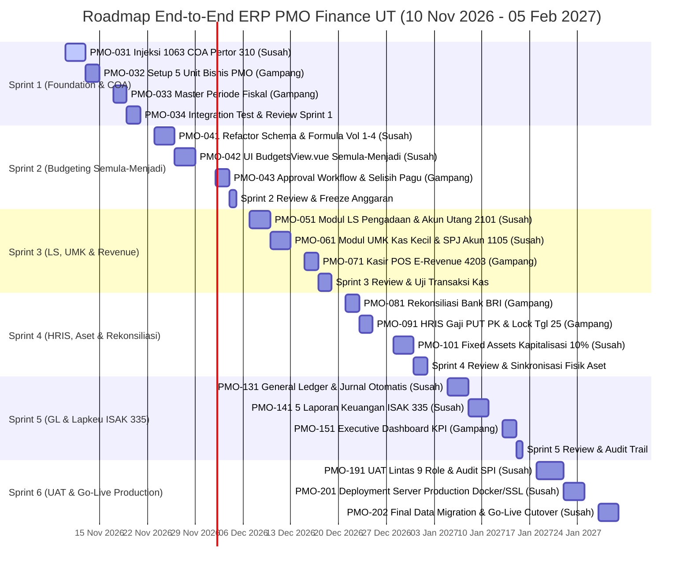

# 📅 JIRA SPRINT SCHEDULE, ROADMAP & TIMELINE EXECUTION
## ERP Keuangan & Operasional PMO UTama (Universitas Terbuka PTNBH)

> **Dokumen Resmi Acuan:** Peraturan Rektor No. 310 Tahun 2025, ISAK 335, dan Standar Manajemen Proyek Agile Scrum.  
> **Status:** Berlaku per Kick-off Selasa, 10 November 2026.  
> **Assignee Utama:** Syah Bintang  

---

## 🧭 PRINSIP KERJA EKSEKUSI (`/jira`)

1. **Fokus 1 Sprint per 1 Sprint:** Tidak mengerjakan atau melompat ke tiket sprint lain sebelum sprint aktif diselesaikan dan di-review.
2. **Cicil 1 Tiket per 1 Tiket:**
   - Koding & refactor fitur secara terisolasi.
   - Uji verifikasi teknis & fungsional.
   - Sediakan format deskripsi Jira (Role, Flowchart Mermaid, Priority).
   - Buatkan commit Git konvensional yang bersih.
3. **Standar Estimasi Waktu Kerja:**
   - **Tiket Gampang / Sedang:** 1 – 2 Hari Kerja.
   - **Tiket Susah / Kompleks (Core Engine / Database / Math):** 2 – 3 Hari Kerja.
   - **Hari Kerja:** Senin s/d Jumat (Sabtu & Minggu libur).
4. **Board 6 Kolom:**
   `To Do` ➔ `In Progress` ➔ `In Review` ➔ `In Progress (Fixing)` ➔ `Testing` ➔ `Done` (Swimlane by Assignee).

---

## 🗺️ PETA LENGKAP ROADMAP 6 SPRINT (10 NOV 2026 – 05 FEB 2027)

---

## 📌 BREAKDOWN TIKET PER SPRINT

### SPRINT 1: Foundation & Master Data COA Pertor 310
* **Periode:** Selasa, 10 Nov 2026 – Jumat, 20 Nov 2026
* **Sasaran Sprint:** Basis data siap 100% menampung 1.063 Akun Resmi Pertor 310, 5 Unit Bisnis PMO, dan Periode Fiskal yang terkunci.

| Kode Tiket | Judul Pekerjaan | Kompleksitas | Durasi | Start Date | Due Date | Priority | Status |
| :--- | :--- | :---: | :---: | :---: | :---: | :---: | :---: |
| **`PMO-031`** | Injeksi 1.063 Akun COA Resmi Pertor 310 ke PostgreSQL | **Susah** | 3 Hari | Sel, 10 Nov 2026 | Kam, 12 Nov 2026 | **Highest / Blocker** | `To Do` |
| **`PMO-032`** | Setup Master Data 5 Unit Bisnis PMO & Cost Center | **Gampang** | 2 Hari | Jum, 13 Nov 2026 | Sen, 16 Nov 2026 | **High** | `To Do` |
| **`PMO-033`** | Master Periode Fiskal & Skema Locking Tutup Buku | **Gampang** | 2 Hari | Sel, 17 Nov 2026 | Rab, 18 Nov 2026 | **Medium** | `To Do` |
| **`PMO-034`** | Integration Testing DB & Smoke Test Sesi Auth | **Gampang** | 1 Hari | Kam, 19 Nov 2026 | Kam, 19 Nov 2026 | **High** | `To Do` |
| **`SPRINT-1-REV`**| Sprint Review, Retrospective & Release Tag v1.1.0 | **Review** | 1 Hari | Jum, 20 Nov 2026 | Jum, 20 Nov 2026 | **Medium** | `To Do` |

---

### SPRINT 2: Budgeting Semula-Menjadi & Multi-Level Volume
* **Periode:** Senin, 23 Nov 2026 – Jumat, 04 Des 2026
* **Sasaran Sprint:** Modul Anggaran (`BudgetsView.vue`) selaras penuh dengan format Excel Rektorat (4 tingkat perkalian volume, pagu Semula vs Menjadi, dan selisih otomatis).

| Kode Tiket | Judul Pekerjaan | Kompleksitas | Durasi | Start Date | Due Date | Priority |
| :--- | :--- | :---: | :---: | :---: | :---: | :---: |
| **`PMO-041`** | Refactor Prisma Schema `BudgetLine` & Formula $V_1 \times V_2 \times V_3 \times V_4$ | **Susah** | 3 Hari | Sen, 23 Nov 2026 | Rab, 25 Nov 2026 | **Highest** |
| **`PMO-042`** | Refactor Komponen UI `BudgetsView.vue` Semula vs Menjadi | **Susah** | 3 Hari | Kam, 26 Nov 2026 | Sen, 30 Nov 2026 | **High** |
| **`PMO-043`** | Workflow Persetujuan Revisi Anggaran & Validasi Realisasi | **Gampang** | 2 Hari | Sel, 01 Des 2026 | Rab, 02 Des 2026 | **High** |
| **`PMO-044`** | Review Sprint 2, Uji Impor Excel & Freeze Anggaran 2027 | **Gampang** | 2 Hari | Kam, 03 Des 2026 | Jum, 04 Des 2026 | **Medium** |

---

### SPRINT 3: Core Transaction Engines (LS, UMK & Revenue POS)
* **Periode:** Senin, 07 Des 2026 – Jumat, 18 Des 2026
* **Sasaran Sprint:** Alur transaksi kas utama (Pengadaan LS, Kas Kecil UMK, Kasir POS) terhubung ke akun COA Pertor 310.

| Kode Tiket | Judul Pekerjaan | Kompleksitas | Durasi | Start Date | Due Date | Priority |
| :--- | :--- | :---: | :---: | :---: | :---: | :---: |
| **`PMO-051`** | Modul LS: Alur BAST ➔ Utang Pengadaan (`210101010100`) & Utang Pajak (`2102`) | **Susah** | 3 Hari | Sen, 07 Des 2026 | Rab, 09 Des 2026 | **High** |
| **`PMO-061`** | Modul UMK: Pencairan Kasir ➔ Akun `110501010100` & Pertanggungjawaban SPJ | **Susah** | 3 Hari | Kam, 10 Des 2026 | Sen, 14 Des 2026 | **High** |
| **`PMO-071`** | Modul Kasir E-Revenue: Sinkronisasi Akun Pendapatan `4203xxxxxx` & PPN Keluaran | **Gampang** | 2 Hari | Sel, 15 Des 2026 | Rab, 16 Des 2026 | **High** |
| **`PMO-072`** | Sprint 3 Review & Uji Transaksi Kas Lintas Unit | **Gampang** | 2 Hari | Kam, 17 Des 2026 | Jum, 18 Des 2026 | **Medium** |

---

### SPRINT 4: Operational Rules, HRIS Lock & Aset ISAK 335
* **Periode:** Senin, 21 Des 2026 – Kamis, 31 Des 2026
* **Sasaran Sprint:** Otomasi kepatuhan operasional (Locking HRIS tgl 25, Cut-off Aset tgl 20, dan Rekonsiliasi Bank).

| Kode Tiket | Judul Pekerjaan | Kompleksitas | Durasi | Start Date | Due Date | Priority |
| :--- | :--- | :---: | :---: | :---: | :---: | :---: |
| **`PMO-081`** | Rekonsiliasi Bank BRI: Parser Rekening Koran & Mutasi Kas | **Gampang** | 2 Hari | Sen, 21 Des 2026 | Sel, 22 Des 2026 | **High** |
| **`PMO-091`** | HRIS Gaji PUT PK: Perhitungan SBM, PPh 21 & Auto-Lock Tgl 25 | **Gampang** | 2 Hari | Rab, 23 Des 2026 | Kam, 24 Des 2026 | **High** |
| **`PMO-101`** | Fixed Assets: Filter Threshold Kapitalisasi 10% & Cut-off Penyusutan Tgl 20 | **Susah** | 3 Hari | Sen, 28 Des 2026 | Rab, 30 Des 2026 | **High** |
| **`PMO-102`** | Sprint 4 Review & Tutup Buku Akhir Tahun 2026 | **Gampang** | 1 Hari | Kam, 31 Des 2026 | Kam, 31 Des 2026 | **High** |

---

### SPRINT 5: General Ledger, Jurnal Otomatis & 5 Lapkeu ISAK 335
* **Periode:** Selasa, 05 Jan 2027 – Jumat, 15 Jan 2027
* **Sasaran Sprint:** Buku Besar otomatis terisi dari seluruh transaksi dan menghasilkan 5 Laporan Keuangan ISAK 335.

| Kode Tiket | Judul Pekerjaan | Kompleksitas | Durasi | Start Date | Due Date | Priority |
| :--- | :--- | :---: | :---: | :---: | :---: | :---: |
| **`PMO-131`** | Posting Engine General Ledger & Double-Entry Balance Validator | **Susah** | 3 Hari | Sel, 05 Jan 2027 | Kam, 07 Jan 2027 | **Highest** |
| **`PMO-141`** | Engine Generator 5 Laporan Keuangan ISAK 335 (Neraca, Aktivitas, Arus Kas, dll) | **Susah** | 3 Hari | Jum, 08 Jan 2027 | Sel, 12 Jan 2027 | **Highest** |
| **`PMO-151`** | Dashboard Eksekutif & KPI Keuangan Real-Time | **Gampang** | 2 Hari | Rab, 13 Jan 2027 | Kam, 14 Jan 2027 | **Medium** |
| **`PMO-152`** | Sprint 5 Review & Verifikasi Audit Trail | **Gampang** | 1 Hari | Jum, 15 Jan 2027 | Jum, 15 Jan 2027 | **High** |

---

### SPRINT 6: UAT Audit SPI, Server Hardening & Production Go-Live
* **Periode:** Senin, 18 Jan 2027 – Jumat, 05 Feb 2027
* **Sasaran Sprint:** Sistem diuji menyeluruh oleh stakeholder dan di-deploy ke server produksi kampus UT.

| Kode Tiket | Judul Pekerjaan | Kompleksitas | Durasi | Start Date | Due Date | Priority |
| :--- | :--- | :---: | :---: | :---: | :---: | :---: |
| **`PMO-191`** | UAT Simulasi Transaksi Riil Lintas 9 Role & Audit SPI | **Susah** | 4 Hari | Sen, 18 Jan 2027 | Kam, 21 Jan 2027 | **Critical** |
| **`PMO-201`** | Deployment Server Ubuntu, Docker Container, Nginx SSL & Backup Cron | **Susah** | 3 Hari | Jum, 22 Jan 2027 | Sel, 26 Jan 2027 | **Blocker** |
| **`PMO-202`** | Final Data Migration Cutover & Official Go-Live Production | **Susah** | 3 Hari | Rab, 27 Jan 2027 | Jum, 29 Jan 2027 | **Blocker** |
| **`PMO-LIVE`** | Stabilisasi Pasca Go-Live & Handover SOP Operasional | **Support** | 5 Hari | Sen, 01 Feb 2027 | Jum, 05 Feb 2027 | **High** |

---

## 📌 JIRA CALENDAR: TANGGAL KRUSIAL BULANAN

| Tanggal | Aktivitas Sistem Otomatis / Finansial |
| :---: | :--- |
| **Tgl 20** | **Cut-Off Penyusutan Aset Tetap:** Transaksi aset setelah tanggal 20 dibukukan penyusutannya pada bulan berikutnya. |
| **Tgl 25** | **Auto-Lock Absensi & Lembur HRIS:** Data kehadiran dikunci otomatis untuk perhitungan slip gaji PUT PK. |
| **Tgl 28** | **Batas Akhir Berkas Pencairan:** Batas submit SPJ/berkas ke Bagian Perencanaan & Penganggaran UT Pusat. |
| **Tgl 30 / 31** | **Disbursement Bank BRI & Tutup Buku Bulanan:** Pencairan dana dan penguncian jurnal periode fiskal. |
