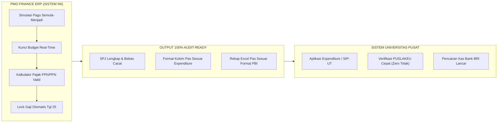
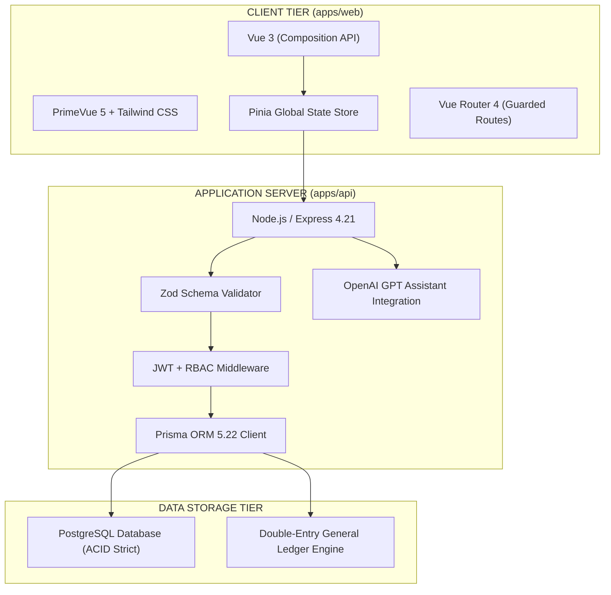
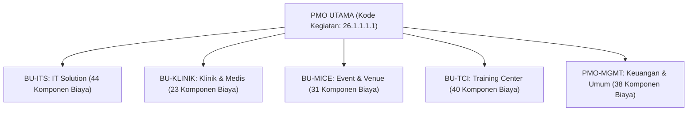
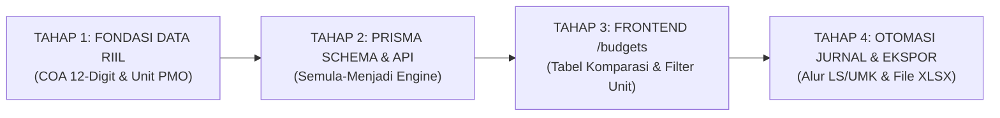

# 🏛️ DOKUMENTASI LENGKAP & MASTER BLUEPRINT SISTEM ERP PMO FINANCE UNIVERSITAS TERBUKA

> **Dokumen Resmi:** Single Source of Truth (SSOT) PMO Finance ERP  
> **Klasifikasi:** Dokumen Spesifikasi Teknis, Panduan Stakeholder, & Blueprint Arsitektur  
> **Status Integrasi:** 100% Selaras dengan **Pertor UT 310/2025**, **KODE COA UT**, **RGA PMO 2027**, & **Revisi ke-7 Block Grant**  
> **Petunjuk Pembacaan:** Dokumen ini disusun secara terstruktur dari visi strategis hingga detail sel terkecil. Gunakan pintasan **`Ctrl + F`** atau **`Cmd + F`** untuk langsung melompat ke bab, istilah akuntansi, atau modul teknis yang Anda butuhkan.

---

## 📑 DAFTAR ISI CEPAT (QUICK JUMP INDEX)

* [BAGIAN I: PROJECT BRIEF & LATAR BELAKANG STRATEGIS](#bagian-i-project-brief--latar-belakang-strategis)
  * [1.1. Profil Singkat & Latar Belakang PMO UTama](#11-profil-singkat--latar-belakang-pmo-utama)
  * [1.2. Mengapa PMO Membutuhkan ERP Mandiri?](#12-mengapa-pmo-membutuhkan-erp-mandiri)
  * [1.3. Visi & Tujuan Implementasi Sistem](#13-visi--tujuan-implementasi-sistem)
* [BAGIAN II: PERBEDAAN PMO FINANCE VS SISTEM UT PUSAT](#bagian-ii-perbedaan-pmo-finance-vs-sistem-ut-pusat)
  * [2.1. Anatomi Sistem Keuangan UT Pusat (SIP-UT / Expenditure / Puslakeu / PBI)](#21-anatomi-sistem-keuangan-ut-pusat-sip-ut--expenditure--puslakeu--pbi)
  * [2.2. Mengapa Sistem Pusat Tidak Cukup untuk Bisnis PMO?](#22-mengapa-sistem-pusat-tidak-cukup-untuk-bisnis-pmo)
  * [2.3. Konsep Pre-Accounting Engine & Operational Shield](#23-konsep-pre-accounting-engine--operational-shield)
  * [2.4. Tabel Komparasi Fitur: Sistem UT Pusat vs PMO Finance ERP](#24-tabel-komparasi-fitur-sistem-ut-pusat-vs-pmo-finance-erp)
* [BAGIAN III: FUNGSI NYATA & NILAI TAMBAH OPERASIONAL PMO](#bagian-iii-fungsi-nyata--nilai-tambah-operasional-pmo)
  * [3.1. Zero Kas Nombok (Menyelamatkan Kas Kantor)](#31-zero-kas-nombok-menyelamatkan-kas-kantor)
  * [3.2. Zero Blind Commitment (Sistem Kunci Pagu Real-Time)](#32-zero-blind-commitment-sistem-kunci-pagu-real-time)
  * [3.3. Zero Keterlambatan Gaji & Honor (Lock Presensi Tanggal 25)](#33-zero-keterlambatan-gaji--honor-lock-presensi-tanggal-25)
  * [3.4. Zero Nota Cacat Pajak (Kalkulator Pajak Otomatis PPh/PPN)](#34-zero-nota-cacat-pajak-kalkulator-pajak-otomatis-pphppn)
  * [3.5. Zero Double-Typing (Ekspor Kompatibel 100% Format Pusat)](#35-zero-double-typing-ekspor-kompatibel-100-format-pusat)
  * [3.6. Manajemen Dinamis Anggaran Semula - Menjadi](#36-manajemen-dinamis-anggaran-semula---menjadi)
* [BAGIAN IV: ARSITEKTUR TEKNOLOGI & TECH STACK](#bagian-iv-arsitektur-teknologi--tech-stack)
  * [4.1. Pola Arsitektur Monorepo](#41-pola-arsitektur-monorepo)
  * [4.2. Rincian Teknologi Backend (`apps/api`)](#42-rincian-teknologi-backend-appsapi)
  * [4.3. Rincian Teknologi Frontend (`apps/web`)](#43-rincian-teknologi-frontend-appsweb)
  * [4.4. Basis Data, Transaksi ACID & Keamanan Role (RBAC)](#44-basis-data-transaksi-acid--keamanan-role-rbac)
* [BAGIAN V: SPESIFIKASI FUNGSIONAL & DETAIL ISIAN SISTEM](#bagian-v-spesifikasi-fungsional--detail-isian-sistem)
  * [5.1. Landasan Regulasi: Pertor 310/2025 & Standar ISAK 335](#51-landasan-regulasi-pertor-3102025--standar-isak-335)
  * [5.2. Master Data 5 Unit Bisnis PMO & Program Kerja 2027](#52-master-data-5-unit-bisnis-pmo--program-kerja-2027)
  * [5.3. Master Data COA 12-Digit & Integrasi E-Revenue (134 Akun)](#53-master-data-coa-12-digit--integrasi-e-revenue-134-akun)
  * [5.4. Standar Belanja Operasional PMO (27 Akun Block Grant & BAS DIPA)](#54-standar-belanja-operasional-pmo-27-akun-block-grant--bas-dipa)
  * [5.5. Mesin Anggaran Semula - Menjadi (Formula Multi-Volume & Snapshot)](#55-mesin-anggaran-semula---menjadi-formula-multi-volume--snapshot)
  * [5.6. Alur Transaksi & Format Baku Jurnal (Lampiran III Pertor 310)](#56-alur-transaksi--format-baku-jurnal-lampiran-iii-pertor-310)
  * [5.7. Kebijakan Kapitalisasi & Penyusutan Aset Tetap](#57-kebijakan-kapitalisasi--penyusutan-aset-tetap)
  * [5.8. Desain Skema Database (Prisma Models Lengkap)](#58-desain-skema-database-prisma-models-lengkap)
  * [5.9. Panduan Antarmuka Pengguna (UI/UX) per Modul](#59-panduan-antarmuka-pengguna-uiux-per-modul)
* [BAGIAN VI: ROADMAP IMPLEMENTASI & CHECKLIST VERIFIKASI](#bagian-vi-roadmap-implementasi--checklist-verifikasi)

---

# BAGIAN I: PROJECT BRIEF & LATAR BELAKANG STRATEGIS

## 1.1. Profil Singkat & Latar Belakang PMO UTama
Universitas Terbuka (UT) resmi bertransformasi menjadi **Perguruan Tinggi Negeri Badan Hukum (PTNBH)** berdasarkan **Peraturan Pemerintah No. 39 Tahun 2022**. Status PTNBH ini memberikan otonomi akademik, pengelolaan aset mandiri, serta mandat legal untuk memperluas sumber pendapatan non-akademik di luar SPP/UKT mahasiswa melalui **Revenue Generating Activities (RGAs)**.

Untuk mengakselerasi komersialisasi riset, pemanfaatan aset, dan hilirisasi layanan teknologi informasi kampus, didirikanlah **Project Management Office UTama (PMO UTama)**. PMO bertindak sebagai entitas bisnis lincah (*business arm / entrepreneurial unit*) di bawah pengawasan Pusat Bisnis dan Investasi (PBI) UT, yang mengelola portofolio proyek strategis:
1. Penyediaan platform digital komersial untuk perguruan tinggi se-Indonesia (Aplikasi Promise, Pentest, dsb).
2. Layanan operasional MICE (penyelenggaraan konferensi, wisuda, dan sewa fasilitas universitas).
3. Pelatihan profesional dan sertifikasi kompetensi (Training Center Indonesia - TCI).
4. Layanan medis terpadu kampus (Poliklinik dan Medical Check-Up).
5. Layanan konsultasi korporasi dan riset terapan.

## 1.2. Mengapa PMO Membutuhkan ERP Mandiri?
Sebagai unit yang menjalankan model bisnis dinamis (*fast-paced service delivery*), PMO setiap hari menghadapi siklus operasional yang bergerak cepat:
* Membayar honor tim ahli IT lepas (*freelancer / external consultant*).
* Menyewa infrastruktur server cloud (*AWS, GCP, Backup Data*) yang pembayarannya tidak bisa menunggu disposisi berbulan-bulan.
* Membeli bahan obat darurat poliklinik dan suku cadang pendingin venue MICE.
* Melakukan pergeseran pos anggaran secara cepat dari kegiatan A ke kegiatan B untuk merespons permintaan tender klien.

Di sisi lain, birokrasi universitas pusat beroperasi dengan ritme kepatuhan yang sangat ketat: setiap pengajuan belanja harus melewati verifikasi berlapis (Pusat Bisnis $\rightarrow$ Verifikator PUSLAKEU $\rightarrow$ Pejabat Pembuat Komitmen $\rightarrow$ Surat Perintah Membayar $\rightarrow$ Pendebitan Kas Giro BRI).

**Bottleneck utama:** Ketidaksinkronan ritme ini membuat PMO kerap mengalami krisis:
* Dana kas kecil kantor tekor karena bon belanja tidak lolos audit pajak.
* Honor pengajar/tim molor karena terlambat 1 hari dari batas tanggal 30.
* Manajer unit tidak mengetahui secara *live* berapa sisa jatah uang yang boleh dibelanjakan.

## 1.3. Visi & Tujuan Implementasi Sistem
Sistem **PMO Finance ERP** dibangun sebagai platform terpadu yang memadukan **kelincahan manajemen proyek internal (*startup-speed agility*)** dengan **kepatuhan hukum akuntansi universitas (*institutional audit-grade compliance*)**.

---

# BAGIAN II: PERBEDAAN PMO FINANCE VS SISTEM UT PUSAT

## 2.1. Anatomi Sistem Keuangan UT Pusat (SIP-UT / Expenditure / Puslakeu / PBI)
Sistem keuangan di universitas pusat (Aplikasi *Expenditure*, SIP-UT, SIKU) didesain untuk **Pertanggungjawaban Anggaran Makro Universitas**:
* Bersifat agregat: Mencakup seluruh fakultas, unit rektorat, dan 39 kantor UPBJJ di seluruh Indonesia.
* Fokus pada pencatatan realisasi dana negara (DIPA APBN & PNBP Agregat).
* Menggunakan formulir kaku yang dirancang untuk staf bendahara pengeluaran universitas, bukan untuk manajer proyek atau pic lapangan.

## 2.2. Mengapa Sistem Pusat Tidak Cukup untuk Bisnis PMO?
1. **Tidak Ada Rekam Jejak Multi-Volume Proyek:** Sistem pusat hanya mencatat total rupiah, tidak bisa menampung rincian multi-satuan seperti $3\text{ Orang} \times 5\text{ Hari} \times 15\text{ Trip}$ yang menjadi dasar kontrak penagihan PMO.
2. **Tidak Ada Mekanisme Simulasi "Semula - Menjadi":** Setiap revisi di sistem pusat harus melalui proses pengajuan DIPA ulang yang memakan waktu berminggu-minggu, sedangkan manajer PMO butuh simulasi pergeseran pagu secara *real-time*.
3. **Buta Status Posisi Berkas:** Staf PMO yang mengantar map berkas fisik ke rektorat tidak pernah tahu berkasnya sedang macet di meja siapa.
4. **Tidak Ada Peringatan Pajak Otomatis di Tingkat Pengajuan:** Sistem pusat hanya menolak kuitansi saat audit akhir tanpa memberi panduan tarif PPh 21/22/23/PPN yang benar di awal belanja.

## 2.3. Konsep Pre-Accounting Engine & Operational Shield
PMO Finance ERP **BUKAN** pesaing dan **TIDAK MENDUPLIKASI** sistem universitas pusat.  
Sebaliknya, sistem ini bertindak sebagai **"Pre-Accounting Engine"** dan **"Perisai Operasional (Operational Shield)"**:



> **Prinsip Utama:** Tidak ada selembar pun berkas atau satu baris pun data yang keluar dari PMO menuju Rektorat sebelum dinyatakan **100% Valid, Lolos Pajak, dan Sesuai Format** oleh PMO Finance ERP.

## 2.4. Tabel Komparasi Fitur: Sistem UT Pusat vs PMO Finance ERP

| Parameter | Sistem Universitas Pusat (SIP-UT / Expenditure) | PMO Finance ERP (Sistem Internal Ini) |
| :--- | :--- | :--- |
| **Pengguna Utama** | Bendahara Universitas & Auditor Puslakeu | GM PMO, Manajer Unit Bisnis, Admin Keuangan PMO, PIC Proyek |
| **Fokus Operasional** | Pencatatan makro realisasi APBN/PTNBH universitas | Manajemen harian portofolio bisnis, kas operasional, dan profitabilitas unit |
| **Format Anggaran** | Akun mata anggaran gelondongan | Tabular **Semula - Menjadi** lengkap dengan rincian multi-volume & satuan |
| **Simulasi Pergeseran** | Kaku, harus melalui revisi SK DIPA tahunan | Dinamis, dapat disimulasikan kapan saja dengan riwayat revisi (Rev 1 s/d 7) |
| **Pengendalian Belanja** | Post-Audit (ditolak setelah uang terlanjur keluar) | **Pre-Locking** (transaksi otomatis ditolak sistem jika melebihi sisa pagu) |
| **Validasi Pajak** | Pengecekan manual di meja verifikator | Kalkulator otomatis saat input nota belanja (PPh 21/22/23/PPN 11%) |
| **Siklus Payroll Tim** | Terlambat kirim berkas = gaji tertunda sebulan | **Auto-lock presensi tgl 25**, pengajuan tgl 28, jaminan cair tgl 30 |
| **Hubungan Sistem** | Sistem tujuan akhir pelaporan (*Final Recording*) | Sistem penyaring & validasi awal (*Data Preparation & Quality Gate*) |

---

# BAGIAN III: FUNGSI NYATA & NILAI TAMBAH OPERASIONAL PMO

## 3.1. Zero Kas Nombok (Menyelamatkan Kas Kantor)
* **Masalah:** Staf membeli bensin operasional, konsumsi lembur, atau ATK dengan uang kas kecil kantor. Saat nota diajukan ganti uang (*reimburse / GUP*), Puslakeu menolak karena nota tidak bermeterai, toko tidak ber-NPWP, atau tidak ada bukti potong PPh 22. Uang kas kantor akhirnya hilang dan nombok.
* **Solusi Sistem:** Modul `/petty-cash` mewajibkan foto bukti fisik, memvalidasi kelayakan toko, dan otomatis memotong pajak yang diperlukan sebelum uang kas diserahkan ke staf.

## 3.2. Zero Blind Commitment (Sistem Kunci Pagu Real-Time)
* **Masalah:** Manajer unit bisnis menandatangani kontrak subkontraktor tanpa mengetahui berapa sisa plafon anggarannya, berisiko membuat anggaran proyek defisit.
* **Solusi Sistem:** Setiap mata anggaran di `/budgets` menampilkan saldo komitmen (*committed amount*) dan saldo bebas (*available amount*). Jika nilai usulan melebihi saldo bebas, tombol pengajuan otomatis terkunci (*disabled*) dengan notifikasi peringatan.

## 3.3. Zero Keterlambatan Gaji & Honor (Lock Presensi Tanggal 25)
* **Masalah:** Keterlambatan satu orang merekap honor narasumber menyebabkan seluruh berkas honorarium tim tertolak di loket Puslakeu karena melewati batas mati tanggal 30.
* **Solusi Sistem:** Modul presensi mengunci (*system auto-lock*) seluruh pengajuan lembur dan honorarium pada **Tanggal 25 pukul 23:59**. Manajer memiliki waktu 3 hari (tgl 26-28) untuk verifikasi, sehingga berkas diserahkan ke PBI tepat waktu pada tanggal 28.

## 3.4. Zero Nota Cacat Pajak (Kalkulator Pajak Otomatis PPh/PPN)
* **Masalah:** Salah menghitung tarif pajak (misal honor tenaga ahli perorangan yang harusnya PPh 21 tarif progresif malah dipotong PPh 23, atau belanja barang di atas Rp 2 juta tidak dipotong PPh 22 dan PPN 11%).
* **Solusi Sistem:** Mesin kalkulator pajak membedakan otomatis kategori transaksi:
  * Honor Perorangan $\rightarrow$ PPh 21.
  * Sewa/Jasa Badan Usaha $\rightarrow$ PPh 23 (2%).
  * Belanja Barang Pemerintah $\rightarrow$ PPh 22 (1.5%) + PPN 11%.

## 3.5. Zero Double-Typing (Ekspor Kompatibel 100% Format Pusat)
* **Masalah:** Staf PBI harus mengetik ulang berkas Excel PMO satu per satu ke dalam aplikasi pusat, menyebabkan proses pencairan memakan waktu hingga 3 minggu.
* **Solusi Sistem:** Tombol ekspor menghasilkan file CSV/Excel dengan header, tipe data, dan format teks yang persis dengan skema impor *Expenditure* universitas pusat.

## 3.6. Manajemen Dinamis Anggaran Semula - Menjadi
* **Masalah:** Anggaran PMO berasal dari Block Grant yang pagunya sering bergeser antar unit bisnis sesuai realisasi tender.
* **Solusi Sistem:** Penganggaran mendukung histori revisi snapshot (Revisi 1 sampai Revisi 7 dan seterusnya) dengan formula matematis otomatis yang menjaga agar total alokasi tetap seimbang (*balanced shift*).

---

# BAGIAN IV: ARSITEKTUR TEKNOLOGI & TECH STACK

Sistem dibangun menggunakan standar arsitektur monorepo modern berkinerja tinggi, berorientasi keamanan data, dan siap diaudit.



## 4.1. Pola Arsitektur Monorepo
Proyek menggunakan arsitektur **NPM Workspaces Monorepo (`pmo-utama-erp`)**:
* `apps/api`: REST API Backend Server berbasis Express & Prisma.
* `apps/web`: Single Page Application (SPA) Frontend berbasis Vue 3 & Vite.
* `prisma/`: Skema basis data terpusat, migrasi, dan skrip *data seeding*.
* `docs/`: Dokumentasi tunggal, acuan regulasi, dan arsip data kerja.

## 4.2. Rincian Teknologi Backend (`apps/api`)
* **Runtime:** Node.js v20+ (ECMAScript Modules / ESM).
* **Framework:** Express 4.21.1 dengan arsitektur *Service-Repository Pattern*.
* **Type Safety:** TypeScript 5.6.3 dengan pengecekan ketat (*strict mode*).
* **ORM:** Prisma 5.22.0 untuk migrasi skema dan *query building*.
* **Validasi Data:** Zod 3.23.8 untuk memvalidasi setiap payload HTTP request.
* **Keamanan HTTP:** Helmet 8.0.0, CORS, dan enkripsi password bcrypt.
* **Otentikasi:** JSON Web Token (JWT) stateless dengan *expiry auto-renewal*.
* **Pengujian:** Vitest 2.1.4 dan Supertest 7.0.0 untuk unit testing dan integration testing.

## 4.3. Rincian Teknologi Frontend (`apps/web`)
* **Framework UI:** Vue 3.5.12 menggunakan `<script setup lang="ts">` (Composition API murni).
* **Build Tool:** Vite 5.4.10 (HMR instan dan *tree-shaking bundler*).
* **Component Library:** PrimeVue 5.0.4 dengan tema enterprise dan PrimeIcons 8.0.2.
* **State Management:** Pinia 2.2.6 untuk manajemen status pengguna, keranjang pengajuan, dan cache data master.
* **Routing:** Vue Router 4.4.5 dengan *navigation guards* berdasarkan hak akses (Role).
* **Utilitas Keuangan:** Format angka mata uang Rupiah otomatis, kalkulator deviasi anggaran, dan export engine XLSX.

## 4.4. Basis Data, Transaksi ACID & Keamanan Role (RBAC)
* **PostgreSQL:** Menjamin kepatuhan transaksi akuntansi (Atomicity, Consistency, Isolation, Durability) agar tidak ada jurnal gantung (*orphaned entries*).
* **Role-Based Access Control (RBAC):**
  1. `SUPERADMIN`: Akses teknis penuh dan manajemen database.
  2. `GM_PMO`: Persetujuan akhir anggaran (*Budget Approval*), pengesahan pengeluaran LS, dan evaluasi strategis.
  3. `MANAGER_UNIT`: Pengelolaan anggaran unit (IT Solution, Klinik, MICE, TCI, Umum) dan permohonan belanja.
  4. `FINANCE_STAFF`: Verifikasi nota pajak, rekonsiliasi kas kecil, input BAST, dan pembuatan jurnal.
  5. `EMPLOYEE_PIC`: Pengajuan panjar kegiatan (UMK), unggah bukti kuitansi SPJ, dan pencatatan presensi.

---

# BAGIAN V: SPESIFIKASI FUNGSIONAL & DETAIL ISIAN SISTEM

## 5.1. Landasan Regulasi: Pertor 310/2025 & Standar ISAK 335
Seluruh logika akuntansi di dalam sistem tunduk pada **Peraturan Rektor No. 310 Tahun 2025**:
* **Standar Akuntansi Nonlaba (ISAK 335):** Tidak mengenal istilah "Modal Saham", melainkan menggunakan terminologi **Aset Neto (Net Assets)**.
* **Klasifikasi Sumber Dana:**
  * **Aset Neto Tanpa Pembatasan (*Unrestricted* - Kode 31):** Seluruh pendapatan mandiri unit bisnis PMO diklasifikasikan ke sini.
  * **Aset Neto Dengan Pembatasan (*Restricted* - Kode 32):** Dana bantuan APBN / BPPTNBH yang terikat syarat pemerintah.
* **Komponen 5 Laporan Finansial:**
  1. Laporan Posisi Keuangan (Neraca).
  2. Laporan Penghasilan Komprehensif (Laba/Rugi Nonlaba).
  3. Laporan Arus Kas (Metode Langsung).
  4. Laporan Perubahan Aset Neto.
  5. Catatan atas Laporan Keuangan (CaLK).

## 5.2. Master Data 5 Unit Bisnis PMO & Program Kerja 2027
Dari dokumen `docs/Tabel Kerja Anggaran Semula-Menjadi PMO 2027 30102026.xlsx`, PMO mengelola 5 unit bisnis pelaksana:



### Rincian Program Utama per Unit:
1. **`IT Solution` (`BU-ITS`):**
   * *Promise Enterprise:* Honorarium narasumber implementasi, perjadin dukungan pengguna, lisensi monitoring server, backup cloud, pentest pihak ketiga, CCTV surveillance.
2. **`KLINIK` (`BU-KLINIK`):**
   * *Layanan Kesehatan:* Belanja modal Dental Unit Poliklinik, pengadaan persediaan obat-obatan, jasa tenaga ahli dokter spesialis, medical check-up.
3. **`MICE` (`BU-MICE`):**
   * *Event & Venue Management:* Konsumsi wisuda peserta & tamu VIP, jasa dekorasi pameran, sewa booth, EO wisuda, soundsystem & multimedia hall.
4. **`Training Center` (`BU-TCI`):**
   * *Diklat & Sertifikasi:* Honor instruktur pelatihan, biaya uji sertifikasi BNSP, modul materi kursus, konsumsi pelatihan tatap muka.
5. **`Keuangan & Umum` (`PMO-MGMT`):**
   * *Block Grant Operasional:* Gaji pegawai kontrak PUT PK, upah lembur staf non-PNS, uang makan, BBM operasional, ATK kantor, capacity building KIIARA.

## 5.3. Master Data COA 12-Digit Resmi Spesifik Operasional PMO

Sesuai arahan operasional dan implementasi riil di basis data PMO, **seluruh kode akun aktif di sistem PMO Finance menggunakan 70 akun operasional spesifik PMO dari file Excel resmi (`docs/KODE COA UT.xlsx` & `docs/Semula-Menjadi Revisi ke 7 Block Grant PMO`) yang tetap berpedoman pada struktur kode baku 12-digit Pertor 310/2025**, bukan melakukan dump 1.063 akun umum universitas yang tidak relevan dengan komersialisasi unit bisnis PMO.

Format kode akun UT menggunakan susunan 12-digit hierarkis: `X.XX.XX.XX.XX.XX`.

### Klasifikasi 5 Kelompok Utama Akun Pertor 310:
1. **Kepala 1 (Aset - No. 1 s/d 279):**
   * `1101`: Kas dan Setara Kas (Kas Tunai, Rekening Giro Penerimaan, Giro Pengeluaran Unit, Giro Pusat).
   * `1102`: Investasi Jangka Pendek (Deposito).
   * `1103`: Piutang (Piutang Pendidikan, Penelitian, Nonakademik, Sewa, Cadangan Kerugian Piutang / CKPN).
   * `1104`: Beban Dibayar di Muka (Pegawai, Barang/Jasa, Pemeliharaan, Perjadin).
   * `1105`: Uang Muka & Pajak (Uang Muka Kegiatan `110501010100`, PPN Masukan, PPh 23 Dibayar di Muka).
   * `1106`: Persediaan (ATK Pengelola, Atribut Wisuda, Obat Poliklinik `110604010100`, Barang Unit Bisnis `11060501xxxx`).
   * `1201`: Properti Investasi (Tanah & Bangunan).
   * `1202`: Investasi Jangka Panjang.
   * `1203`: Aset Tetap (Tanah, Gedung, Peralatan/Mesin, Akumulasi Depresiasi).
   * `1204`: Aset Lainnya (Aset Hak Guna, Software `120402010100`, Lisensi `120402010200`, Amortisasi).
   * `1205`: Dana Abadi.

2. **Kepala 2 (Liabilitas - No. 280 s/d 363):**
   * `2101`: Utang Usaha (`210101010100` Utang Pengadaan Barang dan Jasa).
   * `2102`: Utang Pajak (`210201010100` PPh 21, `210201010200` PPh 22, `210201010300` PPh 23, `210202010100` PPN Keluaran).
   * `2103`: Biaya yang Masih Harus Dibayar (Gaji, Listrik, Operasional).
   * `2104`: Pendapatan Diterima di Muka (UKT, Sewa, Pelatihan, Jasa TI `210401020500`, Poliklinik `210401020700`).
   * `2105`: Pinjaman Jangka Pendek.
   * `2201` - `2202`: Liabilitas Jangka Panjang & Sewa Hak Guna.

3. **Kepala 3 (Aset Neto - No. 364 s/d 376):**
   * `3101`: Aset Neto Tanpa Pembatasan (*Unrestricted* - Sumber operasional mandiri & unit bisnis PMO).
   * `3201`: Aset Neto Dengan Pembatasan (*Restricted* - Dana BPPTNBH / APBN).

4. **Kepala 4 (Pendapatan - No. 377 s/d 485):**
   * `41`: Pendapatan APBN (BPPTNBH & DIPA).
   * `42`: Pendapatan Selain APBN:
     * `4201`: Pendapatan Layanan Akademik (UKT).
     * `4202`: Pendapatan Layanan Nonakademik.
     * `4203`: **Pendapatan Unit Bisnis:**
       * `42030101xxxx`: Kursus, Pelatihan, Seminar (Unit TCI).
       * `42030102xxxx`: Jasa Konsultasi dan Riset (Unit R&D / IT).
       * `42030103xxxx`: Jasa Sertifikasi Profesi (Unit TCI).
       * `42030104xxxx`: Jasa Teknologi Informasi (Unit IT Solution / Promise).
       * `42030105xxxx`: Jasa Produksi Multimedia (Unit MICE / Media).
       * `42030106xxxx`: Jasa Poliklinik (Dokter Umum, Gigi, Laboratorium - Unit KLINIK).
       * `42030107xxxx`: Sewa Sarana & Prasarana, Wisma, Hall MICE.
       * `42030109xxxx`: Pendapatan Lainnya dari Unit Bisnis.
     * `4204` - `4207`: Pendapatan Jasa Perbankan, Investasi, Hibah, dan Dana Abadi.

5. **Kepala 5 (Beban - No. 486 s/d 1063):**
   * `51`: Beban Layanan Penyelenggaraan Tridharma.
   * `52`: Beban Administrasi dan Umum (Pegawai PUT PK, Lembur, Bahan Habis Pakai, Sewa, Pemeliharaan, Jasa Vendor, Jasa Medis).
   * `53`: Beban Belanja Investasi (Tanah, Gedung, Peralatan/Mesin Kantor Unit Usaha `530103030100`, Software `530102010100`, Lisensi `530102010200`).
   * `59`: Beban Lainnya (Administrasi Bank, Kerugian Penurunan Nilai, Selisih Kurs).

## 5.4. Standar Belanja Operasional PMO (27 Akun Block Grant & BAS DIPA)
Dari dokumen `docs/Semula-Menjadi Revisi ke 7 Block Grant PMO_rev wandi.xlsx`, belanja PMO menggunakan 27 akun resmi yang dipetakan langsung dari BAS DIPA universitas pusat:

| No | BAS (6-Digit) | COA (12-Digit) | Nama Akun COA Resmi UT | Klasifikasi Penggunaan |
| :---: | :---: | :---: | :--- | :--- |
| 1 | `525111` | `520401010100` | Beban Jasa Kompensasi Pendukung Operasional | Honorarium narasumber & tim ahli |
| 2 | `525111` | `520101050100` | Beban Lembur Operasional - PNS | Uang lembur pegawai PNS kantor PMO |
| 3 | `525111` | `520101050200` | Beban Lembur Operasional - Non PNS | Uang lembur pegawai non-PNS kantor PMO |
| 4 | `525112` | `520201010100` | Beban Barang Habis Pakai Pendukung Operasional | Kertas, toner, ATK kantor rutin |
| 5 | `525112` | `520901020100` | Beban Barang dan Perlengkapan Unit Usaha | Alat kerja operasional unit bisnis |
| 6 | `525112` | `520301030100` | Beban Pembelian Persediaan Obat | Pengadaan obat rutin Poliklinik |
| 7 | `525112` | `520201030100` | Beban Konsumsi Pendukung Operasional | Snack & makan rapat rutin internal |
| 8 | `525112` | `520501020200` | Beban Pemeliharaan Kendaraan Bermotor | Bahan bakar bensin & servis mobil dinas |
| 9 | `525112` | `510201020300` | Beban Konsumsi Wisuda | Konsumsi peserta & panitia wisuda MICE |
| 10 | `525112` | `510201020400` | Beban Konsumsi Kemahasiswaan | Konsumsi peserta kegiatan kemahasiswaan |
| 11 | `525112` | `510201029900` | Beban Konsumsi Lainnya | Konsumsi kegiatan insidental |
| 12 | `525112` | `510201010300` | Beban Barang Habis Pakai Wisuda | Toga, ijazah, map wisuda MICE |
| 13 | `525112` | `520101060200` | Beban Uang Makan Tenaga Kependidikan - Non PNS | Jatah uang makan bulanan staf kontrak |
| 14 | `525113` | `520901050100` | Beban Jasa Unit Usaha | Sewa jasa vendor, pentest, API WhatsApp |
| 15 | `525113` | `520401020100` | Beban Jasa Tenaga Ahli | Honor dokter klinik & konsultan IT |
| 16 | `525113` | `520901080100` | Beban Pemasaran Unit Usaha | Iklan Meta, LinkedIn Ads, promosi |
| 17 | `525113` | `520101030100` | Beban Gaji Tenaga Kependidikan PUT PK | Gaji pokok pegawai kontrak PMO |
| 18 | `525113` | `520401029900` | Beban Jasa Konsultan Lainnya | Jasa konsultasi hukum, audit, riset |
| 19 | `525113` | `520701030100` | Beban Jasa - Peningkatan SDM Pegawai | Pelatihan kompetensi & sertifikasi staf |
| 20 | `525113` | `520401039900` | Beban Jasa Lainnya | Jasa insidental pihak ketiga |
| 21 | `525114` | `520901060100` | Beban Pemeliharaan Gedung Unit Usaha | Perbaikan AC, partisi, fasilitas bisnis |
| 22 | `525115` | `520601010100` | Beban Perjalanan Dinas Dalam Negeri | Tiket pesawat, hotel dinas dalam negeri |
| 23 | `525115` | `520901070100` | Beban Perjalanan Dinas Unit Usaha | Perjadin sales & penanganan gangguan IT |
| 24 | `525115` | `520701040100` | Beban Perjalanan - Peningkatan SDM Pegawai | Perjadin capacity building alam terbuka |
| 25 | `525115` | `510601010400` | Beban Perjalanan Dinas Wisuda | Perjadin panitia pelaksanaan wisuda daerah |
| 26 | `525115` | `510601010600` | Beban Perjalanan Dinas Kemahasiswaan | Pendampingan mahasiswa delegasi lomba |
| 27 | `537112` | `530103030100` | Belanja Modal Peralatan Kantor Unit Usaha | Pembelian Dental Unit Klinik / Server |

## 5.5. Mesin Anggaran Semula - Menjadi (Formula Multi-Volume & Snapshot)
Setiap baris rincian anggaran dihitung secara berantai:

$$\text{Total Vol Semula} = \text{Vol}_1 \times \text{Vol}_2 \times \text{Vol}_3 \times \text{Vol}_4$$
$$\text{Pagu Semula} = \text{Total Vol Semula} \times \text{Harga Satuan Semula}$$

$$\text{Total Vol Menjadi} = \text{Vol}_{1\text{ (rev)}} \times \text{Vol}_{2\text{ (rev)}} \times \text{Vol}_{3\text{ (rev)}} \times \text{Vol}_{4\text{ (rev)}}$$
$$\text{Pagu Menjadi} = \text{Total Vol Menjadi} \times \text{Harga Satuan Menjadi}$$

$$\text{Selisih Pagu} = \text{Pagu Semula} - \text{Pagu Menjadi}$$
$$\text{Sisa Pagu Riil} = \text{Pagu Menjadi} - \text{Total Realisasi}$$

* **Snapshot Versioning:** Setiap kali revisi anggaran disahkan oleh GM PMO, sistem otomatis membekukan data saat itu ke dalam tabel `BudgetRevision` (berisi JSON utuh seluruh baris), sehingga riwayat pergeseran dari Revisi 1 sampai Revisi 7 tetap utuh dan dapat diaudit setiap saat.

## 5.6. Alur Transaksi & Format Baku Jurnal (Lampiran III Pertor 310)

### 5.6.1. Mekanisme Langsung (LS / Vendor Rekanan)
Untuk pengadaan lisensi server, jasa pentest, renovasi venue, dan barang modal:
1. **Saat BAST / Penerimaan Barang Disahkan (Accrual):**
   * *(Dr)* `5xxxxxxxxx` Beban / `12xxxxxx` Aset Tetap
   * *(Cr)* `210101010100` Utang Pengadaan Barang dan Jasa
   * *(Cr)* `210201010100` Utang Pajak PPh (PPh 21/22/23)
   * *(Cr)* `210202010100` Utang Pajak PPN (11%)
2. **Saat Kas Ditransfer ke Rekening Vendor via Bank:**
   * *(Dr)* `210101010100` Utang Pengadaan Barang dan Jasa
   * *(Cr)* `110102010100` Rekening Giro Pengeluaran
3. **Saat Penyetoran Pajak ke Kas Negara:**
   * *(Dr)* `2102xxxxxx` Utang Pajak PPh / PPN
   * *(Cr)* `110102010100` Rekening Giro Pengeluaran

### 5.6.2. Mekanisme Uang Muka Kegiatan (UMK / Panjar Staf)
Untuk kas kecil kantor, BBM dinas, konsumsi kegiatan, dan tiket perjalanan:
1. **Saat Panjar Kas Diberikan ke Rekening Pegawai:**
   * *(Dr)* `110501010100` Uang Muka Kegiatan Pegawai UT
   * *(Cr)* `110102010100` Rekening Giro Pengeluaran / Kas Kantor
2. **Saat PIC Menyerahkan SPJ & Kuitansi Pembelian Sah:**
   * *(Dr)* `5xxxxxxxxx` Akun Beban Terkait
   * *(Cr)* `2102xxxxxx` Utang Pajak (jika ada potongan pajak)
   * *(Cr)* `110501010100` Uang Muka Kegiatan Pegawai UT
3. **Jika Terdapat Sisa Panjar (Setor Balik ke Rekening Kantor):**
   * *(Dr)* `110102010100` Rekening Kas Pengeluaran
   * *(Cr)* `110501010100` Uang Muka Kegiatan Pegawai UT

## 5.7. Kebijakan Kapitalisasi & Penyusutan Aset Tetap
* **Batas Ambang Materialitas Kapitalisasi:**
  Pengeluaran wajib diakui sebagai **Aset Tetap (Akun 12)** jika umur ekonomis > 1 tahun dan nilai perolehan **> 10% nilai buku aset sejenis** atau **> 1% total nilai buku aset UT non-tanah**. Di bawah nilai ini langsung diakui sebagai **Beban (Akun 5)**.
* **Metode Garis Lurus (*Straight Line*):**
  * Server & Komputer: 4 – 8 tahun.
  * Peralatan Medis (Dental Unit): 5 – 10 tahun.
  * Bangunan Gedung: 10 – 20 tahun.
  * Perangkat Lunak / Lisensi: 4 tahun amortisasi.
* **Aturan Cut-off Tanggal 20:** Perolehan sebelum tanggal 20 disusutkan penuh bulan tersebut; setelah tanggal 20 disusutkan mulai bulan berikutnya.

## 5.8. Desain Skema Database (Prisma Models Lengkap)

```prisma
datasource db {
  provider = "postgresql"
  url      = env("DATABASE_URL")
}

generator client {
  provider = "prisma-client-js"
}

// 1. MASTER UNIT BISNIS PMO
model BusinessUnit {
  id          String   @id @default(uuid())
  code        String   @unique // BU-ITS, BU-KLINIK, BU-MICE, BU-TCI, PMO-MGMT
  name        String   // IT Solution, KLINIK, MICE, Training Center, Keuangan & Umum
  description String?
  isActive    Boolean  @default(true)
  budgets     Budget[]
  createdAt   DateTime @default(now())
  updatedAt   DateTime @updatedAt
}

// 2. MASTER CHART OF ACCOUNTS (COA 12-DIGIT RESMI)
model ChartOfAccount {
  id               String   @id @default(uuid())
  code             String   @unique // 4.2.03.01.04.0100 atau 5.2.09.01.05.0100
  name             String
  type             String   // ASSET, LIABILITY, NET_ASSET, REVENUE, EXPENSE
  normalBalance    String   // DEBIT, CREDIT
  netAssetType     String?  // UNRESTRICTED, RESTRICTED
  isERevenue       Boolean  @default(false)
  dipaBasCode      String?  // 525111, 525112, 525113, 525115, 537112
  isActive         Boolean  @default(true)
  createdAt        DateTime @default(now())

  journalLines     JournalLine[]
}

// 3. ANGGARAN INDUK
model Budget {
  id              String           @id @default(uuid())
  docNumber       String           @unique // BGT-2027-PMO-REV7
  title           String
  businessUnitId  String
  businessUnit    BusinessUnit     @relation(fields: [businessUnitId], references: [id])
  fiscalYear      Int              @default(2027)
  version         Int              @default(1)
  status          String           @default("DRAFT") // DRAFT, SUBMITTED, APPROVED, REVISED
  totalSemula     Decimal          @default(0) @db.Decimal(18, 2)
  totalPergeseran Decimal          @default(0) @db.Decimal(18, 2)
  totalMenjadi    Decimal          @default(0) @db.Decimal(18, 2)
  totalActual     Decimal          @default(0) @db.Decimal(18, 2)
  
  lines           BudgetLine[]
  revisions       BudgetRevision[]
  createdAt       DateTime         @default(now())
  updatedAt       DateTime         @updatedAt
}

// 4. RINCIAN BARIS ANGGARAN SEMULA-MENJADI
model BudgetLine {
  id                 String   @id @default(uuid())
  budgetId           String
  budget             Budget   @relation(fields: [budgetId], references: [id], onDelete: Cascade)
  activityCode       String   @default("26.1.1.1.1") // Standar Kegiatan RGA PMO
  ikpsCode           String?  // IKPS 20.1.1.1
  subActivity        String   // Proyek Promise, Lab Uji, Wisuda
  detailDescription  String   // Rincian Komponen Biaya
  accountCode        String   // COA 12-Digit (520901050100)
  
  // Parameter Volume Semula
  volSemula1         Decimal  @default(0) @db.Decimal(12, 2)
  satSemula1         String?  // ORG, PKT, KL
  volSemula2         Decimal  @default(1) @db.Decimal(12, 2)
  satSemula2         String?  // KEG, JAM, BLN
  volSemula3         Decimal  @default(1) @db.Decimal(12, 2)
  satSemula3         String?  // LOK, TRIP
  volSemula4         Decimal  @default(1) @db.Decimal(12, 2)
  satSemula4         String?  // THN
  totalVolSemula     Decimal  @default(0) @db.Decimal(12, 2)
  unitPriceSemula    Decimal  @default(0) @db.Decimal(18, 2)
  paguSemula         Decimal  @default(0) @db.Decimal(18, 2)

  // Parameter Pergeseran
  pergeseranAmount   Decimal  @default(0) @db.Decimal(18, 2)
  revisionReason     String?  // Dialihkan ke Block Grant PMO, Penyesuaian Prognosis

  // Parameter Volume Menjadi
  volMenjadi1        Decimal  @default(0) @db.Decimal(12, 2)
  satMenjadi1        String?
  volMenjadi2        Decimal  @default(1) @db.Decimal(12, 2)
  satMenjadi2        String?
  volMenjadi3        Decimal  @default(1) @db.Decimal(12, 2)
  satMenjadi3        String?
  volMenjadi4        Decimal  @default(1) @db.Decimal(12, 2)
  satMenjadi4        String?
  totalVolMenjadi    Decimal  @default(0) @db.Decimal(12, 2)
  unitPriceMenjadi   Decimal  @default(0) @db.Decimal(18, 2)
  paguMenjadi        Decimal  @default(0) @db.Decimal(18, 2)

  // Realisasi
  actualAmount       Decimal  @default(0) @db.Decimal(18, 2)
}

// 5. RIWAYAT SNAPSHOT REVISI ANGGARAN
model BudgetRevision {
  id                String   @id @default(uuid())
  budgetId          String
  budget            Budget   @relation(fields: [budgetId], references: [id], onDelete: Cascade)
  version           Int      // Revisi 1 s/d 7 dst
  revisionNumber    String   // REV-07
  reasonSummary     String
  snapshotData      Json     // Snapshot utuh seluruh baris saat revisi disahkan
  revisedById       String
  approvedById      String?
  createdAt         DateTime @default(now())
}
```

## 5.9. Panduan Antarmuka Pengguna (UI/UX) per Modul
* **`/budgets`:**
  * Komparasi berdampingan Semula - Menjadi dengan *live calculation*.
  * Filter pil unit bisnis instan (`Semua`, `IT Solution`, `KLINIK`, `MICE`, `TCI`, `Keuangan & Umum`).
  * Tombol ekspor format resmi PBI (XLSX).
* **`/disbursements`:**
  * Pemisahan form transaksi antara **LS (Vendor Rekanan)** dan **UMK (Panjar Pegawai)**.
  * Kalkulator pajak otomatis dan checklist kelengkapan berkas fisik (BAST, Kuitansi, Faktur Pajak).
* **`/petty-cash`:**
  * Formulir pelaporan kas kecil dengan bukti foto nota.
  * Rekonsiliasi harian dan verifikasi nota bebas cacat pajak.
* **`/revenue`:**
  * Pencatatan tagihan dan pelunasan invoice klien terikat langsung ke akun `420301xxxxxx` E-Revenue.

---

# BAGIAN VI: ROADMAP IMPLEMENTASI & CHECKLIST VERIFIKASI



### Checklist Verifikasi Kesiapan Sistem:
- [ ] 134 akun pendapatan unit bisnis (`420301xxxxxx`) tersimpan di tabel `ChartOfAccount` dengan status `isERevenue: true`.
- [ ] 27 akun belanja operasional resmi dari dokumen Revisi ke-7 tersimpan lengkap dengan relasi kode BAS DIPA.
- [ ] 5 unit bisnis PMO (`IT Solution`, `KLINIK`, `MICE`, `TCI`, `Keuangan & Umum`) aktif dan dapat dipilih di modul budgeting.
- [ ] Perubahan angka volume 1 s/d 4 dan harga satuan di tabel kerja `/budgets` otomatis menghitung total pagu dan selisih pergeseran tanpa perlu *refresh* halaman.
- [ ] Setiap pengesahan revisi menghasilkan entri snapshot baru di `BudgetRevision` yang dapat di-download ulang dalam format XLSX identik dengan file manajer.
- [ ] Transaksi belanja berstatus LS otomatis menerbitkan jurnal akrual utang pengadaan dan utang pajak PPh/PPN.
- [ ] Transaksi panjar kas berstatus UMK otomatis memotong saldo uang muka kegiatan saat kuitansi SPJ diunggah.
