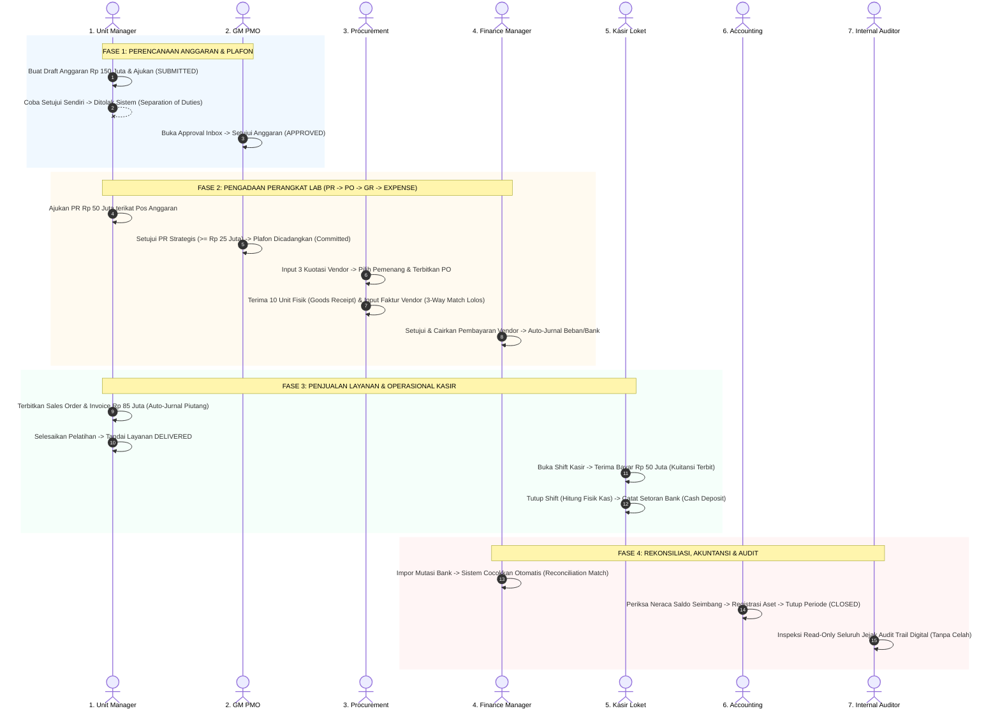

# 📖 Panduan Simulasi Kasus Nyata (Real-Life End-to-End) Lintas 9 Role
## ERP Keuangan & Operasional PMO UTama

Dokumen ini menyajikan simulasi kasus nyata (*real-world business case*) dari hulu ke hilir. Seluruh tahapan telah diuji langsung pada mesin aplikasi, mencakup interaksi antar-peran, pertukaran dokumen, aturan pemisahan tugas (*Separation of Duties*), pencatatan komitmen anggaran, hingga pembukuan akuntansi otomatis.

---

### 🏢 Skenario Kasus Nyata:
> **Divisi TCI (Training, Certification & Infrastructure)** merencanakan kegiatan operasional dan pengadaan perangkat lab baru. Di saat bersamaan, Divisi TCI menyelenggarakan **Program Pelatihan & Sertifikasi Cloud AI** untuk klien korporat **PT Mitra Solusi Nusantara** senilai **Rp 85.000.000**, serta membutuhkan belanja modal **10 Unit Laptop & Lab Equipment** senilai **Rp 50.000.000**.

---

## 👥 Profil Akun Demo Berdasarkan Peran

| Peran | Nama Aktor | Email Login | Kata Sandi Bersama |
| :--- | :--- | :--- | :--- |
| **Unit Manager** | Rendra Pratama, M.Kom | `unit.manager@pmoutama.demo.id` | `DemoErp!2026` |
| **GM PMO** | Ir. Hendra Wijaya, MBA | `gm@pmoutama.demo.id` | `DemoErp!2026` |
| **Procurement Officer**| Budi Santoso | `procurement@pmoutama.demo.id` | `DemoErp!2026` |
| **Finance Manager** | Siti Rahmawati, SE, Ak | `finance@pmoutama.demo.id` | `DemoErp!2026` |
| **Petugas Kasir** | Anisa Putri | `kasir@pmoutama.demo.id` | `DemoErp!2026` |
| **Accounting Officer** | Dewi Lestari | `accounting@pmoutama.demo.id` | `DemoErp!2026` |
| **Tax Officer** | Fajar Hidayat | `tax@pmoutama.demo.id` | `DemoErp!2026` |
| **Internal Auditor** | Agus Setiawan | `auditor@pmoutama.demo.id` | `DemoErp!2026` |
| **Super Admin** | Arif Budiman | `admin@pmoutama.demo.id` | `DemoErp!2026` |

---

## 🔄 Alur Perjalanan Kasus Nyata (Step-by-Step)

---

### Bab 1: Perencanaan & Pengesahan Anggaran (Role: Unit Manager & GM PMO)

#### Skenario:
Rendra (Unit Manager) harus menyusun anggaran tahunan Divisi TCI sebelum boleh membelanjakan sepeser pun uang kas kantor.

1. **Rendra Login (`unit.manager@pmoutama.demo.id`)**:
   - Masuk ke menu **Perencanaan Anggaran** (`/budgets`).
   - Klik **`+ Buat Draft Anggaran`**.
   - **Form Input**:
     - Judul: `Anggaran Operasional & Lab TCI FY 2026`
     - Unit Bisnis: `BU-TCI - Divisi TCI`
     - Target Pendapatan: `Rp 200.000.000`
     - Baris Pos 1 (CAPEX): `5-1200 - Pengadaan Perangkat Lab Multimedia` | Plafon: `Rp 50.000.000`
     - Baris Pos 2 (OPEX): `5-1100 - Operasional Penyelenggaraan Sertifikasi` | Plafon: `Rp 100.000.000`
   - Klik **Simpan & Ajukan Persetujuan**. Status anggaran menjadi **`SUBMITTED`**.

2. **Uji Kontrol Pemisahan Tugas (Anti-Fraud)**:
   - Rendra mencoba meng-approve pengajuannya sendiri.
   - **Respon Sistem**: Tombol persetujuan tidak aktif, dan sistem menolak tindakan melalui error `SEPARATION_OF_DUTIES_VIOLATION`. Pembuat dilarang menyetujui dokumennya sendiri!

3. **Hendra Login (`gm@pmoutama.demo.id`)**:
   - Masuk ke menu **Approval Inbox** (`/approvals`).
   - Terlihat dokumen antrean: `Persetujuan Anggaran: Anggaran Operasional & Lab TCI FY 2026`.
   - Hendra memeriksa rincian, lalu mengklik tombol **`Setujui`**.
   - **Status Berubah**: Dokumen menjadi **`APPROVED`**. Plafon resmi aktif dan siap dibelanjakan.

---

### Bab 2: Pengadaan 10 Unit Laptop Lab (Role: Unit Manager, GM, Procurement, Finance)

#### Skenario:
Lab komputer butuh 10 laptop baru. Nilai estimasi adalah 10 unit x Rp 5.000.000 = **Rp 50.000.000**.

1. **Rendra (Unit Manager) Mengajukan PR**:
   - Masuk ke menu **Pengadaan & Beban** (`/procurement`) Tab 1.
   - Klik **`+ Buat Purchase Request (PR)`**.
   - **Input Data**:
     - Judul: `Pengadaan 10 Unit Laptop Lab Sertifikasi Cloud`
     - Pos Mata Anggaran Sumber: Pilih `Pengadaan Perangkat Lab Multimedia (Sisa Pagu: Rp 50.000.000)`
     - Barang/Jasa: `Laptop Workstation Core i7 16GB`
     - Kuantitas: `10`
     - Estimasi Harga Satuan: `Rp 5.000.000` (Total: Rp 50.000.000)
   - Klik **Ajukan PR**.
   - Karena nilainya **>= Rp 25.000.000**, sistem secara cerdas menetapkan wewenang persetujuan eskalasi ke **`GM_PMO`**.

2. **Hendra (GM PMO) Menyetujui PR**:
   - Hendra membuka menu **Approval Inbox**, melihat PR senilai Rp 50.000.000, lalu klik **`Setujui`**.
   - **Dampak di Database**: Sistem otomatis menerbitkan entitas `BudgetCommitment` (Status: `RESERVED`). Pagu bebas langsung terpotong Rp 50.000.000 sehingga divisi tidak bisa melakukan *double-spending*.

3. **Budi (Procurement Officer) Mengelola Komparasi Vendor & PO**:
   - Budi login (`procurement@pmoutama.demo.id`).
   - Membuka PR yang sudah disetujui, lalu menginput 3 kuotasi penawaran harga vendor:
     1. *PT Mitra Solusi Nusantara*: Rp 52.000.000
     2. *PT Prima Tekno Solusindo*: **Rp 48.000.000** (Paling hemat)
     3. *CV Sinergi Sarana*: Rp 51.500.000
   - Budi memilih **PT Prima Tekno Solusindo** sebagai pemenang dan menerbitkan **Purchase Order (PO)**.
   - Saat kurir mengantarkan 10 unit laptop ke kantor, Budi mengklik **`Terima Barang (GR)`** (kuantitas diterima: 10 unit). Status PO berubah menjadi **`RECEIVED`**.
   - Budi menginput nomor faktur vendor `INV-PRIMA-2026-091`. Sistem menjalankan **3-Way Matching** (PO Rp 48 Juta vs GR 10 Unit vs Faktur Rp 48 Juta). Hasil: **MATCHED_3WAY**!

4. **Siti (Finance Manager) Mencairkan Pembayaran**:
   - Siti login (`finance@pmoutama.demo.id`).
   - Membuka daftar pengeluaran (`Expense`), memverifikasi dokumen kelengkapan BAST & Faktur, lalu klik **`Setujui & Cairkan Pembayaran`**.
   - **Otomatisasi Sistem**:
     - Status tagihan menjadi `PAID`.
     - Komitmen anggaran diubah statusnya menjadi `CONSUMED` dan masuk ke realisasi belanja riil (`ActualAmount`).
     - Sistem otomatis memposting **Jurnal Umum Double-Entry**:
       * *Debit:* `1-1310 Peralatan & Perlengkapan Kantor` = Rp 48.000.000
       * *Kredit:* `1-1120 Bank Mandiri Operasional` = Rp 48.000.000

---

### Bab 3: Penjualan Jasa Sertifikasi & Penerimaan Kas (Role: Unit Manager & Kasir)

#### Skenario:
Klien korporat **PT Mitra Solusi Nusantara** mendaftarkan 17 karyawannya untuk paket pelatihan bersertifikasi resmi senilai **Rp 85.000.000**.

1. **Rendra (Unit Manager) Menerbitkan Tagihan Pelanggan**:
   - Rendra masuk ke menu **Pendapatan & Kasir** (`/revenue`).
   - Membuat **Sales Order** baru: Pelanggan `PT Mitra Solusi Nusantara`, Layanan `Paket Pelatihan & Uji Sertifikasi Cloud AI`, Kuantitas: `17` peserta, Total: `Rp 85.000.000`.
   - Sistem menerbitkan **Customer Invoice** (`ISSUED`).
   - Sistem otomatis memposting Jurnal Piutang:
     * *Debit:* `1-1210 Piutang Usaha Pelanggan` = Rp 85.000.000
     * *Kredit:* `4-1100 Pendapatan Jasa Pelatihan & Sertifikasi` = Rp 76.576.577
     * *Kredit:* `2-1210 Utang Pajak PPN Keluaran 11%` = Rp 8.423.423

2. **Penyerahan Layanan Independen dari Pembayaran**:
   - Setelah pelatihan selesai 3 hari, Rendra mengklik tombol **`Selesaikan Layanan (Deliver Service)`**.
   - Status penyerahan menjadi **`DELIVERED`**. Tagihan invoice tetap secara jujur berstatus belum lunas (`ISSUED`) hingga kasir menerima uangnya.

3. **Anisa (Petugas Kasir) Menerima Pembayaran di Loket**:
   - Anisa login (`kasir@pmoutama.demo.id`).
   - **Buka Shift**: Memilih *Register Kasir 01* dengan modal awal kas laci (*Opening Float*) `Rp 1.000.000`.
   - **Terima Pembayaran**: Klien membayar uang muka tahap 1 via Transfer Bank sebesar **Rp 50.000.000**.
   - Anisa menginput nominal pembayaran. Sistem dengan proteksi `Idempotency Key` menerbitkan kuitansi resmi dan otomatis meng-update sisa piutang tagihan pelanggan menjadi `Rp 35.000.000` (Status: `PARTIALLY_PAID`).
   - Jurnal Kas Masuk otomatis terposting:
     * *Debit:* `1-1120 Bank Mandiri Operasional` = Rp 50.000.000
     * *Kredit:* `1-1210 Piutang Usaha Pelanggan` = Rp 50.000.000

4. **Tutup Shift Kasir & Setoran ke Bank**:
   - Pada pukul 17:00, Anisa menutup shift (*Closeout*).
   - Anisa menghitung fisik kas di laci (`actualCountedCash`), mencocokkannya dengan saldo sistem.
   - Mencatat **Setoran Kasir ke Bank (`CashDeposit`)** untuk memindahkan uang fisik loket ke rekening bank perusahaan.

---

### Bab 4: Rekonsiliasi Bank, Tutup Buku & Audit Trail (Role: Finance, Tax, Accounting, Auditor)

#### Skenario:
Akhir bulan tiba. Seluruh rekening bank harus dicocokkan, posisi pajak dihitung, buku besar ditutup, dan auditor memastikan integritas laporan.

1. **Siti (Finance Manager) - Rekonsiliasi Bank Otomatis**:
   - Mengunduh rekening koran mutasi bank dari internet banking, lalu mengunggahnya ke menu **Kas & Rekonsiliasi** (`/reconciliation`).
   - Sistem menghitung sidik jari hash `SHA-256` pada setiap baris untuk mencegah impor ganda.
   - Sistem mencocokkan mutasi kredit Rp 50.000.000 dengan kuitansi pembayaran klien PT Mitra Solusi dan mutasi debet Rp 48.000.000 dengan pencairan laptop lab.
   - Siti memeriksa kesesuaian dan mengklik **`Finalisasi Rekonsiliasi`** (Status terkunci: `FINALIZED`).

2. **Fajar (Tax Officer) - Pengecekan Kepatuhan Pajak**:
   - Fajar login (`tax@pmoutama.demo.id`).
   - Memeriksa posisi pajak periode berjalan:
     * **PPN Keluaran (Pajak dipungut dari klien):** Rp 8.423.423
     * **PPN Masukan (Pajak dibayar ke vendor laptop):** Terhitung proporsional dari pembelian PO.
     * Saldo kewajiban pajak siap dilaporkan pada SPT Masa PPN.

3. **Dewi (Accounting Officer) - Neraca Saldo, Buku Besar & Tutup Buku**:
   - Dewi login (`accounting@pmoutama.demo.id`).
   - Membuka **Akuntansi & Jurnal** (`/accounting`):
     - Memeriksa **Buku Besar (General Ledger)**: Seluruh mutasi jurnal debit dan kredit seimbang secara sempurna (`Total Debit == Total Credit`).
     - Membuka **Neraca Saldo (Trial Balance)** dan **Laba Rugi**.
     - Mendaftarkan 10 unit laptop ke buku daftar **Aset Tetap (`FixedAsset`)** dengan masa manfaat 48 bulan untuk amortisasi beban penyusutan garis lurus.
   - Di akhir periode, Dewi mengunci periode fiskal di menu Administrasi menjadi **`CLOSED`**. Seluruh transaksi susulan pada periode tersebut otomatis ditolak sistem.

4. **Agus (Internal Auditor / SPI) - Pengawasan Kepatuhan Independen**:
   - Agus login (`auditor@pmoutama.demo.id`).
   - Akun Agus memiliki hak akses **100% Read-Only**. Jika mencoba menambah transaksi atau mengedit nominal, sistem langsung memblokir dengan kode error `AUDITOR_READ_ONLY`.
   - Agus membuka menu **Administrasi & Audit Trail** (`/admin`):
     - Menelusuri seluruh riwayat mutasi dari pembuatan anggaran oleh Rendra, persetujuan Hendra, komparasi 3 penawaran Budi, pencairan Siti, hingga kuitansi Anisa.
     - Setiap baris log memuat: *Waktu Presisi Server, IP Address, ID Pengguna, Nilai Sebelum vs Nilai Sesudah*.
   - Agus mengonfirmasi bahwa **seluruh siklus operasional berjalan 100% patuh SOP, transparan, dan bebas bentrok wewenang.**

---

## 📊 Hasil Akhir Metrik Finansial pada Simulasi Ini

| Entitas Finansial | Posisi Saldo Akhir | Keterangan |
| :--- | :--- | :--- |
| **Plafon Anggaran Belanja TCI** | Rp 150.000.000 | Disetujui resmi oleh GM PMO |
| **Realisasi Belanja Pengadaan (Actual)** | Rp 48.000.000 | 10 Unit Laptop Lab Berhasil Diterima & Dibayar |
| **Sisa Plafon Anggaran Bebas** | Rp 102.000.000 | Aman dari overspending |
| **Pendapatan Diakui (Invoiced Revenue)** | Rp 85.000.000 | Dari Klien PT Mitra Solusi Nusantara |
| **Kas Riil Masuk (Confirmed Cash In)** | Rp 50.000.000 | Pembayaran Tahap 1 Masuk Rekening Bank |
| **Sisa Piutang Usaha (AR)** | Rp 35.000.000 | Tercatat pada AR Aging (Jatuh Tempo 30 Hari) |
| **Keseimbangan Buku Besar** | **SEIMBANG (0 Selisih)** | Total Debit == Total Kredit di seluruh transaksi |
