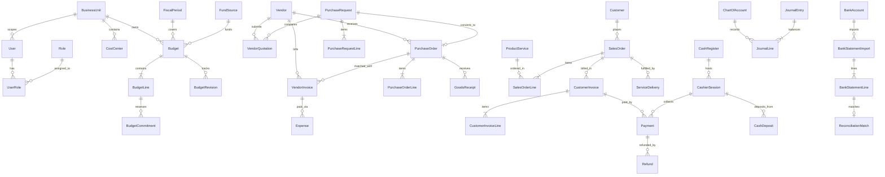

# Model Data & Arsitektur Database - ERP Keuangan & Operasional PMO UTama

## 1. Prinsip Desain Database
- **Presisi Finansial**: Seluruh kolom nominal uang menggunakan `Decimal(18, 2)` di PostgreSQL dan diproses secara presisi di backend. Penggunaan tipe floating-point biasa (`Float`/`Double`) untuk nilai uang dilarang.
- **Sumber Data Tunggal vs Data Turunan**:
  - **Data Sumber (Source of Truth)**: `BudgetLine`, `PurchaseRequest`, `PurchaseOrder`, `VendorInvoice`, `Expense`, `SalesOrder`, `CustomerInvoice`, `Payment`, `Refund`, `CashierSession`, `BankStatementLine`, `JournalEntry`, dan `JournalLine`.
  - **Data Turunan/Terkalkulasi**: Ringkasan `committedAmount`, `actualAmount`, dan `availableAmount` pada anggaran dihitung secara konsisten di dalam transaksi database dari komitmen aktif dan realisasi transaksi sumber, sedangkan Buku Besar (General Ledger), Trial Balance, Laba Rugi, dan Neraca dihitung langsung dari agregasi `JournalLine` berstatus `POSTED`.
- **Integritas & Audit**: Setiap entitas transaksi memiliki UUID, nomor referensi unik (`code`/`docNumber`), status eksplisit (enum), waktu pembuatan/pembaruan, pembuat/penyetuju, serta menghasilkan rekaman `AuditLog` di server. Transaksi yang sudah diposting atau dibayar tidak pernah dihapus permanen; pembatalan menggunakan status `VOID` atau `REVERSED`.

---

## 2. Diagram Relasi Entitas Utama (ERD)

---

## 3. Daftar Kelompok Tabel

### 3.1 Identitas, Organisasi & Kontrol
- `User`: Pengguna aplikasi, password hash, unit bisnis utama, status aktif.
- `Role` & `Permission`: Definisi peran (`SUPER_ADMIN`, `GM_PMO`, `UNIT_MANAGER`, `PROCUREMENT`, `FINANCE_MANAGER`, `ACCOUNTING`, `TAX_OFFICER`, `CASHIER`, `AUDITOR`) beserta daftar izin granular.
- `BusinessUnit`, `CostCenter`, `FundSource`, `FiscalPeriod`: Struktur organisasi dan periode akuntansi/anggaran (termasuk flag `isClosed` untuk mengunci posting pada periode tertutup).
- `ApprovalPolicy` & `ApprovalLog`: Aturan ambang batas nominal persetujuan dan jejak keputusan persetujuan/penolakan.
- `AuditLog`: Jejak audit tidak terhapuskan untuk seluruh mutasi penting (`actorId`, `action`, `entityType`, `entityId`, `beforeData`, `afterData`, `ipAddress`, `requestId`).
- `Notification`: Notifikasi internal aplikasi dengan tautan ke objek transaksi terkait.

### 3.2 Perencanaan & Anggaran
- `Budget`: Dokumen anggaran per unit bisnis, periode fiskal, dan sumber dana (`DRAFT`, `SUBMITTED`, `APPROVED`, `REJECTED`, `REVISED`, `CLOSED`), serta versi aktif.
- `BudgetLine`: Rincian mata anggaran per kategori (`CAPEX`, `OPEX`, `MODAL_KERJA`, `PENGADAAN`, `PEGAWAI`, `PAJAK`), akun COA, plafon awal, revisi, komitmen aktif, dan realisasi.
- `BudgetRevision`: Riwayat revisi plafon anggaran beserta alasan dan penyetuju.
- `BudgetCommitment`: Pencatatan komitmen anggaran dari PR/PO yang telah disetujui agar tidak terjadi penggunaan plafon ganda.

### 3.3 Pengadaan & Pengeluaran
- `Vendor`: Data master rekanan, NPWP, rekening bank, kelengkapan dokumen legalitas, status (`DRAFT`, `UNDER_REVIEW`, `ACTIVE`, `INACTIVE`, `BLOCKED`), catatan evaluasi, dan deklarasi konflik kepentingan.
- `PurchaseRequest` & `PurchaseRequestLine`: Permintaan pembelian dengan pengaitan ke `BudgetLine`.
- `VendorQuotation`: Penawaran harga dari vendor untuk PR tertentu, mendukung evaluasi perbandingan harga, waktu pengiriman, garansi, serta alasan pengecualian bila penawaran kurang dari 3 vendor.
- `PurchaseOrder` & `PurchaseOrderLine`: Pesanan pembelian resmi ke vendor terpilih.
- `GoodsReceipt` & `GoodsReceiptLine`: Bukti penerimaan barang/jasa (mendukung penerimaan parsial maupun penuh).
- `VendorInvoice`: Tagihan dari vendor dengan pemeriksaan 3-way matching terhadap PO dan Goods Receipt.
- `Expense`: Transaksi pengeluaran kas/bank (baik dari tagihan PO maupun pengeluaran operasional non-PO) beserta lampiran bukti.

### 3.4 Pendapatan, Pembayaran & Kasir
- `Customer`: Master pelanggan organisasi/individu.
- `ProductService` & `ProductPriceHistory`: Katalog produk/layanan dengan harga, tarif pajak terkait, akun pendapatan, dan histori perubahan harga.
- `SalesOrder` & `SalesOrderLine`: Pesanan pelanggan.
- `ServiceDelivery`: Bukti penyerahan layanan/produk oleh petugas operasional.
- `CustomerInvoice` & `CustomerInvoiceLine`: Tagihan pelanggan dengan pelacakan `totalAmount`, `paidAmount`, `balanceDue`, dan tanggal jatuh tempo (`dueDate`).
- `Payment` & `Refund`: Penerimaan pembayaran pelanggan (tunai, transfer, QRIS/VA simulasi) dengan `idempotencyKey`, rincian potongan biaya provider (`feeAmount`), dan dokumen kuitansi unik.
- `CashRegister`, `CashierSession`, `CashDeposit`: Sesi kasir dari buka kasir, perhitungan saldo teoritis, input kas fisik saat penutupan, perhitungan selisih (`discrepancyAmount`), hingga setoran ke rekening bank.

### 3.5 Rekonsiliasi Bank & Akuntansi
- `BankAccount`, `BankStatementImport`, `BankStatementLine`, `ReconciliationMatch`: Pengelolaan rekening kas/bank, impor mutasi dengan deteksi fingerprint duplikat, dan pencocokan mutasi bank terhadap transaksi internal.
- `ChartOfAccount` & `AccountMapping`: Bagan akun standar (`ASSET`, `LIABILITY`, `EQUITY`, `REVENUE`, `EXPENSE`) dan pemetaan akun otomatis.
- `JournalEntry` & `JournalLine`: Jurnal akuntansi berpasangan yang wajib seimbang (`totalDebit == totalCredit`), mendukung status `DRAFT`, `POSTED`, dan `REVERSED`, serta tautan balik ke transaksi sumber (`sourceType`, `sourceId`).
- `TaxConfiguration`, `FixedAsset`, `StrategicEvaluation`: Konfigurasi pajak ber-versi, registrasi aset tetap beserta penyusutan, dan dokumen evaluasi strategis akhir periode.
