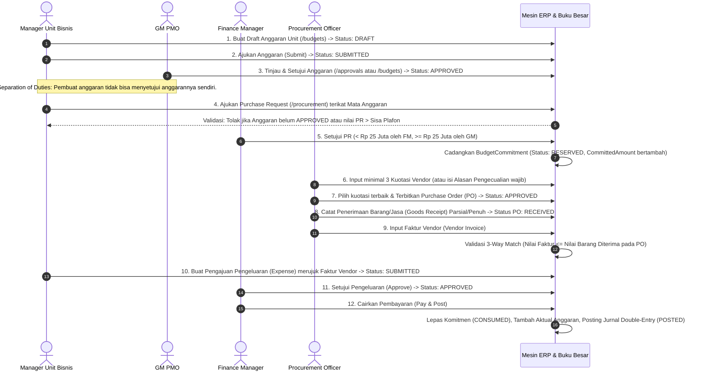
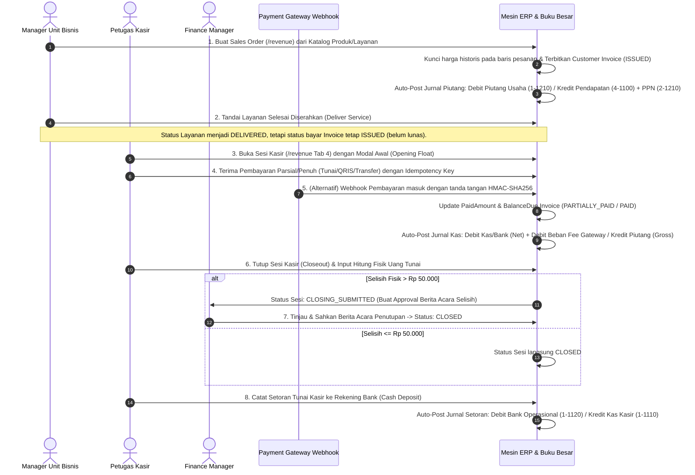
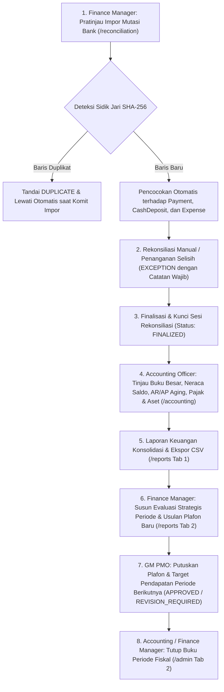

# Peta User Journey End-to-End ERP Keuangan & Operasional PMO UTama

Dokumen ini menjelaskan alur perjalanan pengguna (*User Journey*) lintas peran dari awal perencanaan anggaran hingga penutupan buku dan evaluasi strategis periode berikutnya.

---

## 1. Peta Peran & Tanggung Jawab Utama (9 Actor Personas)

| Peran (Role Code) | Aktor Demo | Fokus Ruang Kerja di Aplikasi |
| :--- | :--- | :--- |
| **Manager Unit Bisnis** (`UNIT_MANAGER`) | `unit.diklat@pmoutama.demo.id` | Menyusun draft anggaran unit, mengajukan PR, mengajukan pengeluaran operasional, membuat pesanan pelanggan (Sales Order), dan mencatat penyelesaian layanan. |
| **General Manager PMO** (`GM_PMO`) | `gm@pmoutama.demo.id` | Meninjau Dashboard Eksekutif, menyetujui plafon & revisi anggaran, menyetujui PR bernilai strategis (>= Rp 25 Juta), dan menetapkan keputusan plafon periode berikutnya. |
| **Procurement Officer** (`PROCUREMENT`) | `procurement@pmoutama.demo.id` | Mengelola vendor aktif, menginput minimal 3 kuotasi penawaran, menerbitkan Purchase Order (PO), mencatat penerimaan barang/jasa (Goods Receipt), dan memverifikasi tagihan vendor (*3-Way Match*). |
| **Finance Manager** (`FINANCE_MANAGER`) | `finance@pmoutama.demo.id` | Menyetujui PR operasional (< Rp 25 Juta), menyetujui & mencairkan pengeluaran biaya (*Auto-Journal*), menyetujui refund & berita acara selisih kasir, serta memfinalisasi rekonsiliasi bank. |
| **Petugas Kasir** (`CASHIER`) | `kasir@pmoutama.demo.id` | Membuka sesi kasir dengan modal awal (*opening float*), menerima pembayaran pelanggan (Tunai/QRIS/Transfer/VA), menutup shift kasir dengan hitung fisik kas, dan mencatat setoran tunai ke bank. |
| **Accounting Officer** (`ACCOUNTING`) | `accounting@pmoutama.demo.id` | Mengelola Bagan Akun (COA), membuat jurnal penyesuaian berimbang, mengeksekusi jurnal pembalik (*Reversal*), memeriksa Buku Besar & Neraca Saldo, meregistrasi aset tetap, dan menutup periode fiskal. |
| **Tax Officer** (`TAX_OFFICER`) | `tax@pmoutama.demo.id` | Mengelola konfigurasi tarif PPN/PPh secara versi dan meninjau posisi PPN Keluaran vs PPN Masukan. |
| **Internal Auditor** (`AUDITOR`) | `auditor@pmoutama.demo.id` | Menginspeksi seluruh dokumen, laporan keuangan, dan *Server-Side Audit Trail* secara *Read-Only* tanpa wewenang mengubah data. |
| **System Administrator** (`SUPER_ADMIN`) | `admin@pmoutama.demo.id` | Mengelola pengguna, matriks role RBAC, unit bisnis, dan parameter sistem tanpa hak menyetujui transaksi keuangan. |

---

## 2. Journey 1: Siklus Perencanaan Modal, Anggaran, Pengadaan (PR/PO/GR) hingga Pencairan Biaya

Alur ini memastikan setiap rupiah yang dikeluarkan unit kerja memiliki pagu anggaran yang sah, mencadangkan komitmen (*Budget Commitment*) agar tidak terjadi *double-spending*, melewati *3-Way Matching* (PO vs GR vs Faktur Vendor), dan otomatis memposting jurnal akuntansi saat dibayar.

### Langkah Layar demi Layar (Journey 1)
1. **Penyusunan & Persetujuan Anggaran (`/budgets`)**:
   - Login sebagai **Manager Unit Diklat** (`unit.diklat@pmoutama.demo.id`).
   - Buka menu **Modal & Anggaran**, klik **+ Buat Draft Anggaran**, isi rincian mata anggaran per *Cost Center* (`CAPEX` / `OPEX`), lalu klik **Ajukan Persetujuan**.
   - Beralih ke akun **GM PMO** (`gm@pmoutama.demo.id`), buka **Kotak Masuk Approval** (`/approvals`) atau **Modal & Anggaran** (`/budgets`), lalu klik **Setujui**.
   - Jika di pertengahan tahun dibutuhkan perubahan pagu, GM PMO menggunakan tombol **Revisi Plafon** yang menyimpan snapshot versi lama ke tabel `BudgetRevision`.
2. **Pengajuan PR & Pencadangan Komitmen (`/procurement` Tab 1)**:
   - Login kembali sebagai **Manager Unit Diklat**, buka **Pengadaan, PO & Biaya**, klik **+ Buat Purchase Request (PR)**, pilih mata anggaran yang sudah `APPROVED`.
   - Sistem langsung memvalidasi sisa plafon (`Allocated - Committed - Actual`).
   - **Finance Manager** (`finance@pmoutama.demo.id`) menyetujui PR tersebut. Saat disetujui, sistem otomatis membuat `BudgetCommitment` berstatus `RESERVED` sehingga sisa plafon langsung berkurang sebesar estimasi PR.
3. **Kuotasi Vendor, PO, Penerimaan Barang & 3-Way Match (`/procurement` Tab 1 s/d Tab 3)**:
   - Login sebagai **Procurement Officer** (`procurement@pmoutama.demo.id`).
   - Tambahkan penawaran harga dari vendor aktif pada PR. Sistem mewajibkan minimal **3 penawaran vendor** sebelum PO dapat diterbitkan, kecuali diisi alasan pengecualian (*Quotation Exception Reason*) yang tercatat di Audit Trail.
   - Terbitkan **Purchase Order (PO)**.
   - Saat barang/jasa tiba, klik **Terima Barang (GR)** pada PO (mendukung penerimaan bertahap/parsial maupun penuh).
   - Catat **Faktur Vendor (Vendor Invoice)**. Sistem menjalankan **3-Way Match**: jika tagihan melebihi kuantitas/nilai barang yang benar-benar sudah diterima di GR, sistem menolak tagihan kecuali diajukan ke alur *Exception Review*.
4. **Pencairan Biaya & Auto-Posting Jurnal (`/procurement` Tab 4)**:
   - **Finance Manager** memverifikasi pengajuan biaya (`Expense`), klik **Setujui**, lalu klik **Cairkan & Posting Jurnal**.
   - Sistem secara atomik mengubah komitmen anggaran menjadi realisasi aktual (`actualAmount`), menandai faktur vendor `PAID`, dan menerbitkan `JournalEntry` berimbang (Debit Beban / Kredit Bank) di Buku Besar.
   - Apabila terjadi kesalahan setelah pencairan, dokumen tidak boleh dihapus; Finance Manager menggunakan tombol **Void / Reversal** dengan alasan wajib untuk mengembalikan saldo aktual anggaran dan membuat jurnal pembalik.

---

## 3. Journey 2: Siklus Pesanan Pelanggan, Penyerahan Layanan, Penagihan, Pembayaran & Sesi Kasir

Alur ini memisahkan dengan tegas antara **Pendapatan Tertagih (Invoiced Revenue / Piutang)**, **Status Penyerahan Layanan (Service Delivery)**, dan **Penerimaan Kas Bersih (Confirmed Cash Received)**.

### Langkah Layar demi Layar (Journey 2)
1. **Master Produk & Harga Historis (`/revenue` Tab 5)**:
   - Ketika harga layanan di katalog diperbarui melalui fitur **Ubah Harga**, sistem menyimpan riwayat ke `ProductPriceHistory`. Seluruh `SalesOrder` dan `CustomerInvoice` yang sudah terbit sebelumnya tetap mempertahankan harga snapshot saat transaksi dibuat.
2. **Pesanan Pelanggan & Penyerahan Layanan (`/revenue` Tab 1 & Tab 2)**:
   - **Manager Unit** membuat **Sales Order** dan menerbitkan **Customer Invoice**. Sistem otomatis memposting jurnal pengakuan piutang usaha.
   - Saat pelatihan/konsultansi selesai dilaksanakan, klik **Selesaikan Layanan**. Status layanan berubah menjadi `DELIVERED`, namun tagihan tetap berstatus `ISSUED` sampai pembayaran benar-benar diterima.
3. **Penerimaan Pembayaran Idempoten & Potongan Biaya Gateway (`/revenue` Tab 2 & Tab 3)**:
   - **Petugas Kasir** (`kasir@pmoutama.demo.id`) mencatat pembayaran pelanggan (mendukung pembayaran bertahap/parsial maupun pelunasan penuh).
   - Jika menggunakan metode non-tunai yang mengenakan potongan *merchant fee* (misalnya QRIS/VA), sistem mencatat **Nominal Bruto** (mengurangi piutang pelanggan secara penuh), **Biaya Admin/Fee** (masuk ke akun Beban Administrasi Bank `5-1500`), dan **Nominal Bersih** (masuk ke rekening Kas/Bank).
   - Setiap pembayaran dilindungi `idempotencyKey` sehingga klik ganda atau pengiriman ulang jaringan tidak akan menggandakan penerimaan kas maupun jurnal.
4. **Sesi Kasir, Hitung Fisik & Setoran Bank (`/revenue` Tab 4)**:
   - Kasir membuka shift pada register kasir yang belum memiliki sesi `OPEN`.
   - Pada akhir shift, kasir memasukkan hasil hitung fisik uang tunai (`actualCountedCash`). Sistem menghitung selisih terhadap saldo teoritis (`openingFloat + totalCashIn - totalCashOut`).
   - Jika terdapat selisih di atas Rp 50.000, sesi masuk ke status `CLOSING_SUBMITTED` dan memerlukan pengesahan berita acara oleh **Finance Manager** sebelum menjadi `CLOSED`.
   - Kasir kemudian mencatat **Setoran Kas ke Bank (`CashDeposit`)** yang otomatis memindahkan saldo dari akun Kas Kasir (`1-1110`) ke Bank Operasional (`1-1120`).

---

## 4. Journey 3: Rekonsiliasi Mutasi Bank, Penutupan Akuntansi, Pelaporan & Evaluasi Strategis

Alur ini menghubungkan mutasi rekening koran perbankan dengan pencatatan internal, menjaga keseimbangan Buku Besar, hingga menghasilkan keputusan plafon anggaran periode berikutnya.

### Langkah Layar demi Layar (Journey 3)
1. **Pratinjau & Rekonsiliasi Mutasi Bank (`/reconciliation`)**:
   - Login sebagai **Finance Manager** (`finance@pmoutama.demo.id`), buka menu **Rekening & Rekonsiliasi Bank**, lalu klik **+ Impor Mutasi Bank**.
   - Tahap 1 adalah **Pratinjau (Preview)**: sistem menghitung sidik jari `SHA-256` untuk setiap baris (`bankAccountId + tanggal + nomor referensi + arah mutasi + nominal`). Baris yang sudah pernah diimpor langsung ditandai `DUPLICATE` dan tidak akan dimasukkan ulang.
   - Tahap 2 adalah **Pencocokan & Finalisasi**: baris yang cocok dengan kuitansi pembayaran, setoran kasir, atau pencairan biaya ditandai `MATCHED`. Baris biaya admin/bunga bank atau selisih ditandai `EXCEPTION` dengan alasan wajib, lalu sesi dikunci melalui tombol **Finalisasi Rekonsiliasi**.
2. **Buku Besar, Jurnal Umum, Pajak & Aset Tetap (`/accounting`)**:
   - Login sebagai **Accounting Officer** (`accounting@pmoutama.demo.id`).
   - Pada Tab 1 (**Buku Besar & Neraca Saldo**), periksa keseimbangan total Debit dan Kredit serta buka rincian mutasi berjalan (*Running Balance*) per akun.
   - Pada Tab 2 (**Jurnal Umum**), buat jurnal penyesuaian berimbang. Jurnal yang sudah `POSTED` tidak dapat dihapus; koreksi dilakukan dengan tombol **Jurnal Pembalik (Reversal)**.
   - Pada Tab 3 & 4, tinjau **Umur Piutang (AR) & Utang (AP)**, posisi **PPN Keluaran vs PPN Masukan**, serta daftar **Aset Tetap**.
3. **Laporan Keuangan, Ekspor CSV & Evaluasi Strategis (`/reports`)**:
   - Buka menu **Laporan & Evaluasi Strategis**.
   - Tab 1 menampilkan **Laporan Laba Rugi**, **Neraca (Posisi Keuangan)** yang seimbang, **Arus Kas Operasional**, dan tabel **Anggaran vs Komitmen vs Aktual** beserta tombol **Ekspor CSV**.
   - Tab 2 menampilkan **Evaluasi Strategis Periode**: **Finance Manager** menyusun analisis selisih (*variance analysis*), ringkasan risiko, dan rekomendasi plafon periode berikutnya. **GM PMO** kemudian mengklik **Putuskan Plafon** untuk menetapkan plafon anggaran dan target pendapatan periode selanjutnya.
4. **Penguncian Periode Fiskal & Audit Trail (`/admin`)**:
   - Pada akhir periode, **Accounting Officer** atau **Finance Manager** menutup periode fiskal (`CLOSED`) di menu **Pengguna, Kebijakan & Audit Trail** (Tab 2). Periode yang tertutup menolak seluruh posting jurnal baru kecuali dibuka kembali (`Reopen`) oleh pejabat berwenang dengan alasan tertulis.
   - **Internal Auditor** (`auditor@pmoutama.demo.id`) dapat menelusuri seluruh kronologi transaksi beserta pelaku, waktu server, dan nomor permintaan (`Request ID`) pada Tab 1 (**Jejak Audit Trail**).
